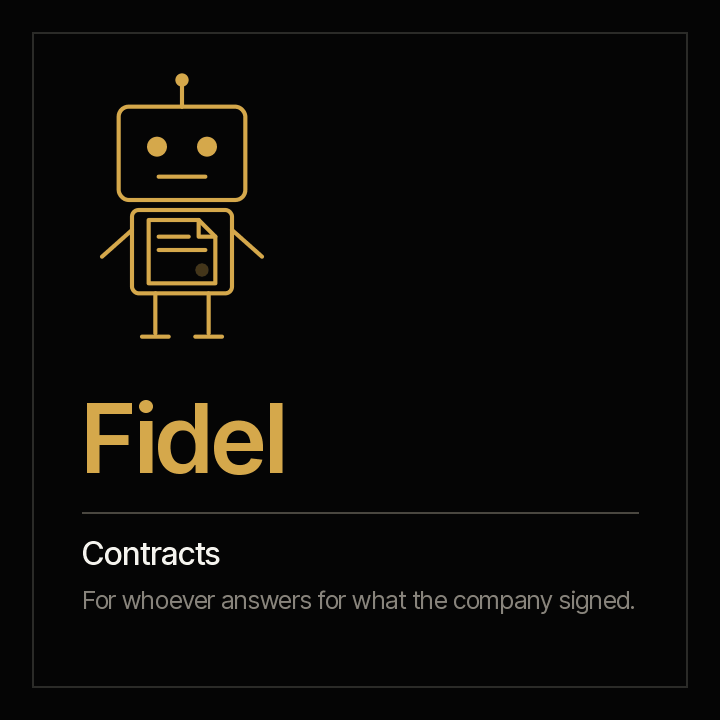

<picture><source media="(prefers-color-scheme: dark)" srcset="../../docs/img/marca/en/criterio-clo-oscuro.svg"></picture>

# Fidel · the contracts



**Fidel puts what the company signed next to what is actually happening.** You handle the
contracts and answer for them. He arrives with what falls due, the notice periods coming up, who
signed with what authority and what was paid against what was agreed.

[Español](README.es.md) · `criterio-legal` · Apache 2.0 · One instance per entity

**Status: the seven commands are built**, along with the five skills and the calculation engine,
tested against synthetic material from four industries with a key the agent never sees and one
control entity per country. **The agent's extraction passed a [first, small round](../../tests/evidencias/familias/clo/RONDAS.md)** —banking and the Colombian control—; the full round is the next step, and nothing has been run yet on an organisation's documents. Nothing is announced as finished until the
[acceptance criteria](ACCEPTANCE.md) pass.

**This page stands on its own.** Fidel works without Constanza: if you only handle the contracts,
everything is here, including his tests. The family —how he meets Constanza and Rostrum— is in
the [criterio-clo family](../../families/criterio-clo/README.md).

---

## What it is

| | |
|---|---|
| **Whom it extends** | The lawyer or the team that handles the entity's contracts |
| **What it works on** | **Every contract of one entity**, one by one and as a whole |
| **What it looks at** | The entity's legal folder, as it is: the contract register, the payments, the signing-authority matrix and each contract's folder with its amendments, guarantees, counterparty and execution |
| **Cadence** | When an expiry or a notice period enters the configured window, when a new document arrives, and once a week |
| **Instances** | One per entity |

## What it does

**What it does that is not done today: check every contract, not a sample, against the
signing-authority matrix, and every payment against its contract's value and end date.** A
signature without authority or a payment after termination gives no warning: it can be in any
contract.

**What it can answer that today takes days:** which contract falls due with no recorded
decision, which notice of non-renewal is coming up —or has already passed—, which contract the
register reports as in force when it has already ended, who signed beyond their authority, which
required guarantee has no policy and what was paid above the value with its amendments.

<!-- clo:comandos · generado por scripts/familias.py; no se edita a mano -->
### The seven commands

> They are typed with the plugin prefix: `/criterio-legal:` and autocomplete does the rest. It is the only form that resolves in a Claude Code session.

| Command | What it does |
|---|---|
| `/criterio-legal:legal-setup` | The configuration, the inventory and the first contract records |
| `/criterio-legal:contract-scan` | The contract records up to date, with what changed and the new signals |
| `/criterio-legal:contract-register` | The contract register against what the documents say |
| `/criterio-legal:obligations-calendar` | Expiries, notices and obligations, with what is overdue without evidence |
| `/criterio-legal:authority-check` | Who signed each contract and with what authority |
| `/criterio-legal:contract-execution` | Payments against the agreed value, and guarantees against what was required |
| `/criterio-legal:legal-wake` | What the contracts need today; silent when nothing does |
<!-- /clo:comandos -->

`legal-setup` goes first because the others need it, and `legal-wake` is the one you put on a
clock. Between them, the five that prepare the work: what changed, the register, the calendar,
the signatures and the execution.

<!-- clo:skills · generado por scripts/familias.py; no se edita a mano -->
### The five skills

They load on their own when the subject comes up. They are the knowledge the commands share, and they are consulted like a manual.

| Skill | What it encapsulates | Whose it is |
|---|---|---|
| `contract-calendar` | The contract calendar: termination with its amendments, the deadline for the notice of non-renewal, automatic extension and each dated obligation against its evidence | Own |
| `contract-record` | A contract's record: parties, value, dates, renewal, notice period, signatories, amendments, guarantees, counterparty certificate and obligations, each item with its citation | Own |
| `legal-intake` | Which documents the family processes, where each one goes, which tables the engine processes directly and what the agent extracts to the record | Own · also in Constanza |
| `payments-guarantees` | What was paid on each contract against its value and amendments, payments after termination, and the guarantees required against the policies provided and their term | Own |
| `signing-authority` | Who signed against the signing-authority matrix —type, amount and term of the authority, amendments included—, the document without both parties' signatures and the counterparty certificate expired at signing | Own |
<!-- /clo:skills -->

## What it is for

`/criterio-legal:obligations-calendar` calculates each contract's termination with its amendments
and the deadline for its notice of non-renewal. And it does something more, which is what
separates a useful calendar from a list of dates: **an auto-renewing contract nobody decides on
renews on its own**, and the report says so before the date passes.

> **Banco Andino** · contracts as of 6 October 2026
> An auto-renewing contract has its notice period within the configured window, and no document
> records the decision to renew or terminate it.
> **If nobody decides, the contract decides on its own.**

That case comes from the synthetic material, planted with its key **before** the engine runs, and
it is the reason Fidel exists: not to decide for you, but so that the decision arrives in time.

### What it costs today

<!-- clo:cifras · generado por scripts/familias.py; no se edita a mano -->
| Figure | Source |
|---|---|
| **8.6%** of contract value is eroded on average by poor contract management; the best a little over 3%, the worst more than 20% | [World Commerce & Contracting con Deloitte, 2022](https://www.deloitte.com/us/en/services/tax/articles/contract-management-lifecycle-insights.html) — More than 1,200 organisations |
| **90%** of organisations report difficulty locating their own contracts | [EY Law y Harvard Law School Center on the Legal Profession, 2021](https://clp.law.harvard.edu/wp-content/uploads/2022/10/ey-contracting-report-june-2021.pdf) — 1,000 contracting leaders, within research of more than 2,000 people in 22 countries, January 2021 |
| **19,000** contracts a year are managed on average by a large organisation's contracting team | [EY Law y Harvard Law School Center on the Legal Profession, 2021](https://clp.law.harvard.edu/wp-content/uploads/2022/10/ey-contracting-report-june-2021.pdf) — 1,000 contracting leaders, January 2021 |
<!-- /clo:cifras -->

A company that cannot find its own contracts cannot know what it signed, what is expiring or what
it committed to.

### And what it is not for

- **It gives no opinion on the validity of a contract, a clause, a signature or a guarantee.**
  Legal judgement is left as a question for the person.
- **It does not recommend renewing, terminating or renegotiating.** The decision belongs to a
  person, and Fidel records it when a document takes it.
- **It does not draft, sign or send contracts, amendments or notices.**
- **It does not state from memory a regulation, a legal deadline or an authority the matrix does
  not have.**
- **It never moves, renames or creates anything inside the organisation's documents.** The only
  thing it leaves, if the person allows it, is the file that marks the root folder so it is
  recognised at a glance.
- **It does not guess.** Every data point carries the citation of the document and, for tables,
  the row it came from. *"Not found"* is a valid answer.

**And one thing is deliberately absent: the organisation's compliance.** The obligations matrix,
the policies, the regulations and the whistleblowing channel are Constanza's, who takes from
Fidel's records the compliance obligations of the contracts. Public contracts, with their own
rules, are left for another version.

And one that has to be said out loud: **your documents are processed on the AI platform's
infrastructure**, not only on your machine. Confirm that this is admissible under your policies
before pointing it at confidential material. Full disclaimer in [DISCLAIMER.md](../../DISCLAIMER.md),
terms in [TERMS.md](../../TERMS.md).

## Installing and configuring

```
/plugin marketplace add josenanez/criterio
/plugin install criterio-legal@criterio
/criterio-legal:legal-setup
```

**In Claude Cowork** — Customise → Explore plugins → Personal → **+** → Add marketplace from
GitHub → `josenanez/criterio`.

If you answer for compliance and not for the contracts, yours is
[Constanza](../criterio-compliance/README.md).

### The first result

`/criterio-legal:legal-setup` does not ask you to tidy anything up before starting. It looks at
the entity's legal folder, compares it with the
[recommended structure](../../families/criterio-clo/README.md#the-recommended-folder-structure)
and asks the questions no document answers —the entity, the signing-authority matrix, how many
days ahead an expiry is flagged, who decides to renew—. In the first fifteen minutes it shows the
contract calendar: what falls due, the notice periods coming up or already past with no decision
and the overdue obligations with no evidence, with the signals the engine raised in the register,
the signatures and the payments.

From there, every command delivers its report in the same order: what needs attention, the
result, what could not be processed, the questions it asked and the sources.

**What ends up configured** is written by `/criterio-legal:legal-setup` from your answers, in
`.criterio/legal/<entidad>/config.json`: the entity, the matrix, the notice days, the maximum age
of the counterparty certificate, who decides to renew and the record that you accepted the terms,
with your name and the date. All of that is changed **by talking**.

### How often it runs

A command waits. **This one is scheduled and runs on its own.** Its cadence is the contracts'
dates: it runs when an expiry or a notice period enters the configured window, when a new
document arrives and once a week. The decision is date arithmetic, so the code takes it:

```
python3 scripts/legal.py despertar --config <file>
```

And `/criterio-legal:legal-wake` is the command the clock invokes: it does what is due, answers
first the questions somebody left in Rostrum, and **if nothing is due it produces nothing.**
Putting it on a clock is on your organisation's side: a scheduled task in Cowork, or the system's
scheduler in Claude Code. If unattended runs are not welcome, the cadence still says what is due,
run by hand.

**And if you want the general counsel to see what falls due without asking you for it**, the
family has a portal that publishes it, where whoever is looking can leave Fidel a written
question. → **[Rostrum](../criterio-server/README.md)**

## Working with the others

Fidel works alone. If the others are installed, **there is nothing to connect**: they meet
through the entity's state and the contract records, which are documents.

| With whom | What happens |
|---|---|
| **Constanza** | They share the entity's state. Fidel writes each contract's record and Constanza takes from it the compliance obligations it carries, to put them next to the matrix. Each one writes only its own records |
| **Rostrum** | Publishes his reports, what falls due in the contracts and his signals, for whoever will not open a folder, and hands him the questions left by whoever is looking. **It does not write the state** |

## Tests

### How it is built

The spine is the **contract record**, one per contract: parties, value, dates, renewal, notice
period, signatories, amendments, guarantees, the counterparty certificate and the obligations,
each data point with the citation of its document and date. The agent writes it; the engine
validates it and calculates over it.

[`scripts/legal.py`](scripts/legal.py), on the standard library, does everything that is
calculation: expiries, notice deadlines, extensions, authority against the matrix, paid against
agreed and guarantees against what is required, the same result every time. It processes the
tables directly —the register, the payments, the matrix— and the agent takes to the record only
what each written contract carries. [`scripts/texto.py`](scripts/texto.py) turns Word, Excel,
PowerPoint, PDF and email into text, and is a literal copy of the PMO family's; `legal.py`
travels copied in `criterio-compliance`. `scripts/sincronizar.py --check` fails if any copy
drifts.

Every framework and every figure used is in
[`families/criterio-clo/FUENTES.es.md`](../../families/criterio-clo/FUENTES.es.md) (Spanish),
with its version, its link and its status.

### How it is verified

```
python3 scripts/legal.py selftest                     the engine
python3 tests/criterio-clo/generar.py                  the material of the four industries
python3 tests/criterio-clo/evaluar.py --agente fidel   every signal against the key
```

On the standard library, with nothing installed. Over synthetic material with a key the engine
never sees — **including the controls**: one entity per country with no defects at all, with the
cases that look like one, such as a contract falling due with the minutes that decide to renew
it. Any signal there is a failure.

**How the last run came out, generated from the run itself:**
[`tests/criterio-legal/RESULTADOS.md`](../../tests/criterio-legal/RESULTADOS.md) (Spanish). What
is planted in each entity and, in the same detail, **what the material does not test**, in
[`EVIDENCIA.md`](../../tests/criterio-clo/EVIDENCIA.md) (Spanish).

The design, with the input, process and report of each command and the engine's signals, in the
[family design](../../families/criterio-clo/DISENO.md); the acceptance criteria, in
[ACCEPTANCE.md](ACCEPTANCE.md).

And the family's tests — what no agent can answer alone — on the
[family page](../../families/criterio-clo/README.md#the-familys-tests).
