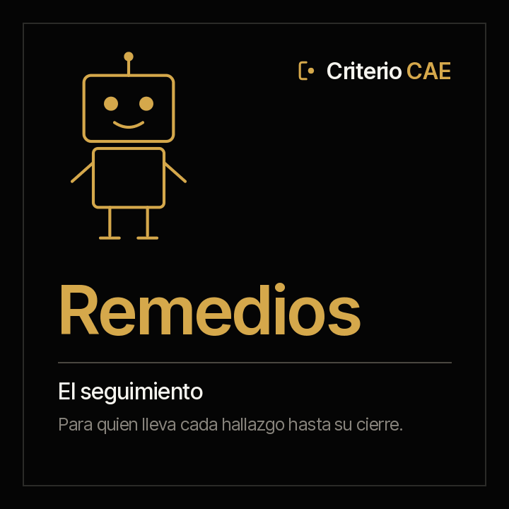

<picture><source media="(prefers-color-scheme: dark)" srcset="../../docs/img/marca/es/criterio-cae-oscuro.svg"></picture>

# Remedios · el seguimiento de los hallazgos



**Remedios lleva cada hallazgo hasta su remedio.**
Tú respondes por el seguimiento de los hallazgos. Ella llega con cada plan de acción al lado de su fecha y de su evidencia: el hallazgo sin plan, sin responsable o sin fecha, el plan vencido sin evidencia ni explicación, la fecha que se corre una y otra vez, el cierre sin evidencia o sin validación, el hallazgo que vuelve, el riesgo aceptado que no llegó a la alta dirección o al consejo y el hallazgo externo que no está en el registro.

<!-- agente:nombre · generado por scripts/familias.py; no se edita a mano -->
**El nombre.** Remedios, del latín *remedium*, «lo que vuelve a curar»: cada hallazgo hasta su remedio.
<!-- /agente:nombre -->

[English](README.md) · `criterio-remediation` · Apache 2.0 · Una instancia por entidad

**Estado: construido, en pruebas, con la familia CAE.** El motor de cálculo, probado contra todo el material sintético de la familia con una clave que el agente no ve y entidades de control. La ronda con el agente viene en la 0.2.0, y no se ha probado sobre la documentación de una organización concreta.

**Esta página se lee sola.** Remedios funciona sin los otros agentes de la familia. La familia —cómo se encuentran entre sí y con Rostrum— está en la [familia criterio-cae](../../families/criterio-cae/README.es.md).

---

## Qué es

| | |
|---|---|
| **A quién extiende** | A quien lleva el seguimiento de los hallazgos y prepara el material del comité de auditoría |
| **Sobre qué trabaja** | **El registro de hallazgos y planes de acción de una entidad, periodo a periodo** |
| **Qué mira** | El registro de hallazgos, las evidencias, el registro de riesgos aceptados y los informes del revisor fiscal, del auditor externo y del supervisor |
| **Cadencia** | Cuando llega una evidencia o vence un plan, y una vez por semana |
| **Instancias** | Una por entidad |

## Qué hace

**Lo que hace y hoy no se hace a mano: poner todo, no una muestra, al lado de su norma y de su evidencia.**

**Lo que puede responder:** qué plan venció sin evidencia, cuál se corrió más de lo permitido, qué cierre no tiene evidencia o validación, qué hallazgo se repite, qué riesgo aceptado no se escaló y qué hallazgo externo no está en el registro.

<!-- cae:comandos · generado por scripts/familias.py; no se edita a mano -->
### Los ocho comandos

> Se escriben con el prefijo del plugin: `/criterio-remediation:` y autocompletar hace el resto. Es la única forma que resuelve en una sesión de Claude Code.

| Comando | Qué hace |
|---|---|
| `/criterio-remediation:remediation-setup` | La configuración, el inventario y los registros reconocidos |
| `/criterio-remediation:remedios` | Lo que necesites, en tus palabras: Remedios elige el comando que lo resuelve y lo corre |
| `/criterio-remediation:remediation-scan` | La ficha del periodo al día |
| `/criterio-remediation:action-status` | Qué plan está vencido y desde cuándo |
| `/criterio-remediation:closure-check` | Qué cierre no se sostiene y qué hallazgo se repite |
| `/criterio-remediation:committee-brief` | El material del comité, para que lo lleve el responsable de auditoría |
| `/criterio-remediation:remediation-wake` | El seguimiento al día sin que nadie se acuerde |
| `/criterio-remediation:share-findings` | Un resumen sin datos, solo si se dice que sí |
<!-- /cae:comandos -->

`remediation-setup` va primero porque los demás lo necesitan, y `remediation-wake` es el que se le pone a un reloj.

<!-- cae:skills · generado por scripts/familias.py; no se edita a mano -->
### Los tres skills

Se cargan solos cuando el tema aparece. Son el conocimiento que los comandos comparten, y se consultan como un manual.

| Skill | Qué encapsula | De quién es |
|---|---|---|
| `audit-intake` | La estructura recomendada de la carpeta de auditoría, qué va en cada carpeta y qué agente la usa, cómo se nombran los trabajos y qué hacer con lo que no encaja | Copia de Prudencia · también en Justo |
| `audit-methodology` | La metodología de auditoría en la configuración: los ciclos por nivel de riesgo, la escala de prioridad con su impacto y su probabilidad, quién aprueba el plan, el programa y los papeles, y cuántas reprogramaciones se permiten | Copia de Prudencia · también en Justo |
| `follow-up-record` | Cómo se lleva a la ficha cada evidencia de implementación, cada explicación de atraso y cada hallazgo de un informe externo, con la cita | Propio |
<!-- /cae:skills -->

## Lo que cuesta hoy

<!-- cae:cifras · generado por scripts/familias.py; no se edita a mano -->
<!-- /cae:cifras -->

## Para qué sirve

`/criterio-remediation:action-status` pone cada caso al lado de su norma y de su evidencia. **Lo que falta se dice con su cita.**

### Y para qué no sirve

- **No cierra un hallazgo ni acepta un riesgo.** Dice qué falta y dónde; la opinión es del auditor.
- **No entra a los sistemas auditados ni a la herramienta de auditoría.** Procesa lo que la organización le entrega.
- **No copia el texto de las Normas.** Las Normas Globales de Auditoría Interna se citan por su número y su título.

Y una que hay que decir en voz alta: **tus documentos se procesan en la infraestructura de la plataforma de IA**, no solo en tu equipo. Un papel de trabajo puede traer información confidencial: confirma que sea admisible bajo tu política antes de apuntarla a esa carpeta. Descargo completo en [DISCLAIMER.es.md](../../DISCLAIMER.es.md), términos en [TERMS.es.md](../../TERMS.es.md).

## Instalación y configuración

```
/plugin marketplace add josenanez/criterio
/plugin install criterio-remediation@criterio
/criterio-remediation:remediation-setup
```

### El primer resultado

`/criterio-remediation:remediation-setup` no te pide que ordenes nada antes de empezar. Mira la carpeta de auditoría de la entidad, la compara con la [estructura recomendada](../../families/criterio-cae/README.es.md#la-estructura-de-carpetas-recomendada), procesa la metodología y hace las preguntas que ningún documento responde. En los primeros quince minutos deja ver el primer resultado.

### Cada cuánto corre

`/criterio-remediation:remediation-wake` es el comando que el reloj invoca: hace lo que toca, responde primero las preguntas que alguien dejó en Rostrum, y **si no toca nada no produce nada.** La decisión de qué toca es aritmética de fechas, y la toma el código:

```
python3 scripts/auditoria.py despertar --config <archivo>
```

## Trabajo en equipo

| Con quién | Qué pasa |
|---|---|
| **Prudencia** | Comparten la carpeta y la metodología; cada uno escribe solo su ficha |
| **Justo** | Comparten la carpeta y la metodología; cada uno escribe solo su ficha |
| **Rostrum** | Solo si la configuración lo dice (`publish_rostrum`; por omisión no, decisión 0014): publica sus reportes, lo que vence y sus señales para quien no abre una carpeta, y le devuelve las preguntas que deja quien lo mira. **No escribe en el estado** |

## Pruebas

[`scripts/auditoria.py`](scripts/auditoria.py), con la librería estándar, hace todo lo que es cálculo: procesa cada tabla con su fila de origen, cuenta los días contra los plazos de la metodología y de las Normas y cruza cada hallazgo con su evidencia, el mismo resultado cada vez. Vive en `criterio-audit-plan` y se copia a los otros dos agentes; `scripts/sincronizar.py --check` falla si la copia se separa.

```
python3 scripts/auditoria.py selftest
python3 tests/criterio-cae/generar.py
python3 tests/criterio-cae/evaluar.py
```

Qué se siembra en cada entidad y **qué no prueba el material**, en [`EVIDENCIA.md`](../../tests/criterio-cae/EVIDENCIA.md). El diseño, con la entrada, el proceso y el reporte de cada comando, en el [diseño de la familia](../../families/criterio-cae/DISENO.es.md).
