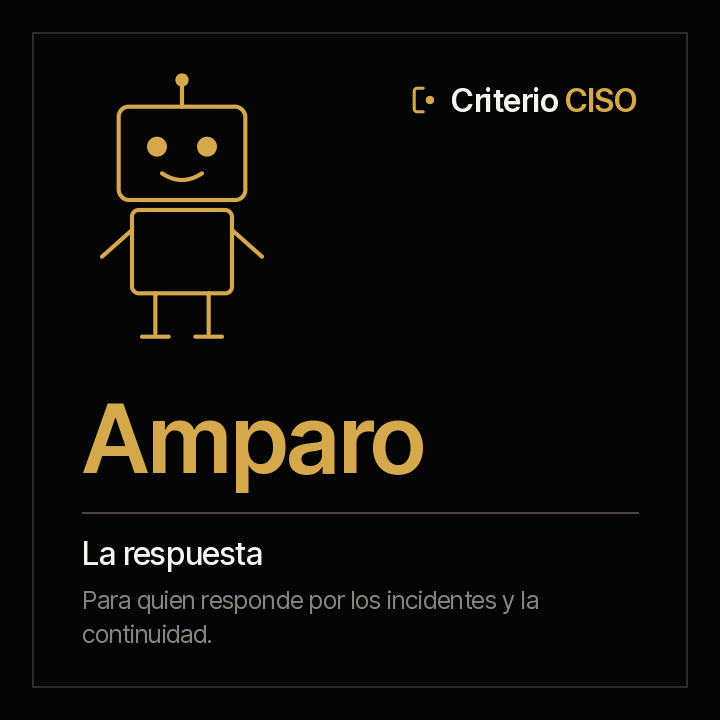

<picture><source media="(prefers-color-scheme: dark)" srcset="../../docs/img/marca/es/criterio-ciso-oscuro.svg"></picture>

# Amparo · la respuesta y la recuperación



**Amparo pone cada incidente al lado de los plazos que se comprometieron.**
Tú respondes por la respuesta a incidentes y por la continuidad. Ella llega con cada incidente contra el plazo de contención de su severidad, cada notificación que pide tu matriz —al supervisor, a la autoridad de datos, a los clientes— contra la que se hizo, la revisión posterior que falta y las pruebas de continuidad y de restauración que vencieron.

<!-- agente:nombre · generado por scripts/familias.py; no se edita a mano -->
**El nombre.** Amparo, del latín *ante parare*, «prevenir, proteger»: cada incidente contra los plazos que se comprometieron.
<!-- /agente:nombre -->

[English](README.md) · `criterio-resilience` · Apache 2.0 · Una instancia por entidad

**Estado: de laboratorio, sin lanzar (versión 0.1.0).** El motor de cálculo, probado contra material sintético de cuatro industrias con una clave que el agente no ve y dos entidades de control. Ya se puede instalar desde el marketplace. **La ronda con el agente es el siguiente paso**, en la 0.2.0. Nada se anuncia como terminado hasta que pasen los [criterios de aceptación](ACCEPTANCE.md).

**Esta página se lee sola.** Amparo funciona sin los otros dos agentes de la familia. La familia —cómo se encuentran entre sí y con Rostrum— está en la [familia criterio-ciso](../../families/criterio-ciso/README.es.md).

---

## Qué es

| | |
|---|---|
| **A quién extiende** | A quien responde por la respuesta a incidentes y la continuidad del negocio, y a quien reporta al supervisor |
| **Sobre qué trabaja** | **Los incidentes y las pruebas de una entidad**, periodo a periodo |
| **Qué mira** | El informe de cada incidente con sus notificaciones, sus revisiones posteriores, la matriz de notificaciones, el calendario de continuidad y el informe de cada prueba |
| **Cadencia** | Cuando llega un incidente, una revisión o una prueba nueva, cuando vence una prueba, y una vez por semana |
| **Instancias** | Una por entidad |

## Qué hace

**Lo que hace y hoy no se hace: poner la línea de tiempo de cada incidente al lado de cada plazo que la organización se comprometió a cumplir**, con la hora de cada constancia.

**Lo que puede responder que hoy cuesta una reconstrucción a mano:** qué incidente se contuvo fuera de plazo, qué notificación al supervisor se hizo tarde o no se hizo, qué incidente cerrado no tiene su revisión, y qué respaldo crítico lleva meses sin una prueba de restauración.

<!-- ciso:comandos · generado por scripts/familias.py; no se edita a mano -->
### Los seis comandos

> Se escriben con el prefijo del plugin: `/criterio-resilience:` y autocompletar hace el resto. Es la única forma que resuelve en una sesión de Claude Code.

| Comando | Qué hace |
|---|---|
| `/criterio-resilience:resilience-setup` | La configuración, con los plazos de la política |
| `/criterio-resilience:resilience-scan` | La ficha del periodo al día, con los incidentes, las revisiones y las pruebas nuevas |
| `/criterio-resilience:incident-timeline` | Cada incidente contra el plazo de su severidad y su revisión |
| `/criterio-resilience:notifications` | Cada notificación que pide la matriz, a tiempo, tarde o sin hacer |
| `/criterio-resilience:continuity-tests` | Cada prueba contra su calendario |
| `/criterio-resilience:resilience-wake` | Lo que tocaba hoy, corrido |
<!-- /ciso:comandos -->

`resilience-setup` va primero porque los demás lo necesitan, y `resilience-wake` es el que se le pone a un reloj. Entre los dos, los cuatro que preparan el trabajo: qué cambió, la línea de tiempo, las notificaciones y las pruebas.

<!-- ciso:skills · generado por scripts/familias.py; no se edita a mano -->
### Los tres skills

Se cargan solos cuando el tema aparece. Son el conocimiento que los comandos comparten, y se consultan como un manual.

| Skill | Qué encapsula | De quién es |
|---|---|---|
| `continuity-record` | El calendario de continuidad y cómo se lleva a la ficha cada prueba —de continuidad, de recuperación, de restauración— con su fecha y su resultado | Propio |
| `incident-record` | Cómo se lleva un incidente a la ficha: su severidad, la detección, la contención y el cierre con su hora, los datos personales y los clientes afectados, cada notificación con su constancia y su revisión posterior | Propio |
| `security-intake` | La estructura recomendada de la carpeta de seguridad, qué va en cada carpeta y qué agente la usa, cómo se nombran la evidencia y las exportaciones, y qué nunca se deja ahí | Copia de Alexis · también en Guillermo |
<!-- /ciso:skills -->

## Para qué sirve

`/criterio-resilience:notifications` pone cada notificación que pide la matriz al lado de la que se hizo, con la hora de su constancia. **La que se hizo tarde y la que no se hizo se dicen con su destinatario y su norma.**

### Y para qué no sirve

- **No notifica a nadie.** Dice qué notificación falta; quién notifica es de una persona.
- **No declara ni cierra un incidente, y no le asigna una severidad.**
- **No ejecuta un plan de continuidad ni una restauración**, y no abre un respaldo.
- **No abre credenciales, llaves ni respaldos.** Los lista como excluidos.

Y una que hay que decir en voz alta: **tus documentos se procesan en la infraestructura de la plataforma de IA**, no solo en tu equipo. Confirma que sea admisible bajo tus políticas antes de apuntarla a material confidencial. Descargo completo en [DISCLAIMER.es.md](../../DISCLAIMER.es.md), términos en [TERMS.es.md](../../TERMS.es.md).

## Instalación y configuración

**Ya está en el marketplace**, de laboratorio y sin lanzar:

```
/plugin marketplace add josenanez/criterio
/plugin install criterio-resilience@criterio
/criterio-resilience:resilience-setup
```

### El primer resultado

`/criterio-resilience:resilience-setup` no te pide que ordenes nada antes de empezar. Mira la carpeta de seguridad de la entidad, la compara con la [estructura recomendada](../../families/criterio-ciso/README.es.md#la-estructura-de-carpetas-recomendada), dice qué no va a abrir y hace las preguntas que ningún documento responde: los plazos de contención y de revisión de la política, con la página de donde salen, la matriz de notificaciones y el calendario. En los primeros quince minutos deja ver el primer resultado: cada incidente del periodo contra el plazo de su severidad.

### Cada cuánto corre

`/criterio-resilience:resilience-wake` es el comando que el reloj invoca: hace lo que toca, responde primero las preguntas que alguien dejó en Rostrum, y **si no toca nada no produce nada.** La decisión de qué toca es aritmética de fechas, y la toma el código:

```
python3 scripts/seguridad.py despertar --config <archivo>
```

## Trabajo en equipo

| Con quién | Qué pasa |
|---|---|
| **Alexis** | Comparten la carpeta y la referencia de la entidad. Alexis procesa los controles; Amparo, los incidentes y las pruebas. Cada una escribe solo su ficha |
| **Guillermo** | Comparten la carpeta y la referencia. Guillermo procesa las vulnerabilidades |
| **Rostrum** | Publica sus reportes, lo que vence y sus señales para quien no abre una carpeta, y le devuelve las preguntas que deja quien lo mira. **No escribe en el estado** |

## Pruebas

### Cómo está construido

La espina es la **ficha del periodo**: cada incidente con su línea de tiempo y sus notificaciones, cada revisión y cada prueba, cada dato con su cita (F-04). La escribe la agente; los resultados, el motor.

[`scripts/seguridad.py`](scripts/seguridad.py), con la librería estándar, hace todo lo que es cálculo: procesa cada tabla y cada exportación con su fila de origen, cuenta los días y las horas contra los plazos de la política y excluye lo que nunca se abre, el mismo resultado cada vez. Vive en `criterio-security` y se copia a los otros dos agentes; `scripts/sincronizar.py --check` falla si alguna copia se separa.

### Cómo se verifica

```
python3 scripts/seguridad.py selftest                        el motor
python3 tests/criterio-ciso/generar.py                       el material de cuatro industrias
python3 tests/criterio-ciso/evaluar.py --agente amparo       cada señal contra la clave
```

**Cómo salió la última corrida, generado desde la corrida misma:** [`tests/criterio-resilience/RESULTADOS.md`](../../tests/criterio-resilience/RESULTADOS.md). Qué se siembra en cada entidad y **qué no prueba el material**, en [`EVIDENCIA.md`](../../tests/criterio-ciso/EVIDENCIA.md). El diseño, con la entrada, el proceso y el reporte de cada comando, en el [diseño de la familia](../../families/criterio-ciso/DISENO.es.md).
