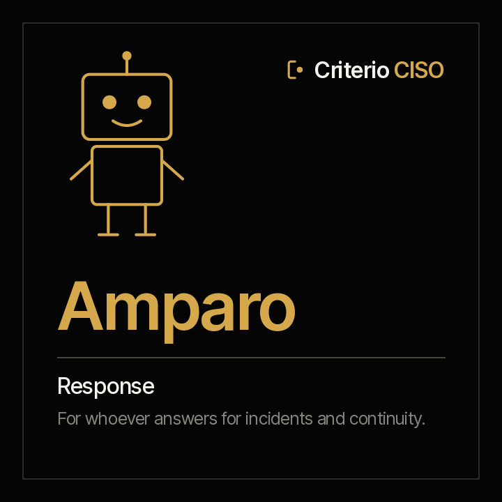

<picture><source media="(prefers-color-scheme: dark)" srcset="../../docs/img/marca/en/criterio-ciso-oscuro.svg"></picture>

# Amparo · response and recovery



**Amparo puts every incident next to the deadlines that were committed.**
You answer for incident response and continuity. She comes with every incident against its severity's containment deadline, every notification your matrix requires —to the supervisor, the data authority, the customers— against the one that was made, the missing post-incident review and the continuity and restore tests that lapsed.

<!-- agente:nombre · generado por scripts/familias.py; no se edita a mano -->
**The name.** Amparo, from the Latin *ante parare*, “to prepare ahead, to protect”: every incident against the deadlines that were committed.
<!-- /agente:nombre -->

[Español](README.es.md) · `criterio-resilience` · Apache 2.0 · One instance per entity

**Status: under construction (version 0.1.0).** The calculation engine, tested against synthetic material from four industries with a key the agent never sees and two control entities. **The round with the agent is the next step**, in 0.2.0. Nothing is announced as finished until it passes the [acceptance criteria](ACCEPTANCE.md).

**This page stands on its own.** Amparo works without the family's other two agents. The family —how they meet each other and Rostrum— is in the [criterio-ciso family](../../families/criterio-ciso/README.md).

---

## What it is

| | |
|---|---|
| **Whom it extends** | Whoever answers for incident response and business continuity, and whoever reports to the supervisor |
| **What it works on** | **An entity's incidents and tests**, period by period |
| **What it looks at** | Each incident's report with its notifications, its post-incident reviews, the notification matrix, the continuity calendar and each test's report |
| **Cadence** | When a new incident, review or test arrives, when a test falls due, and once a week |
| **Instances** | One per entity |

## What it does

**What it does that is not done today: putting each incident's timeline next to every deadline the organisation committed to**, with the time of each record.

**What it can answer that takes a manual reconstruction today:** which incident was contained late, which notification to the supervisor was late or never made, which closed incident has no review, and which critical backup has gone months without a restore test.

<!-- ciso:comandos · generado por scripts/familias.py; no se edita a mano -->
### The six commands

> They are typed with the plugin prefix: `/criterio-resilience:` and autocomplete does the rest. It is the only form that resolves in a Claude Code session.

| Command | What it does |
|---|---|
| `/criterio-resilience:resilience-setup` | The configuration, with the policy's deadlines |
| `/criterio-resilience:resilience-scan` | The period record up to date, with the new incidents, reviews and tests |
| `/criterio-resilience:incident-timeline` | Each incident against its severity's deadline and its review |
| `/criterio-resilience:notifications` | Each notification the matrix requires, on time, late or not made |
| `/criterio-resilience:continuity-tests` | Each test against its calendar |
| `/criterio-resilience:resilience-wake` | What was due today, run |
<!-- /ciso:comandos -->

`resilience-setup` comes first because the others need it, and `resilience-wake` is the one you put on a clock. Between them, the four that prepare the work: what changed, the timeline, notifications and tests.

<!-- ciso:skills · generado por scripts/familias.py; no se edita a mano -->
### The three skills

They load on their own when the subject comes up. They are the knowledge the commands share, and they are consulted like a manual.

| Skill | What it encapsulates | Whose it is |
|---|---|---|
| `continuity-record` | The continuity calendar and how each test —continuity, recovery, restore— goes into the record with its date and its result | Own |
| `incident-record` | How an incident goes into the record: its severity, the detection, containment and closure with their time, personal data and affected customers, each notification with its record and its post-incident review | Own |
| `security-intake` | The recommended structure of the security folder, what goes in each folder and which agent uses it, how evidence and exports are named, and what is never left there | Copy of Alexis's · also in Guillermo |
<!-- /ciso:skills -->

## What it is for

`/criterio-resilience:notifications` puts every notification the matrix requires next to the one that was made, with the time of its record. **The late one and the missing one are reported with their recipient and their rule.**

### And what it is not for

- **It notifies no one.** It says which notification is missing; who notifies is a person's call.
- **It does not declare or close an incident, or assign it a severity.**
- **It does not run a continuity plan or a restore**, and does not open a backup.
- **It does not open credentials, keys or backups.** It lists them as excluded.

And one that has to be said out loud: **your documents are processed on the AI platform's infrastructure**, not only on your machine. Confirm that is acceptable under your policies before pointing it at confidential material. Full disclaimer in [DISCLAIMER.md](../../DISCLAIMER.md), terms in [TERMS.md](../../TERMS.md).

## Installation and setup

**Not in the marketplace yet**: it ships with its first version. Then:

```
/plugin marketplace add josenanez/criterio
/plugin install criterio-resilience@criterio
/criterio-resilience:resilience-setup
```

### The first result

`/criterio-resilience:resilience-setup` does not ask you to tidy anything before starting. It looks at the entity's security folder, compares it with the [recommended structure](../../families/criterio-ciso/README.md#the-recommended-folder-structure), says what it will not open and asks the questions no document answers: the policy's containment and review deadlines, with the page they come from, the notification matrix and the calendar. Within the first fifteen minutes it shows the first result: every incident in the period against its severity's deadline.

### How often it runs

`/criterio-resilience:resilience-wake` is the command the clock invokes: it does what is due, first answers the questions somebody left in Rostrum, and **if nothing is due it produces nothing.** Deciding what is due is date arithmetic, and the code does it:

```
python3 scripts/seguridad.py despertar --config <archivo>
```

## Teamwork

| With whom | What happens |
|---|---|
| **Alexis** | They share the entity's folder and reference. Alexis processes the controls; Amparo, the incidents and the tests. Each writes only its own record |
| **Guillermo** | They share the folder and the reference. Guillermo processes the vulnerabilities |
| **Rostrum** | Publishes its reports, what falls due and its signals for whoever will not open a folder, and returns the questions left by whoever looks at it. **It does not write the state** |

## Tests

### How it is built

The backbone is the **period record**: each incident with its timeline and its notifications, each review and each test, every data point with its citation (F-04). The agent writes it; the engine writes the results.

[`scripts/seguridad.py`](scripts/seguridad.py), with the standard library, does everything that is calculation: it processes each table and each export with its source row, counts days and hours against the policy's deadlines and excludes what is never opened, the same result every time. It lives in `criterio-security` and is copied to the other two agents; `scripts/sincronizar.py --check` fails if any copy drifts.

### How it is verified

```
python3 scripts/seguridad.py selftest                        the engine
python3 tests/criterio-ciso/generar.py                       the material from four industries
python3 tests/criterio-ciso/evaluar.py --agente amparo       every signal against the key
```

**How the latest run went, generated from the run itself:** [`tests/criterio-resilience/RESULTADOS.md`](../../tests/criterio-resilience/RESULTADOS.md). What is planted in each entity and **what the material does not test**, in [`EVIDENCIA.md`](../../tests/criterio-ciso/EVIDENCIA.md) (Spanish). The design, with each command's input, process and report, in the [family design](../../families/criterio-ciso/DISENO.md).
