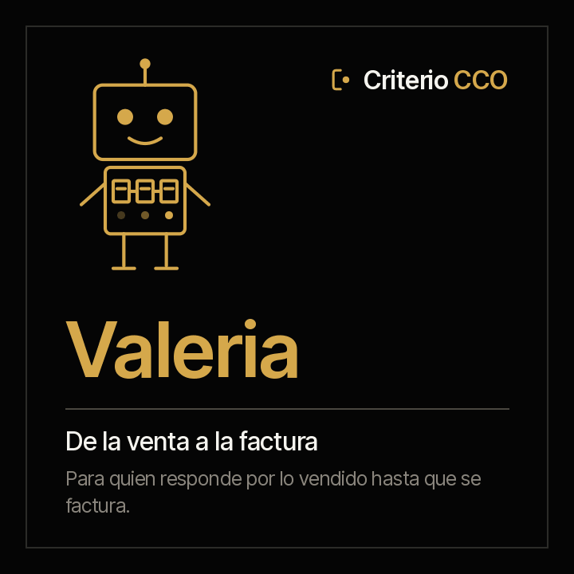

<picture><source media="(prefers-color-scheme: dark)" srcset="../../docs/img/marca/es/criterio-cco-oscuro.svg"></picture>

# Valeria · de la venta a la factura



**Valeria pone cada venta al lado de su política, su contrato y su factura.** Tú respondes por lo
vendido hasta que se factura. Ella llega con cada descuento contra el nivel que lo aprueba, lo ganado
sin contrato en las fichas de Fidel, lo firmado sin factura en las de Clara y cada comisión contra el
plan.

<!-- agente:nombre · generado por scripts/familias.py; no se edita a mano -->
**El nombre.** Valeria, del latín *valere*, valer: lo que vale lo vendido cuando está firmado y facturado.
<!-- /agente:nombre -->

[English](README.md) · `criterio-revenue` · Apache 2.0 · Una instancia por entidad

**Estado: estable, sin lanzar (versión 0.3.0).** Los seis comandos, los seis skills y el motor de
cálculo, probados contra material sintético de Colombia, México, Ecuador, Perú y Chile —con las
exportaciones de Salesforce, HubSpot, Dynamics 365, Zoho y cualquier CRM con su mapeo— con una clave
que el agente no ve y una entidad de control por país. Pasó sus dos rondas con los agentes: con todas
ellas, el piso del margen del 95 % es 98,0 % en señales y 95,1 % en datos. Se instala desde el
marketplace; su lanzamiento está pendiente. Los [criterios de aceptación](ACCEPTANCE.md) siguen
siendo la regla.

**Esta página se lee sola.** Valeria funciona sin Augusto: si solo respondes por la venta hasta la
factura, aquí está todo, incluidas sus pruebas. La familia —cómo se encuentra con Augusto, con Fidel, con Clara y con Rostrum— está en
la [familia criterio-cco](../../families/criterio-cco/README.es.md).

---

## Qué es

| | |
|---|---|
| **A quién extiende** | A quien administra las ventas: la cotización, el contrato, la facturación y la liquidación de comisiones |
| **Sobre qué trabaja** | **Lo vendido por una entidad**, periodo a periodo |
| **Qué mira** | Las cotizaciones y los pedidos, la matriz de descuentos, la tabla de cuentas, el plan y la liquidación de comisiones, las exportaciones del CRM y las fichas de Fidel y de Clara |
| **Cadencia** | Cuando llegan cotizaciones nuevas, cuando vence el plazo de un contrato o una factura, cuando llega la liquidación, y una vez por semana |
| **Instancias** | Una por entidad |

## Qué hace

**Lo que hace y hoy no se hace: cruzar cada venta ganada con su contrato y cada contrato con su
factura**, y recalcular cada comisión con el plan.

**Lo que puede responder que hoy cuesta días de conciliación:** qué descuento no tiene la aprobación
que pide su nivel, qué venta ganada no tiene contrato firmado, qué contrato firmado no se facturó en
su plazo y qué comisión liquidada no es la que da el plan.

<!-- cco:comandos · generado por scripts/familias.py; no se edita a mano -->
### Los seis comandos

> Se escriben con el prefijo del plugin: `/criterio-revenue:` y autocompletar hace el resto. Es la única forma que resuelve en una sesión de Claude Code.

| Comando | Qué hace |
|---|---|
| `/criterio-revenue:revenue-setup` | La configuración, el inventario y las cuentas que faltan para cruzar con Fidel y Clara |
| `/criterio-revenue:deal-scan` | La ficha del periodo al día, con las cotizaciones nuevas y las señales nuevas |
| `/criterio-revenue:discount-check` | Cada descuento contra su política y su aprobación |
| `/criterio-revenue:won-to-invoice` | De lo ganado a lo firmado y a lo facturado: lo que se quedó en el camino |
| `/criterio-revenue:commission-check` | Cada comisión liquidada contra la que da el plan |
| `/criterio-revenue:revenue-wake` | Lo que toca hoy de la venta a la factura; si no toca nada, se calla |
<!-- /cco:comandos -->

`revenue-setup` va primero porque los demás lo necesitan, y `revenue-wake` es el que se le pone a un
reloj. Entre los dos, los cuatro que preparan el trabajo: qué cambió en lo vendido, los descuentos
contra su política, lo ganado hasta la factura y las comisiones contra el plan.

<!-- cco:skills · generado por scripts/familias.py; no se edita a mano -->
### Los seis skills

Se cargan solos cuando el tema aparece. Son el conocimiento que los comandos comparten, y se consultan como un manual.

| Skill | Qué encapsula | De quién es |
|---|---|---|
| `commission-plan` | Cómo se calcula la comisión que da el plan sobre lo ganado y facturado, y por qué no se publica en Rostrum por omisión | Propio |
| `crm-exports` | Cómo se procesa cada exportación del CRM: Salesforce por sus nombres de campo o sus etiquetas, HubSpot por sus propiedades, Dynamics 365 y Zoho por sus columnas, y cualquier CSV o Excel con su mapeo de columnas; la tabla de etapas y el historial de la fecha de cierre | Copia de Augusto |
| `deal-record` | La ficha del periodo de Valeria: cada cotización o pedido con su oportunidad, su precio de lista, su descuento y su aprobación, cada dato con su cita | Propio |
| `discount-policy` | Cómo se lee la matriz de descuentos: el nivel que cubre cada descuento, la aprobación que pide y por qué un cargo superior también la da | Propio |
| `sales-intake` | La estructura recomendada de la carpeta comercial, qué va en cada carpeta y qué agente la usa, y cómo se nombran las exportaciones y la evidencia | Copia de Augusto |
| `won-to-cash` | El cruce de lo ganado con los contratos de Fidel y las facturas de Clara por la identificación de la cuenta, sin volver a procesar sus documentos | Propio |
<!-- /cco:skills -->

## Para qué sirve

`/criterio-revenue:won-to-invoice` pone cada venta ganada al lado de su contrato en las fichas de
Fidel y cada contrato firmado al lado de su factura en las de Clara, por la identificación del cliente.
**No vuelve a procesar un contrato ni una factura**: los toma de quien los procesó.

### Y para qué no sirve

- **No escribe ni cambia nada en el CRM**, y no se conecta a él: procesa lo que el CRM exporta.
- **No aprueba un descuento ni una excepción de precio, y no liquida ni corrige una comisión.**
- **No compara a quien vende.** Cada comisión se mira contra el plan, no contra la de otra persona, y
  el reporte de comisiones no se publica en Rostrum salvo que la configuración lo diga.
- **No contacta a un cliente**, y la ficha no guarda el correo ni el teléfono de nadie.
- **No mueve, renombra ni crea nada dentro de los documentos de la organización.** Lo único que deja,
  si la persona lo autoriza, es el archivo que marca la carpeta raíz.
- **No adivina.** Cada dato lleva la cita del documento y, en las tablas, la fila de donde salió.

Y una que hay que decir en voz alta: **tus documentos se procesan en la infraestructura de la
plataforma de IA**, no solo en tu equipo. Confirma que sea admisible bajo tus políticas antes de
apuntarla a material confidencial. Descargo completo en [DISCLAIMER.es.md](../../DISCLAIMER.es.md),
términos en [TERMS.es.md](../../TERMS.es.md).

## Instalación y configuración

**Todavía no está en el marketplace**: sale con su primera versión, cuando pase la ronda con el
agente. Entonces:

```
/plugin marketplace add josenanez/criterio
/plugin install criterio-revenue@criterio
/criterio-revenue:revenue-setup
```

Si respondes por el pronóstico y no por lo vendido hasta la factura, lo tuyo es
[Augusto](../criterio-sales/README.es.md).

### El primer resultado

`/criterio-revenue:revenue-setup` no te pide que ordenes nada antes de empezar. Mira la carpeta
comercial de la entidad, la compara con la
[estructura recomendada](../../families/criterio-cco/README.es.md#la-estructura-de-carpetas-recomendada),
revisa que cada cuenta ganada tenga la identificación del cliente en la tabla de cuentas, busca las
fichas de Fidel y de Clara y hace las preguntas que ningún documento responde: en cuántos días se
factura un contrato, si las comisiones se publican. En los primeros quince minutos deja ver lo ganado
contra lo firmado y lo facturado.

### Cada cuánto corre

`/criterio-revenue:revenue-wake` es el comando que el reloj invoca: hace lo que toca, responde primero
las preguntas que alguien dejó en Rostrum, y **si no toca nada no produce nada.** La decisión de qué
toca es aritmética de fechas, y la toma el código:

```
python3 scripts/ventas.py despertar --config <archivo>
```

## Trabajo en equipo

| Con quién | Qué pasa |
|---|---|
| **Augusto** | Comparten el estado de la entidad y las mismas exportaciones del CRM. Cada uno escribe solo su ficha |
| **Fidel** | Valeria lee las fichas de sus contratos para saber si una venta ganada tiene su contrato firmado. No las escribe ni procesa el contrato |
| **Clara** | Valeria lee las facturas emitidas de sus cierres para saber si un contrato firmado se facturó y si una venta ganada comisiona. No procesa la factura electrónica |
| **Rostrum** | Publica sus reportes, lo que vence en el embudo y sus señales, para quien no abre una carpeta, y le devuelve las preguntas que deja quien lo mira. **No escribe en el estado** |

## Pruebas

### Cómo está construido

La espina es la **ficha del periodo**: cada cotización o pedido con su oportunidad, su precio de lista,
su descuento y su aprobación, cada dato con su cita. La escribe
el agente; los resultados, el motor.

[`scripts/ventas.py`](scripts/ventas.py), con la librería estándar, hace todo lo que es cálculo: lee
cada descuento contra su nivel, cruza lo ganado con las fichas de Fidel y de Clara y recalcula cada
comisión, el mismo resultado cada vez. **Es copia literal del de Augusto, no una importación**, con
los skills `sales-intake` y `crm-exports`: un plugin instalado tiene que correr solo.
`scripts/sincronizar.py --check` falla si alguna copia se separa.

Cada fuente que se usa está en
[`families/criterio-cco/FUENTES.es.md`](../../families/criterio-cco/FUENTES.es.md), con su versión, su
enlace y su estado.

### Cómo se verifica

```
python3 scripts/ventas.py selftest                       el motor
python3 tests/criterio-cco/generar.py                    el material de Colombia y México
python3 tests/criterio-cco/evaluar.py --agente valeria   cada señal contra la clave
```

**Cómo salió la última corrida, generado desde la corrida misma:**
[`tests/criterio-revenue/RESULTADOS.md`](../../tests/criterio-revenue/RESULTADOS.md). Qué se siembra en
cada entidad y **qué no prueba el material**, en
[`EVIDENCIA.md`](../../tests/criterio-cco/EVIDENCIA.md). El diseño, con la entrada, el proceso y el
reporte de cada comando, en el [diseño de la familia](../../families/criterio-cco/DISENO.es.md).
