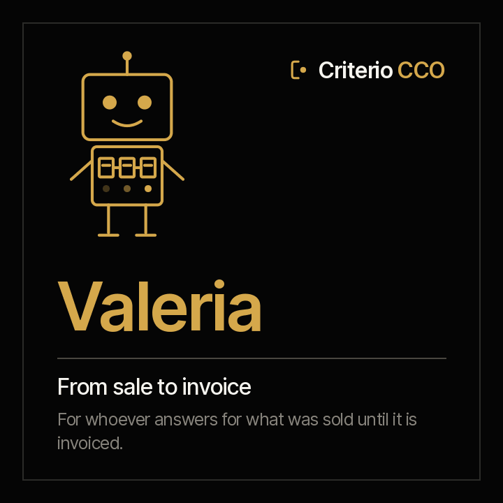

<picture><source media="(prefers-color-scheme: dark)" srcset="../../docs/img/marca/en/criterio-cco-oscuro.svg"></picture>

# Valeria · from sale to invoice



**Valeria puts every sale next to its policy, its contract and its invoice.** You answer for what was sold
until it is invoiced. She arrives with every discount against the level that approves it, what was won
without a contract in Fidel's records, what was signed without an invoice in Clara's, and every commission
against the plan.

<!-- agente:nombre · generado por scripts/familias.py; no se edita a mano -->
**The name.** Valeria, from the Latin *valere*, to be worth: what a sale is worth once it is signed and invoiced.
<!-- /agente:nombre -->

[Español](README.es.md) · `criterio-revenue` · Apache 2.0 · One instance per entity

**Status: stable, not yet launched (version 0.3.0).** The seven commands, the six skills and the
calculation engine, tested against synthetic material from Colombia, Mexico, Ecuador, Peru and Chile
—with Salesforce, HubSpot, Dynamics 365, Zoho and any CRM with its mapping— with a key the agent never
sees and one control entity per country. It passed its two rounds with the agents: across all of them,
the 95% confidence floor is 98.0% on signals and 95.1% on data. It installs from the marketplace; its
launch is pending. The [acceptance criteria](ACCEPTANCE.md) are still the rule.

**This page reads on its own.** Valeria works without Augusto: if you only answer for the sale through to the invoice, everything is here, tests included. The family —how she meets Augusto, Fidel, Clara and Rostrum— is in the
[criterio-cco family](../../families/criterio-cco/README.md).

---

## What it is

| | |
|---|---|
| **Who it extends** | Whoever administers sales: the quote, the contract, the invoicing and the commission settlement |
| **What it works on** | **What an entity sold**, period by period |
| **What it looks at** | The quotes and orders, the discount matrix, the accounts table, the commission plan and settlement, the CRM exports and Fidel's and Clara's records |
| **Cadence** | When new quotes arrive, when a contract's or an invoice's deadline falls due, when the settlement arrives, and once a week |
| **Instances** | One per entity |

## What it does

**What it does and today does not get done: crossing every won sale with its contract and every contract
with its invoice**, and recalculating every commission with the plan.

**What it can answer that today takes days of reconciliation:** which discount lacks the approval its level
asks for, which won sale has no signed contract, which signed contract was not invoiced in time and which
settled commission is not the one the plan gives.

<!-- cco:comandos · generado por scripts/familias.py; no se edita a mano -->
### The seven commands

> They are typed with the plugin prefix: `/criterio-revenue:` and autocomplete does the rest. It is the only form that resolves in a Claude Code session.

| Command | What it does |
|---|---|
| `/criterio-revenue:revenue-setup` | The configuration, the inventory and the accounts still missing to cross with Fidel and Clara |
| `/criterio-revenue:deal-scan` | The period record up to date, with the new quotes and the new signals |
| `/criterio-revenue:discount-check` | Every discount against its policy and its approval |
| `/criterio-revenue:won-to-invoice` | From won to signed to invoiced: what was left along the way |
| `/criterio-revenue:commission-check` | Every settled commission against the one the plan gives |
| `/criterio-revenue:revenue-wake` | What is due today from sale to invoice; if nothing is due, it stays quiet |
| `/criterio-revenue:share-findings` | A summary with no data to share, only if you say yes |
<!-- /cco:comandos -->

`revenue-setup` comes first because the others need it, and `revenue-wake` is the one you put on a clock.
Between them, the four that prepare the work: what changed in what was sold, discounts against their policy,
what was won through to the invoice and commissions against the plan.

<!-- cco:skills · generado por scripts/familias.py; no se edita a mano -->
### The six skills

They load on their own when the subject comes up. They are the knowledge the commands share, and they are consulted like a manual.

| Skill | What it encapsulates | Whose it is |
|---|---|---|
| `commission-plan` | How the commission the plan gives on what was won and invoiced is calculated, and why it is not published in Rostrum by default | Own |
| `crm-exports` | How each CRM export is processed: Salesforce by its field names or labels, HubSpot by its properties, Dynamics 365 and Zoho by their columns, and any CSV or Excel with its column mapping; the stage table and the close-date history | Copy of Augusto's |
| `deal-record` | Valeria's period record: every quote or order with its opportunity, list price, discount and approval, every data point with its citation | Own |
| `discount-policy` | How the discount matrix is read: the level that covers each discount, the approval it asks for and why a higher role also gives it | Own |
| `sales-intake` | The recommended structure of the sales folder, what goes in each folder and which agent uses it, and how exports and evidence are named | Copy of Augusto's |
| `won-to-cash` | Crossing what was won with Fidel's contracts and Clara's invoices by the account's tax id, without processing their documents again | Own |
<!-- /cco:skills -->

## What it is for

`/criterio-revenue:won-to-invoice` puts every won sale next to its contract in Fidel's records and every
signed contract next to its invoice in Clara's, by the customer's tax id. **It never processes a contract or
an invoice again**: it takes them from whoever processed them.

### And what it is not for

- **It does not write or change anything in the CRM**, and does not connect to it: it processes what the CRM exports.
- **It does not approve a discount or a price exception, and does not settle or correct a commission.**
- **It does not compare whoever sells.** Each commission is looked at against the plan, not against someone
  else's, and the commission report is not published in Rostrum unless the configuration says so.
- **It does not contact a customer**, and the record keeps nobody's email or phone.
- **It does not move, rename or create anything inside the organisation's documents.** The only thing it leaves,
  if the person authorises it, is the file that marks the root folder.
- **It does not guess.** Every data point carries its document's citation and, for tables, the row it came from.

And one that has to be said out loud: **your documents are processed on the AI platform's infrastructure**,
not only on your machine. Confirm that is admissible under your policies before pointing it at confidential
material. Full disclaimer in [DISCLAIMER.md](../../DISCLAIMER.md), terms in [TERMS.md](../../TERMS.md).

## Installation and configuration

**It is not in the marketplace yet**: it comes out with its first version, once it passes the round with the
agent. Then:

```
/plugin marketplace add josenanez/criterio
/plugin install criterio-revenue@criterio
/criterio-revenue:revenue-setup
```

If you answer for the forecast rather than the sale through to the invoice, yours is [Augusto](../criterio-sales/README.md).

### The first result

`/criterio-revenue:revenue-setup` does not ask you to tidy anything before starting. It looks at the
entity's sales folder, compares it with the
[recommended structure](../../families/criterio-cco/README.md#the-recommended-folder-structure), checks that
every won account has the customer's tax id in the accounts table, looks for Fidel's and Clara's records and
asks the questions no document answers: within how many days a contract is invoiced, whether commissions are
published. Within the first fifteen minutes it shows what was won against what was signed and invoiced.

### How often it runs

`/criterio-revenue:revenue-wake` is the command the clock invokes: it does what is due, first answers the questions
someone left in Rostrum, and **if nothing is due it produces nothing.** Deciding what is due is date
arithmetic, and the code does it:

```
python3 scripts/ventas.py despertar --config <file>
```

## Teamwork

| With whom | What happens |
|---|---|
| **Augusto** | They share the entity's state and the same CRM exports. Each one writes only its own record |
| **Fidel** | Valeria reads his contract records to know whether a won sale has its signed contract. She does not write them or process the contract |
| **Clara** | Valeria reads the issued invoices of her closes to know whether a signed contract was invoiced and whether a won sale earns commission. She does not process the electronic invoice |
| **Rostrum** | Publishes its reports, what is due and its signals for whoever does not open a folder, and hands back the questions left by whoever looks at it. **It does not write to the state** |

## Tests

### How it is built

The spine is the **period record**: every quote or order with its opportunity, list price, discount and
approval, each data point with its citation. The agent writes it; the engine writes the results.

[`scripts/ventas.py`](scripts/ventas.py), standard library only, does everything that is calculation: it checks each discount against its level, crosses what was won with Fidel's and Clara's records and
recalculates each commission, the same result every time. **It is a literal copy of Augusto's, not an
import**, with the `sales-intake` and `crm-exports` skills: an installed plugin has to run on its own.
`scripts/sincronizar.py --check` fails if a copy drifts.

Every source used is in [`families/criterio-cco/FUENTES.es.md`](../../families/criterio-cco/FUENTES.es.md)
(Spanish), with its version, link and status.

### How it is verified

```
python3 scripts/ventas.py selftest                       the engine
python3 tests/criterio-cco/generar.py                    the Colombia and Mexico material
python3 tests/criterio-cco/evaluar.py --agente valeria   every signal against the key
```

**How the last run went, generated from the run itself:**
[`tests/criterio-revenue/RESULTADOS.md`](../../tests/criterio-revenue/RESULTADOS.md). What is seeded in each
entity and **what the material does not test**, in [`EVIDENCIA.md`](../../tests/criterio-cco/EVIDENCIA.md).
The design, with each command's input, process and report, in the
[family's design](../../families/criterio-cco/DISENO.md).
