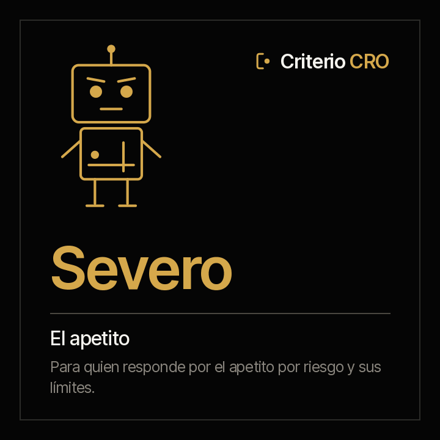

<picture><source media="(prefers-color-scheme: dark)" srcset="../../docs/img/marca/es/criterio-cro-oscuro.svg"></picture>

# Severo · el apetito por riesgo



**Severo pone cada exposición al lado de su límite.**
Tú respondes por el apetito por riesgo de la organización. Él llega con cada exposición que reportan las áreas al lado de su límite y su plan: el límite excedido sin plan ni aprobación, el reporte que llegó tarde, el límite sin dueño o con la revisión vencida, el riesgo alto de la matriz sin límite ni indicador y la declaración de apetito que la junta no ha revisado en el plazo del marco.

<!-- agente:nombre · generado por scripts/familias.py; no se edita a mano -->
**El nombre.** Severo, del latín *severus*, el que no hace concesiones: cada exposición contra su límite.
<!-- /agente:nombre -->

[English](README.md) · `criterio-risk-appetite` · Apache 2.0 · Una instancia por entidad

**Estado: construido, en pruebas, con la familia CRO.** El motor de cálculo, probado contra todo el material sintético de la familia con una clave que el agente no ve y entidades de control. La ronda con el agente viene en la 0.2.0, y no se ha probado sobre la documentación de una organización concreta.

**Esta página se lee sola.** Severo funciona sin el otro agente de la familia. La familia —cómo se encuentran entre sí y con Rostrum— está en la [familia criterio-cro](../../families/criterio-cro/README.es.md).

---

## Qué es

| | |
|---|---|
| **A quién extiende** | A quien responde por la gestión integral de riesgos —el CRO o el gerente de riesgos de la segunda línea— y a quien lleva el marco de apetito y sus límites |
| **Sobre qué trabaja** | **El marco de apetito y los límites de una entidad, periodo a periodo** |
| **Qué mira** | La declaración de apetito, la matriz de riesgos, los límites, los indicadores clave, la exposición que reportan las áreas, los planes de acción y las actas del comité de riesgos y de la junta |
| **Cadencia** | Cuando llega la exposición de un periodo, un acta o un cambio del marco, y una vez por semana |
| **Instancias** | Una por entidad |

## Qué hace

**Lo que hace y hoy no se hace a mano: poner todo, no una muestra, al lado de su fuente.**

**Lo que puede responder:** qué exposición supera su límite sin plan ni aprobación, qué área reportó tarde, qué límite no tiene dueño o pasó su revisión, qué riesgo alto no tiene límite ni indicador y si la junta revisó la declaración de apetito a tiempo.

<!-- cro:comandos · generado por scripts/familias.py; no se edita a mano -->
### Los ocho comandos

> Se escriben con el prefijo del plugin: `/criterio-risk-appetite:` y autocompletar hace el resto. Es la única forma que resuelve en una sesión de Claude Code.

| Comando | Qué hace |
|---|---|
| `/criterio-risk-appetite:appetite-setup` | La configuración, el inventario y las tablas reconocidas |
| `/criterio-risk-appetite:severo` | Lo que necesites, en tus palabras: Severo elige el comando que lo resuelve y lo corre |
| `/criterio-risk-appetite:appetite-scan` | La ficha del periodo al día |
| `/criterio-risk-appetite:limit-check` | Qué límite está excedido sin que nadie lo haya tratado |
| `/criterio-risk-appetite:framework-check` | Qué parte del marco se quedó sin dueño o sin revisión |
| `/criterio-risk-appetite:coverage-check` | Qué riesgo alto no tiene con qué medirse |
| `/criterio-risk-appetite:appetite-wake` | El apetito al día sin que nadie se acuerde |
| `/criterio-risk-appetite:share-findings` | Un resumen sin datos, solo si se dice que sí |
<!-- /cro:comandos -->

`appetite-setup` va primero porque los demás lo necesitan, y `appetite-wake` es el que se le pone a un reloj.

<!-- cro:skills · generado por scripts/familias.py; no se edita a mano -->
### Los tres skills

Se cargan solos cuando el tema aparece. Son el conocimiento que los comandos comparten, y se consultan como un manual.

| Skill | Qué encapsula | De quién es |
|---|---|---|
| `appetite-record` | Cómo se lleva a la ficha la revisión de la declaración de apetito por la junta y cada exceso que aprobó el comité, con la cita | Propio |
| `risk-intake` | La estructura recomendada de la carpeta de riesgos, qué va en cada carpeta y qué agente la usa | Propio · también en Casandra |
| `risk-policy` | Los plazos del marco de apetito en la configuración, y lo que nunca se decide | Propio · también en Casandra |
<!-- /cro:skills -->

## Lo que cuesta hoy

<!-- cro:cifras · generado por scripts/familias.py; no se edita a mano -->
| Cifra | Fuente |
|---|---|
| **30 %** de las organizaciones describen sus procesos de supervisión de riesgos como maduros o robustos | [AICPA y CIMA con la Iniciativa ERM de la Universidad Estatal de Carolina del Norte, The State of Risk Oversight, 17.ª edición, 2026](https://www.aicpa-cima.com/news/article/rising-risk-complexity-outpaces-organizations-strategic-readiness-finds-new-aicpa-and-north-carolina-state-university-study) — 331 altos ejecutivos y miembros de junta |
| **29 %** de las organizaciones tienen un apetito por riesgo articulado formalmente en su planeación estratégica | [AICPA y CIMA con la Iniciativa ERM de la Universidad Estatal de Carolina del Norte, The State of Risk Oversight, 17.ª edición, 2026](https://www.aicpa-cima.com/news/article/rising-risk-complexity-outpaces-organizations-strategic-readiness-finds-new-aicpa-and-north-carolina-state-university-study) — 331 altos ejecutivos y miembros de junta |
| **11 %** de las organizaciones dicen que su gestión de riesgos les da una ventaja estratégica o competitiva | [AICPA y CIMA con la Iniciativa ERM de la Universidad Estatal de Carolina del Norte, The State of Risk Oversight, 17.ª edición, 2026](https://www.aicpa-cima.com/news/article/rising-risk-complexity-outpaces-organizations-strategic-readiness-finds-new-aicpa-and-north-carolina-state-university-study) — 331 altos ejecutivos y miembros de junta |
<!-- /cro:cifras -->

## Para qué sirve

`/criterio-risk-appetite:limit-check` pone cada caso al lado de su fuente. **Lo que falta se dice con su cita.**

### Y para qué no sirve

- **No fija ni cambia un límite, no aprueba un exceso y no acepta un riesgo.** Dice qué está fuera y con qué cita; la decisión es de la junta, del comité de riesgos y de las áreas.
- **No calcula capital, valor en riesgo ni pérdida esperada.** Procesa las cifras que reportan las áreas y los modelos de la organización; no los reemplaza.
- **No se conecta a un sistema.** Procesa las exportaciones que la organización le entrega.

Y una que hay que decir en voz alta: **tus documentos se procesan en la infraestructura de la plataforma de IA**, no solo en tu equipo. Una matriz de riesgos o un acta del comité pueden traer información confidencial: confirma que sea admisible bajo tu política antes de apuntarla a esa carpeta. Descargo completo en [DISCLAIMER.es.md](../../DISCLAIMER.es.md), términos en [TERMS.es.md](../../TERMS.es.md).

## Instalación y configuración

```
/plugin marketplace add josenanez/criterio
/plugin install criterio-risk-appetite@criterio
/criterio-risk-appetite:appetite-setup
```

### El primer resultado

`/criterio-risk-appetite:appetite-setup` no te pide que ordenes nada antes de empezar. Mira la carpeta de riesgos de la entidad, la compara con la [estructura recomendada](../../families/criterio-cro/README.es.md#la-estructura-de-carpetas-recomendada), procesa el marco de apetito y hace las preguntas que ningún documento responde. En los primeros quince minutos deja ver el primer resultado.

### Cada cuánto corre

`/criterio-risk-appetite:appetite-wake` es el comando que el reloj invoca: hace lo que toca, responde primero las preguntas que alguien dejó en Rostrum, y **si no toca nada no produce nada.** La decisión de qué toca es aritmética de fechas, y la toma el código:

```
python3 scripts/riesgos.py despertar --config <archivo>
```

## Trabajo en equipo

| Con quién | Qué pasa |
|---|---|
| **Casandra** | Comparten la carpeta y el marco de apetito; cada uno escribe solo su ficha |
| **Rostrum** | Solo si la configuración lo dice (`publish_rostrum`): publica sus reportes, lo que vence y sus señales para quien no abre una carpeta, y le devuelve las preguntas que deja quien lo mira. **No escribe en el estado** |

## Pruebas

[`scripts/riesgos.py`](scripts/riesgos.py), con la librería estándar, hace todo lo que es cálculo: procesa cada tabla con su fila de origen, compara cada exposición con su límite en su sentido, cuenta los días contra los plazos del marco y cruza la matriz con los límites y los indicadores, el mismo resultado cada vez. Vive en `criterio-risk-appetite` y se copia a Casandra; `scripts/sincronizar.py --check` falla si la copia se separa.

```
python3 scripts/riesgos.py selftest
python3 tests/criterio-cro/generar.py
python3 tests/criterio-cro/evaluar.py
```

Qué se siembra en cada entidad y **qué no prueba el material**, en [`EVIDENCIA.md`](../../tests/criterio-cro/EVIDENCIA.md). El diseño, con la entrada, el proceso y el reporte de cada comando, en el [diseño de la familia](../../families/criterio-cro/DISENO.es.md).
