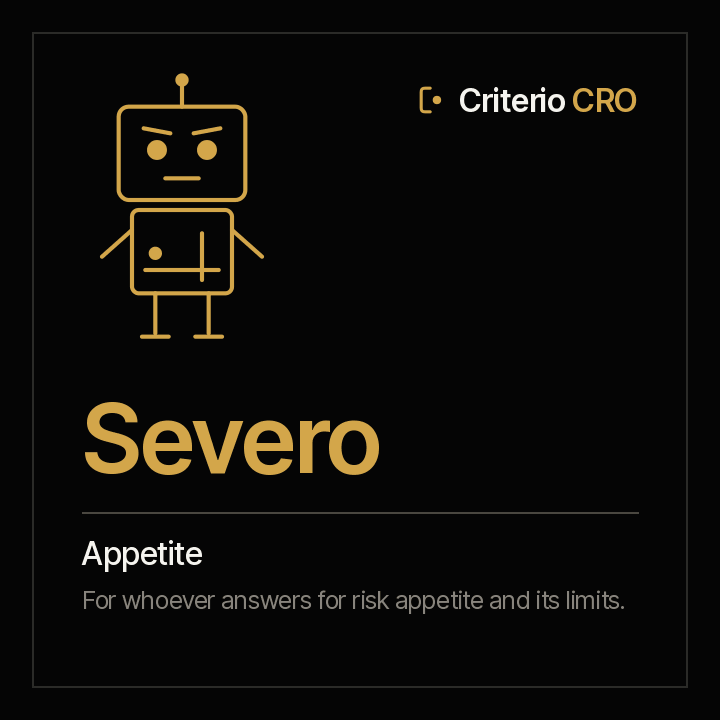

<picture><source media="(prefers-color-scheme: dark)" srcset="../../docs/img/marca/en/criterio-cro-oscuro.svg"></picture>

# Severo · risk appetite



**Severo puts each exposure next to its limit.**
You are responsible for the organisation's risk appetite. He comes with each exposure the areas report next to its limit and its plan: the limit breached with no plan or approval, the late report, the limit with no owner or past its review, the high risk in the register with no limit or indicator and the appetite statement the board has not reviewed within the framework's period.

<!-- agente:nombre · generado por scripts/familias.py; no se edita a mano -->
**The name.** Severo, from the Latin *severus*, the one who makes no concessions: each exposure against its limit.
<!-- /agente:nombre -->

[Español](README.es.md) · `criterio-risk-appetite` · Apache 2.0 · One instance per entity

**Status: built, in testing, with the CRO family.** The calculation engine, tested against all the family’s synthetic material with a key the agent never sees and control entities. In 0.2.0, the agent ran on every entity in the material, with a key it never sees; it has not been tested on a specific organisation’s documentation.

**This page stands on its own.** Severo works without the family’s other agent. The family —how they meet each other and Rostrum— is in the [criterio-cro family](../../families/criterio-cro/README.md).

---

## What it is

| | |
|---|---|
| **Who it extends** | Whoever answers for enterprise risk management —the CRO or the second-line risk manager— and whoever keeps the appetite framework and its limits |
| **What it works on** | **An entity's appetite framework and limits, period by period** |
| **What it looks at** | The appetite statement, the risk register, the limits, the key indicators, the exposure the areas report, the action plans and the minutes of the risk committee and the board |
| **Cadence** | When a period's exposure, a set of minutes or a framework change arrives, and once a week |
| **Instances** | One per entity |

## What it does

**What it does that is not done by hand today: putting everything, not a sample, next to its source.**

**What it can answer:** which exposure exceeds its limit with no plan or approval, which area reported late, which limit has no owner or is past its review, which high risk has no limit or indicator and whether the board reviewed the appetite statement on time.

<!-- cro:comandos · generado por scripts/familias.py; no se edita a mano -->
### The eight commands

> They are typed with the plugin prefix: `/criterio-risk-appetite:` and autocomplete does the rest. It is the only form that resolves in a Claude Code session.

| Command | What it does |
|---|---|
| `/criterio-risk-appetite:appetite-setup` | The configuration, the inventory and the recognised tables |
| `/criterio-risk-appetite:severo` | Whatever you need, in your own words: Severo picks the command that does it and runs it |
| `/criterio-risk-appetite:appetite-scan` | The period's record up to date |
| `/criterio-risk-appetite:limit-check` | Which limit is breached without anyone having dealt with it |
| `/criterio-risk-appetite:framework-check` | Which part of the framework has no owner or no review |
| `/criterio-risk-appetite:coverage-check` | Which high risk has nothing to be measured against |
| `/criterio-risk-appetite:appetite-wake` | The limits up to date without anyone having to remember |
| `/criterio-risk-appetite:share-findings` | A summary with no data, only if the answer is yes |
<!-- /cro:comandos -->

`appetite-setup` goes first because the others need it, and `appetite-wake` is the one you put on a clock.

<!-- cro:skills · generado por scripts/familias.py; no se edita a mano -->
### The three skills

They load on their own when the subject comes up. They are the knowledge the commands share, and they are consulted like a manual.

| Skill | What it encapsulates | Whose it is |
|---|---|---|
| `appetite-record` | How the board's review of the appetite statement and each breach the committee approved go into the record, with their citation | Own |
| `risk-intake` | The recommended structure of the risk folder, what goes in each folder and which agent uses it | Own · also in Casandra |
| `risk-policy` | The appetite framework's deadlines in the configuration, and what is never decided | Own · also in Casandra |
<!-- /cro:skills -->

## What it costs today

<!-- cro:cifras · generado por scripts/familias.py; no se edita a mano -->
| Figure | Source |
|---|---|
| **30%** of organizations describe their risk oversight processes as mature or robust | [AICPA y CIMA con la Iniciativa ERM de la Universidad Estatal de Carolina del Norte, The State of Risk Oversight, 17.ª edición, 2026](https://www.aicpa-cima.com/news/article/rising-risk-complexity-outpaces-organizations-strategic-readiness-finds-new-aicpa-and-north-carolina-state-university-study) — 331 senior executives and board-level leaders |
| **29%** of organizations have a formally articulated risk appetite in their strategic planning | [AICPA y CIMA con la Iniciativa ERM de la Universidad Estatal de Carolina del Norte, The State of Risk Oversight, 17.ª edición, 2026](https://www.aicpa-cima.com/news/article/rising-risk-complexity-outpaces-organizations-strategic-readiness-finds-new-aicpa-and-north-carolina-state-university-study) — 331 senior executives and board-level leaders |
| **11%** of organizations say their risk management gives them a strategic or competitive advantage | [AICPA y CIMA con la Iniciativa ERM de la Universidad Estatal de Carolina del Norte, The State of Risk Oversight, 17.ª edición, 2026](https://www.aicpa-cima.com/news/article/rising-risk-complexity-outpaces-organizations-strategic-readiness-finds-new-aicpa-and-north-carolina-state-university-study) — 331 senior executives and board-level leaders |
<!-- /cro:cifras -->

## What it is for

`/criterio-risk-appetite:limit-check` puts each case next to its source. **What is missing is said with its citation.**

### And what it is not for

- **It does not set or change a limit, approve a breach or accept a risk.** It says what is outside and with what citation; the decision is the board's, the risk committee's and the areas'.
- **It does not calculate capital, value at risk or expected loss.** It processes the figures the areas and the organisation's models report; it does not replace them.
- **It does not connect to a system.** It processes the exports the organisation gives it.

And one that has to be said out loud: **your documents are processed on the AI platform’s infrastructure**, not only on your computer. A risk register or committee minutes may contain confidential information: confirm it is admissible under your policy before pointing it at that folder. Full disclaimer in [DISCLAIMER.md](../../DISCLAIMER.md), terms in [TERMS.md](../../TERMS.md).

## Installation and setup

```
/plugin marketplace add josenanez/criterio
/plugin install criterio-risk-appetite@criterio
/criterio-risk-appetite:appetite-setup
```

### The first result

`/criterio-risk-appetite:appetite-setup` does not ask you to tidy anything before starting. It looks at the entity’s risk folder, compares it with the [recommended structure](../../families/criterio-cro/README.md#the-recommended-folder-structure), processes the appetite framework and asks the questions no document answers. Within the first fifteen minutes it shows the first result.

### How often it runs

`/criterio-risk-appetite:appetite-wake` is the command the clock calls: it does what is due, first answers the questions someone left in Rostrum, and **if nothing is due it produces nothing.** Deciding what is due is date arithmetic, and the code does it:

```
python3 scripts/riesgos.py despertar --config <file>
```

## Teamwork

| With whom | What happens |
|---|---|
| **Casandra** | They share the folder and the appetite framework; each writes only its own record |
| **Rostrum** | Only if the configuration says so (`publish_rostrum`): it publishes its reports, what is due and its signals for whoever does not open a folder, and returns the questions left by whoever views it. **It does not write to the state** |

## Tests

[`scripts/riesgos.py`](scripts/riesgos.py), with the standard library, does everything that is calculation: it processes each table with its source row, compares each exposure with its limit in its direction, counts days against the framework's deadlines and matches the register against the limits and the indicators, the same result every time. It lives in `criterio-risk-appetite` and is copied to Casandra; `scripts/sincronizar.py --check` fails if the copy drifts.

```
python3 scripts/riesgos.py selftest
python3 tests/criterio-cro/generar.py
python3 tests/criterio-cro/evaluar.py
```

What is planted in each entity and **what the material does not test**, in [`EVIDENCIA.md`](../../tests/criterio-cro/EVIDENCIA.md). The design, with the input, process and report of each command, in the [family design](../../families/criterio-cro/DISENO.md).
