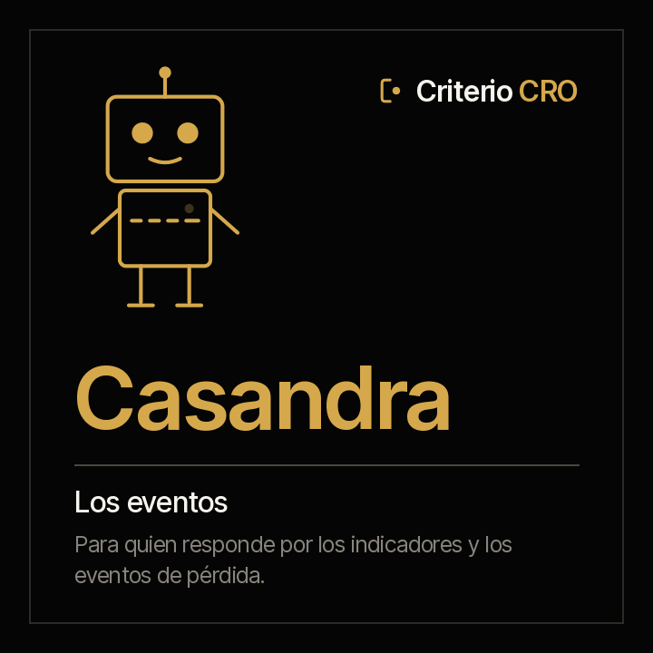

<picture><source media="(prefers-color-scheme: dark)" srcset="../../docs/img/marca/es/criterio-cro-oscuro.svg"></picture>

# Casandra · los indicadores y los eventos



**Casandra pone cada aviso al lado de lo que se hizo con él.**
Tú respondes por los indicadores clave de riesgo y la base de eventos de pérdida. Ella llega con cada indicador al lado de su umbral y cada evento al lado de su registro: el indicador en alerta sin acción, el que no se reportó, el evento sin causa, sin monto o sin proceso, el que se registró tarde, el que se repite en el mismo proceso y el que no está en la matriz de riesgos.

<!-- agente:nombre · generado por scripts/familias.py; no se edita a mano -->
**El nombre.** Casandra, la que anunciaba lo que venía: cada indicador que avisa antes.
<!-- /agente:nombre -->

[English](README.md) · `criterio-risk-events` · Apache 2.0 · Una instancia por entidad

**Estado: construida, en pruebas, con la familia CRO.** El motor de cálculo, probado contra todo el material sintético de la familia con una clave que la agente no ve y entidades de control. La ronda con la agente viene en la 0.2.0, y no se ha probado sobre la documentación de una organización concreta.

**Esta página se lee sola.** Casandra funciona sin el otro agente de la familia. La familia —cómo se encuentran entre sí y con Rostrum— está en la [familia criterio-cro](../../families/criterio-cro/README.es.md).

---

## Qué es

| | |
|---|---|
| **A quién extiende** | A quien responde por el riesgo operacional y los indicadores clave —el CRO o el líder de riesgo operacional— y a quien lleva la base de eventos de pérdida |
| **Sobre qué trabaja** | **Los indicadores clave y la base de eventos de una entidad, periodo a periodo** |
| **Qué mira** | Los indicadores clave con sus umbrales, sus valores y sus acciones, la base de eventos de pérdida, la matriz de riesgos y las actas del comité de riesgos |
| **Cadencia** | Cuando llegan los valores de un periodo, un evento nuevo o un acta, y una vez por semana |
| **Instancias** | Una por entidad |

## Qué hace

**Lo que hace y hoy no se hace a mano: poner todo, no una muestra, al lado de su fuente.**

**Lo que puede responder:** qué indicador está en alerta sin una acción, cuál no se reportó, qué evento no tiene causa, monto o proceso, cuál se registró fuera de plazo, qué se repite en el mismo proceso y qué evento no corresponde a ningún riesgo de la matriz.

<!-- cro:comandos · generado por scripts/familias.py; no se edita a mano -->
### Los ocho comandos

> Se escriben con el prefijo del plugin: `/criterio-risk-events:` y autocompletar hace el resto. Es la única forma que resuelve en una sesión de Claude Code.

| Comando | Qué hace |
|---|---|
| `/criterio-risk-events:events-setup` | La configuración, el inventario y las tablas reconocidas |
| `/criterio-risk-events:casandra` | Lo que necesites, en tus palabras: Casandra elige el comando que lo resuelve y lo corre |
| `/criterio-risk-events:events-scan` | La ficha del periodo al día |
| `/criterio-risk-events:kri-check` | Qué aviso llegó y nadie atendió |
| `/criterio-risk-events:event-check` | Qué evento no está completo ni a tiempo |
| `/criterio-risk-events:pattern-check` | Qué evento se repite y cuál la matriz no ve |
| `/criterio-risk-events:events-wake` | Los eventos al día sin que nadie se acuerde |
| `/criterio-risk-events:share-findings` | Un resumen sin datos, solo si se dice que sí |
<!-- /cro:comandos -->

`events-setup` va primero porque los demás lo necesitan, y `events-wake` es el que se le pone a un reloj.

<!-- cro:skills · generado por scripts/familias.py; no se edita a mano -->
### Los tres skills

Se cargan solos cuando el tema aparece. Son el conocimiento que los comandos comparten, y se consultan como un manual.

| Skill | Qué encapsula | De quién es |
|---|---|---|
| `kri-record` | Cómo se lleva a la ficha cada acción sobre un indicador clave que quedó en un acta, con la cita | Propio |
| `risk-intake` | La estructura recomendada de la carpeta de riesgos, qué va en cada carpeta y qué agente la usa | Copia de Severo |
| `risk-policy` | Los plazos del marco de apetito en la configuración, y lo que nunca se decide | Copia de Severo |
<!-- /cro:skills -->

## Lo que cuesta hoy

<!-- cro:cifras · generado por scripts/familias.py; no se edita a mano -->
<!-- /cro:cifras -->

## Para qué sirve

`/criterio-risk-events:kri-check` pone cada caso al lado de su fuente. **Lo que falta se dice con su cita.**

### Y para qué no sirve

- **No fija un umbral, no califica un riesgo y no cierra un evento.** Dice qué está fuera y con qué cita; la decisión es del comité de riesgos y de las áreas.
- **No calcula una pérdida esperada ni capital.** Suma los montos que trae la base; no modela.
- **No se conecta a un sistema.** Procesa las exportaciones que la organización le entrega.

Y una que hay que decir en voz alta: **tus documentos se procesan en la infraestructura de la plataforma de IA**, no solo en tu equipo. Una base de eventos o un acta del comité pueden traer información confidencial: confirma que sea admisible bajo tu política antes de apuntarla a esa carpeta. Descargo completo en [DISCLAIMER.es.md](../../DISCLAIMER.es.md), términos en [TERMS.es.md](../../TERMS.es.md).

## Instalación y configuración

```
/plugin marketplace add josenanez/criterio
/plugin install criterio-risk-events@criterio
/criterio-risk-events:events-setup
```

### El primer resultado

`/criterio-risk-events:events-setup` no te pide que ordenes nada antes de empezar. Mira la carpeta de riesgos de la entidad, la compara con la [estructura recomendada](../../families/criterio-cro/README.es.md#la-estructura-de-carpetas-recomendada), procesa la política de riesgo operacional y hace las preguntas que ningún documento responde. En los primeros quince minutos deja ver el primer resultado.

### Cada cuánto corre

`/criterio-risk-events:events-wake` es el comando que el reloj invoca: hace lo que toca, responde primero las preguntas que alguien dejó en Rostrum, y **si no toca nada no produce nada.** La decisión de qué toca es aritmética de fechas, y la toma el código:

```
python3 scripts/riesgos.py despertar --config <archivo>
```

## Trabajo en equipo

| Con quién | Qué pasa |
|---|---|
| **Severo** | Comparten la carpeta y el marco de apetito; cada uno escribe solo su ficha |
| **Rostrum** | Solo si la configuración lo dice (`publish_rostrum`): publica sus reportes, lo que vence y sus señales para quien no abre una carpeta, y le devuelve las preguntas que deja quien lo mira. **No escribe en el estado** |

## Pruebas

[`scripts/riesgos.py`](scripts/riesgos.py), con la librería estándar, hace todo lo que es cálculo: procesa cada tabla con su fila de origen, compara cada indicador con sus umbrales en su sentido, cuenta los días de registro de cada evento contra el plazo de la política y agrupa los eventos que se repiten, el mismo resultado cada vez. Vive en `criterio-risk-appetite` y se copia a Casandra; `scripts/sincronizar.py --check` falla si la copia se separa.

```
python3 scripts/riesgos.py selftest
python3 tests/criterio-cro/generar.py
python3 tests/criterio-cro/evaluar.py
```

Qué se siembra en cada entidad y **qué no prueba el material**, en [`EVIDENCIA.md`](../../tests/criterio-cro/EVIDENCIA.md). El diseño, con la entrada, el proceso y el reporte de cada comando, en el [diseño de la familia](../../families/criterio-cro/DISENO.es.md).
