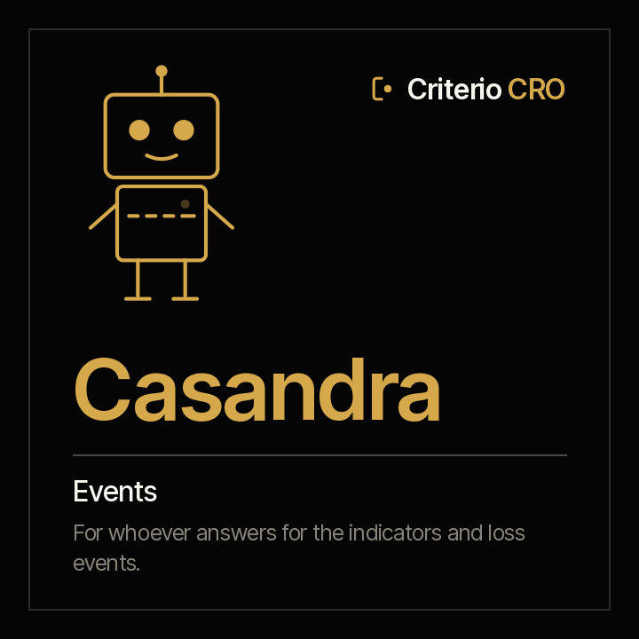

<picture><source media="(prefers-color-scheme: dark)" srcset="../../docs/img/marca/en/criterio-cro-oscuro.svg"></picture>

# Casandra · indicators and events



**Casandra puts each warning next to what was done about it.**
You are responsible for the key risk indicators and the loss event database. She comes with each indicator next to its threshold and each event next to its record: the indicator on alert with no action, the one not reported, the event with no cause, amount or process, the one registered late, the one repeating in the same process and the one missing from the risk register.

<!-- agente:nombre · generado por scripts/familias.py; no se edita a mano -->
**The name.** Casandra, the one who foretold what was coming: each indicator that warns ahead.
<!-- /agente:nombre -->

[Español](README.es.md) · `criterio-risk-events` · Apache 2.0 · One instance per entity

**Status: built and tested, in the lab, with the CRO family.** The calculation engine, tested against all the family’s synthetic material with a key the agent never sees and control entities. In 0.2.0, the agent ran on every entity in the material, with a key it never sees; it has not been tested on a specific organisation’s documentation.

**This page stands on its own.** Casandra works without the family’s other agent. The family —how they meet each other and Rostrum— is in the [criterio-cro family](../../families/criterio-cro/README.md).

---

## What it is

| | |
|---|---|
| **Who it extends** | Whoever answers for operational risk and key indicators —the CRO or the operational risk lead— and whoever keeps the loss event database |
| **What it works on** | **An entity's key indicators and event database, period by period** |
| **What it looks at** | The key indicators with their thresholds, values and actions, the loss event database, the risk register and the risk committee's minutes |
| **Cadence** | When a period's values, a new event or a set of minutes arrives, and once a week |
| **Instances** | One per entity |

## What it does

**What it does that is not done by hand today: putting everything, not a sample, next to its source.**

**What it can answer:** which indicator is on alert with no action, which one was not reported, which event has no cause, amount or process, which was registered late, what repeats in the same process and which event belongs to no risk in the register.

<!-- cro:comandos · generado por scripts/familias.py; no se edita a mano -->
### The eight commands

> They are typed with the plugin prefix: `/criterio-risk-events:` and autocomplete does the rest. It is the only form that resolves in a Claude Code session.

| Command | What it does |
|---|---|
| `/criterio-risk-events:events-setup` | The configuration, the inventory and the recognised tables |
| `/criterio-risk-events:casandra` | Whatever you need, in your own words: Casandra picks the command that does it and runs it |
| `/criterio-risk-events:events-scan` | The period's record up to date |
| `/criterio-risk-events:kri-check` | Which warning arrived and nobody dealt with |
| `/criterio-risk-events:event-check` | Which event is neither complete nor on time |
| `/criterio-risk-events:pattern-check` | Which event repeats and which one the register does not see |
| `/criterio-risk-events:events-wake` | The events up to date without anyone having to remember |
| `/criterio-risk-events:share-findings` | A summary with no data, only if the answer is yes |
<!-- /cro:comandos -->

`events-setup` goes first because the others need it, and `events-wake` is the one you put on a clock.

<!-- cro:skills · generado por scripts/familias.py; no se edita a mano -->
### The three skills

They load on their own when the subject comes up. They are the knowledge the commands share, and they are consulted like a manual.

| Skill | What it encapsulates | Whose it is |
|---|---|---|
| `kri-record` | How each action on a key indicator agreed in the minutes goes into the record, with its citation | Own |
| `risk-intake` | The recommended structure of the risk folder, what goes in each folder and which agent uses it | Copy of Severo's |
| `risk-policy` | The appetite framework's deadlines in the configuration, and what is never decided | Copy of Severo's |
<!-- /cro:skills -->

## What it costs today

<!-- cro:cifras · generado por scripts/familias.py; no se edita a mano -->
<!-- /cro:cifras -->

## What it is for

`/criterio-risk-events:kri-check` puts each case next to its source. **What is missing is said with its citation.**

### And what it is not for

- **It does not set a threshold, rate a risk or close an event.** It says what is outside and with what citation; the decision is the risk committee's and the areas'.
- **It does not calculate expected loss or capital.** It adds up the amounts in the database; it does not model.
- **It does not connect to a system.** It processes the exports the organisation gives it.

And one that has to be said out loud: **your documents are processed on the AI platform’s infrastructure**, not only on your computer. An event database or committee minutes may contain confidential information: confirm it is admissible under your policy before pointing it at that folder. Full disclaimer in [DISCLAIMER.md](../../DISCLAIMER.md), terms in [TERMS.md](../../TERMS.md).

## Installation and setup

```
/plugin marketplace add josenanez/criterio
/plugin install criterio-risk-events@criterio
/criterio-risk-events:events-setup
```

### The first result

`/criterio-risk-events:events-setup` does not ask you to tidy anything before starting. It looks at the entity’s risk folder, compares it with the [recommended structure](../../families/criterio-cro/README.md#the-recommended-folder-structure), processes the operational risk policy and asks the questions no document answers. Within the first fifteen minutes it shows the first result.

### How often it runs

`/criterio-risk-events:events-wake` is the command the clock calls: it does what is due, first answers the questions someone left in Rostrum, and **if nothing is due it produces nothing.** Deciding what is due is date arithmetic, and the code does it:

```
python3 scripts/riesgos.py despertar --config <file>
```

## Teamwork

| With whom | What happens |
|---|---|
| **Severo** | They share the folder and the appetite framework; each writes only its own record |
| **Rostrum** | Only if the configuration says so (`publish_rostrum`): it publishes its reports, what is due and its signals for whoever does not open a folder, and returns the questions left by whoever views it. **It does not write to the state** |

## Tests

[`scripts/riesgos.py`](scripts/riesgos.py), with the standard library, does everything that is calculation: it processes each table with its source row, compares each indicator with its thresholds in its direction, counts each event's registration days against the policy's deadline and groups the events that repeat, the same result every time. It lives in `criterio-risk-appetite` and is copied to Casandra; `scripts/sincronizar.py --check` fails if the copy drifts.

```
python3 scripts/riesgos.py selftest
python3 tests/criterio-cro/generar.py
python3 tests/criterio-cro/evaluar.py
```

What is planted in each entity and **what the material does not test**, in [`EVIDENCIA.md`](../../tests/criterio-cro/EVIDENCIA.md). The design, with the input, process and report of each command, in the [family design](../../families/criterio-cro/DISENO.md).
