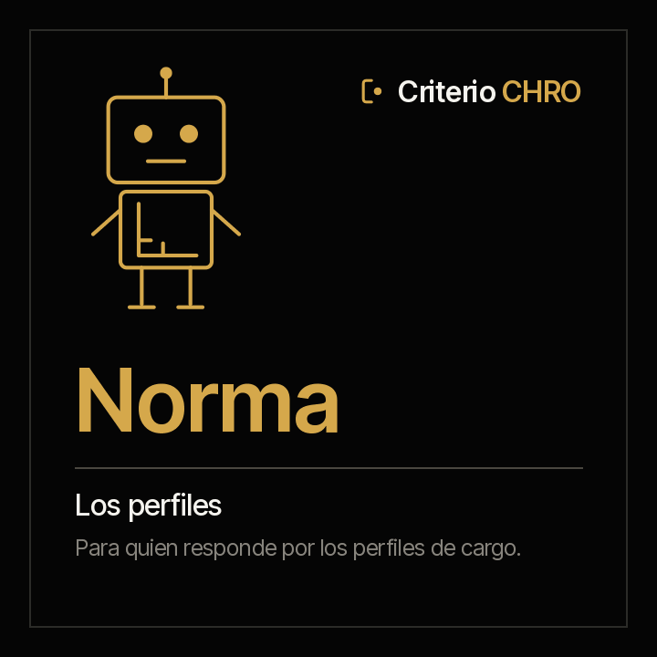

<picture><source media="(prefers-color-scheme: dark)" srcset="../../docs/img/marca/es/criterio-chro-oscuro.svg"></picture>

# Norma · los perfiles de cargo



**Norma pone cada perfil de cargo sobre un estándar.**
Tú respondes por los perfiles de cargo y el manual de funciones. Ella llega con cada perfil al lado de la ocupación de su estándar —la CUOC del DANE u O*NET—: las destrezas y los conocimientos que no recoge, los requisitos que no se apoyan en ninguna tarea, lo que pide y la ley no permite pedir, el nivel de estudios que no corresponde a la ocupación y los perfiles que se solapan.

<!-- agente:nombre · generado por scripts/familias.py; no se edita a mano -->
**El nombre.** Norma, del latín *norma*, la escuadra del carpintero: cada perfil sobre un estándar.
<!-- /agente:nombre -->

[English](README.md) · `criterio-roles` · Apache 2.0 · Una instancia por entidad

**Estado: lanzado y estable, con la familia CHRO.** El motor de cálculo, probado contra todo el material sintético de la familia con una clave que el agente no ve, entidades de control y la prueba de sesgo con pares de candidatos; con el agente, las rondas 1 y 2 sobre la banca de Colombia y su control. El resto del material todavía no corre con el agente, y no se ha probado sobre la documentación de una organización concreta.

**Esta página se lee sola.** Norma funciona sin el otro agente de la familia. La familia —cómo se encuentran entre sí y con Rostrum— está en la [familia criterio-chro](../../families/criterio-chro/README.es.md).

---

## Qué es

| | |
|---|---|
| **A quién extiende** | A quien responde por la gestión humana —el CHRO, el jefe de compensación o de desarrollo organizacional— y a quien diseña o actualiza los perfiles de cargo |
| **Sobre qué trabaja** | **Los perfiles de cargo de una entidad**, periodo a periodo |
| **Qué mira** | Los perfiles de cargo, el manual de funciones y la descarga oficial del estándar de ocupaciones |
| **Cadencia** | Cuando llega un perfil nuevo o cambiado, cuando vence una revisión, y una vez por semana |
| **Instancias** | Una por entidad |

## Qué hace

**Lo que hace y hoy no se hace: poner todos los perfiles, no una muestra, al lado de la ocupación de su estándar**, con cada requisito atado a una tarea.

**Lo que puede responder:** qué perfil no tiene ocupación, qué destreza de su ocupación no recoge, qué requisito no se apoya en ninguna tarea, qué perfil pide la edad, el estado civil o un dato sensible, qué perfil pide un título que su ocupación no exige y qué perfiles son el mismo con otro nombre.

<!-- chro:comandos · generado por scripts/familias.py; no se edita a mano -->
### Los nueve comandos

> Se escriben con el prefijo del plugin: `/criterio-roles:` y autocompletar hace el resto. Es la única forma que resuelve en una sesión de Claude Code.

| Comando | Qué hace |
|---|---|
| `/criterio-roles:roles-setup` | La configuración, el inventario y el estándar reconocido |
| `/criterio-roles:norma` | Lo que necesites, en tus palabras: Norma elige el comando que lo resuelve y lo corre |
| `/criterio-roles:roles-scan` | La ficha del periodo al día |
| `/criterio-roles:profile-build` | Un borrador de perfil sobre un estándar |
| `/criterio-roles:profile-check` | Cada perfil contra su estándar |
| `/criterio-roles:profile-language` | Los requisitos que piden lo que no se puede pedir |
| `/criterio-roles:profile-map` | El mapa de los perfiles de la organización |
| `/criterio-roles:roles-wake` | Lo que toca hoy en los perfiles |
| `/criterio-roles:share-findings` | Un resumen sin datos, solo si se dice que sí |
<!-- /chro:comandos -->

`roles-setup` va primero porque los demás lo necesitan, y `roles-wake` es el que se le pone a un reloj. Entre los dos, los que preparan el trabajo: qué cambió, un perfil nuevo desde su ocupación, los perfiles contra su ocupación, lo que no se puede pedir y el mapa.

<!-- chro:skills · generado por scripts/familias.py; no se edita a mano -->
### Los tres skills

Se cargan solos cuando el tema aparece. Son el conocimiento que los comandos comparten, y se consultan como un manual.

| Skill | Qué encapsula | De quién es |
|---|---|---|
| `occupation-standard` | El estándar de ocupaciones: la descarga oficial de la CUOC o de O*NET, el código de cada ocupación, el umbral de importancia de O*NET, el nivel de competencia y la equivalencia de los estudios de la organización con la CINE | Propio |
| `profile-record` | Cómo se lleva un perfil de cargo a la ficha: su ocupación, sus tareas, cada requisito con la tarea y el elemento del estándar que lo apoyan, sus estudios, lo que no aplica con su motivo y su revisión | Propio |
| `talent-intake` | La estructura recomendada de la carpeta de talento, qué va en cada carpeta y qué agente la usa, cómo se nombran los perfiles, las carpetas de los candidatos y las exportaciones, y qué nunca se pide ni se trata | Propio · también en Cándido |
<!-- /chro:skills -->

## Lo que cuesta hoy

<!-- chro:cifras · generado por scripts/familias.py; no se edita a mano -->
| Cifra | Fuente |
|---|---|
| **72 %** de los empleadores dice que le cuesta cubrir sus vacantes, frente al 74 % del año anterior | [ManpowerGroup, 2026 Global Talent Shortage Survey, comunicado del 26 de febrero de 2026, 2026](https://investor.manpowergroup.com/node/68796) — 39.063 empleadores de 41 países, entre ellos Argentina, Brasil, Chile, Colombia, Costa Rica, Guatemala, México, Panamá y Perú; trabajo de campo del 1 al 31 de octubre de 2025 |
| **Más de 3 de cada 4** responsables de selección encontraron discrepancias en lo que declaraban sus candidatos en los últimos doce meses | [HireRight, 2025 Global Benchmark Report, comunicado en Business Wire, 2025](https://www.businesswire.com/news/home/20250915364914/en) — Más de 1.000 profesionales de recursos humanos, riesgo y adquisición de talento en el mundo; el informe se publicó en junio de 2025 |
| **39 días** tarda, en la mediana, cubrir una vacante que no es de dirección | [SHRM, 2026 Recruiting Executives Benchmarking, 2026](https://www.shrm.org/topics-tools/research/2025-recruiting-benchmarking) — Datos de más de 4.600 organizaciones; la página no dice el país ni las fechas de recolección |
<!-- /chro:cifras -->

## Para qué sirve

`/criterio-roles:profile-check` pone cada perfil al lado de su ocupación en la descarga del estándar. **Lo que le falta, el requisito sin tarea y el nivel de estudios que no corresponde se dicen con su cita.**

### Y para qué no sirve

- **No aprueba un perfil.** Dice qué le falta frente a su estándar; la decisión es de una persona.
- **No fija un salario, un cargo ni una estructura.**
- **No evalúa a una persona.** Eso es de la selección, y ahí tampoco decide el agente.
- **No copia el texto de una norma de pago.** Las normas ISO se citan por su número.

Y una que hay que decir en voz alta: **tus documentos se procesan en la infraestructura de la plataforma de IA**, no solo en tu equipo. Una hoja de vida trae datos personales: confirma que sea admisible bajo tu política de datos antes de apuntarla a esa carpeta. Descargo completo en [DISCLAIMER.es.md](../../DISCLAIMER.es.md), términos en [TERMS.es.md](../../TERMS.es.md).

## Instalación y configuración

**Ya está en el marketplace**:

```
/plugin marketplace add josenanez/criterio
/plugin install criterio-roles@criterio
/criterio-roles:roles-setup
```

### El primer resultado

`/criterio-roles:roles-setup` no te pide que ordenes nada antes de empezar. Mira la carpeta de talento de la entidad, la compara con la [estructura recomendada](../../families/criterio-chro/README.es.md#la-estructura-de-carpetas-recomendada), reconoce la descarga del estándar y hace las preguntas que ningún documento responde: qué estándar, desde qué importancia una destreza es exigible en O*NET y qué nivel de la CINE corresponde a cada forma de nombrar los estudios. En los primeros quince minutos deja ver el primer resultado: cada perfil contra su ocupación.

### Cada cuánto corre

`/criterio-roles:roles-wake` es el comando que el reloj invoca: hace lo que toca, responde primero las preguntas que alguien dejó en Rostrum, y **si no toca nada no produce nada.** La decisión de qué toca es aritmética de fechas, y la toma el código:

```
python3 scripts/talento.py despertar --config <archivo>
```

## Trabajo en equipo

| Con quién | Qué pasa |
|---|---|
| **Cándido** | Comparten la carpeta y la referencia. Cándido contrasta cada candidato con los perfiles que procesó Norma |
| **Rostrum** | Publica sus reportes, lo que vence y sus señales para quien no abre una carpeta, y le devuelve las preguntas que deja quien lo mira. **No escribe en el estado** |

## Pruebas

[`scripts/talento.py`](scripts/talento.py), con la librería estándar, hace todo lo que es cálculo: procesa la descarga del estándar y cada tabla con su fila de origen, cuenta los días contra los plazos de la política, contrasta cada requisito y cada afirmación con su evidencia y deja fuera lo que no se trata, el mismo resultado cada vez. Vive en `criterio-roles` y se copia a `criterio-talent`; `scripts/sincronizar.py --check` falla si la copia se separa.

```
python3 scripts/talento.py selftest                          el motor y la prueba de sesgo
python3 tests/criterio-chro/generar.py                       el material
python3 tests/criterio-chro/evaluar.py --agente norma       cada señal contra la clave
```

Qué se siembra en cada entidad y **qué no prueba el material**, en [`EVIDENCIA.md`](../../tests/criterio-chro/EVIDENCIA.md). El diseño, con la entrada, el proceso y el reporte de cada comando, en el [diseño de la familia](../../families/criterio-chro/DISENO.es.md).
