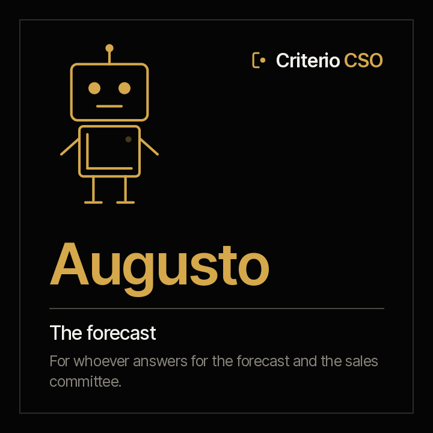

<picture><source media="(prefers-color-scheme: dark)" srcset="../../docs/img/marca/en/criterio-cco-oscuro.svg"></picture>

# Augusto · the forecast



**Augusto puts the pipeline next to its evidence and the forecast next to what backs it.** You answer
for the forecast and run the sales committee. He arrives with every opportunity against the document
its stage requires, the stalled ones, the close dates that slip, what was committed against what backs
it and the target against what closed.

<!-- agente:nombre · generado por scripts/familias.py; no se edita a mano -->
**The name.** Augusto, from the Latin *augur*, the one who reads the signs before they happen: the forecast against what backs it.
<!-- /agente:nombre -->

[Español](README.es.md) · `criterio-sales` · Apache 2.0 · One instance per entity

**Status: laboratory, not yet launched (version 0.1.0).** The six commands, the four skills and the
calculation engine, tested against synthetic material from Colombia and Mexico with a key the agent
never sees and one control entity per country. It can already be installed from the marketplace.
**The round with the agent is the next step**, in 0.2.0. Nothing is announced as finished until the
[acceptance criteria](ACCEPTANCE.md) pass.

**This page reads on its own.** Augusto works without Valeria: if you only answer for the forecast, everything is here, tests included. The family —how he meets Valeria and Rostrum— is in the
[criterio-cco family](../../families/criterio-cco/README.md).

---

## What it is

| | |
|---|---|
| **Who it extends** | The head of sales and whoever prepares the sales committee |
| **What it works on** | **An entity's pipeline**, period by period |
| **What it looks at** | The CRM's dated opportunity exports, each opportunity's evidence, the committee minutes, the stage table and the targets |
| **Cadence** | When a new export or new minutes arrive, when the period closes within the week, and once a week |
| **Instances** | One per entity |

## What it does

**What it does and today does not get done: checking every opportunity, not a sample, against the
document its stage requires**, and separating the committed forecast that has documents from what does not.

**What it can answer that today takes hours before every committee:** which opportunity is in negotiation
with no proposal sent, which one has had no activity for weeks, which one slipped its close date three times,
how much of what was committed is backed by documents and how what closed is doing against the target at the
cut-off.

<!-- cco:comandos · generado por scripts/familias.py; no se edita a mano -->
### The six commands

> They are typed with the plugin prefix: `/criterio-sales:` and autocomplete does the rest. It is the only form that resolves in a Claude Code session.

| Command | What it does |
|---|---|
| `/criterio-sales:sales-setup` | The configuration, the inventory and the format of each CRM export |
| `/criterio-sales:pipeline-scan` | The period record up to date, with what changed in the pipeline and the new signals |
| `/criterio-sales:pipeline-check` | Every opportunity against its evidence: the one without it, the stalled one and the one whose close date slips |
| `/criterio-sales:forecast-check` | The committed forecast against what backs it, opportunity by opportunity |
| `/criterio-sales:target-check` | The period's target against what closed at the cut-off, by line |
| `/criterio-sales:sales-wake` | What is due today in the pipeline; if nothing is due, it stays quiet |
<!-- /cco:comandos -->

`sales-setup` comes first because the others need it, and `sales-wake` is the one you put on a clock.
Between them, the four that prepare the work: what changed in the pipeline, the pipeline against its
evidence, the forecast against its backing and the target against what closed.

<!-- cco:skills · generado por scripts/familias.py; no se edita a mano -->
### The four skills

They load on their own when the subject comes up. They are the knowledge the commands share, and they are consulted like a manual.

| Skill | What it encapsulates | Whose it is |
|---|---|---|
| `crm-exports` | How each CRM export is processed: Salesforce by its field names or labels, HubSpot by its properties, Dynamics 365 and Zoho by their columns, and any CSV or Excel with its column mapping; the stage table and the close-date history | Own · also in Valeria |
| `forecast-backing` | The stage-weighted forecast with and without evidence, the target prorated by the days in the period, and why people are never compared | Own |
| `pipeline-record` | Augusto's period record: every evidence document with its opportunity, type, amount and date, and the committed forecast from the committee minutes, every data point with its citation | Own |
| `sales-intake` | The recommended structure of the sales folder, what goes in each folder and which agent uses it, and how exports and evidence are named | Own · also in Valeria |
<!-- /cco:skills -->

## What it costs today

<!-- cco:cifras · generado por scripts/familias.py; no se edita a mano -->
| Figure | Source |
|---|---|
| **4 in 5** sales and finance leaders missed at least one quarterly sales forecast in the past year; 52% of sales leaders say their forecast is off by 10% or more | [Xactly con Regina Corso Consulting, 2024 Sales Forecasting Benchmark Report, 2024](https://www.xactlycorp.com/sites/default/files/file/2024-07/2024_sales_forecasting_benchmark_report.pdf) — 405 sales, finance and revenue operations professionals in North America, 19 to 28 March 2024 |
| **28%** of their week is what a seller spends selling; 72% goes to other tasks, above all managing deals and entering data | [Salesforce, State of Sales, quinta edición, 2022](https://www.salesforce.com/news/stories/sales-research-2023/) — 7,775 sales professionals in 38 countries across North America, Latin America, Asia-Pacific and Europe, 24 August to 30 September 2022 |
| **84%** of sales leaders say sales analytics had less influence on performance than expected; 44% point to poor data quality | [Gartner, 2023](https://www.gartner.com/en/newsroom/press-releases/2024-02-06-gartner-survey-finds-sales-analytics-has-less-influence-on-sales-performance-than-what-leadership-expected) — 303 sales leaders, July 2023 |
<!-- /cco:cifras -->

## What it is for

`/criterio-sales:forecast-check` puts what the committee committed next to what backs it: what closed and
the opportunities closing in the period with their stage's evidence, each at its stage's probability.
**What is weighted without evidence is shown apart and backs nothing.**

### And what it is not for

- **It does not write or change anything in the CRM**, and does not connect to it: it processes what the CRM exports.
- **It does not propose a forecast or set a target.** Both belong to a person.
- **It does not rate or compare whoever sells.** The forecast and the target are looked at by period and by
  line, never by person.
- **It does not contact a customer**, and the record keeps nobody's email or phone.
- **It does not move, rename or create anything inside the organisation's documents.** The only thing it leaves,
  if the person authorises it, is the file that marks the root folder.
- **It does not guess.** Every data point carries its document's citation and, for tables, the row it came from.

And one that has to be said out loud: **your documents are processed on the AI platform's infrastructure**,
not only on your machine. Confirm that is admissible under your policies before pointing it at confidential
material. Full disclaimer in [DISCLAIMER.md](../../DISCLAIMER.md), terms in [TERMS.md](../../TERMS.md).

## Installation and configuration

**It is not in the marketplace yet**: it comes out with its first version, once it passes the round with the
agent. Then:

```
/plugin marketplace add josenanez/criterio
/plugin install criterio-sales@criterio
/criterio-sales:sales-setup
```

If you answer for the sale through to the invoice rather than the forecast, yours is [Valeria](../criterio-revenue/README.md).

### The first result

`/criterio-sales:sales-setup` does not ask you to tidy anything before starting. It looks at the entity's
sales folder, compares it with the
[recommended structure](../../families/criterio-cco/README.md#the-recommended-folder-structure), recognises
each CRM export's format —Salesforce, HubSpot or another— and asks the questions no document answers:
which column carries each field if the CRM is not one of the two, the stage table, the days without
activity. Within the first fifteen minutes it shows the pipeline against its evidence.

### How often it runs

`/criterio-sales:sales-wake` is the command the clock invokes: it does what is due, first answers the questions
someone left in Rostrum, and **if nothing is due it produces nothing.** Deciding what is due is date
arithmetic, and the code does it:

```
python3 scripts/ventas.py despertar --config <file>
```

## Teamwork

| With whom | What happens |
|---|---|
| **Valeria** | They share the entity's state and the same CRM exports. Valeria takes what was won from there to cross it with contracts and invoices. Each one writes only its own record |
| **Rostrum** | Publishes its reports, what is due and its signals for whoever does not open a folder, and hands back the questions left by whoever looks at it. **It does not write to the state** |

## Tests

### How it is built

The spine is the **period record**: every evidence document of an opportunity with its type, amount and
date, and the committed forecast from the committee minutes, each data point with its citation. The agent
writes it; the engine writes the results.

[`scripts/ventas.py`](scripts/ventas.py), standard library only, does everything that is calculation: it reads each export from its source, compares one cut with another, counts the close dates that slip,
weights the pipeline by stage and prorates the target, the same result every time. It lives here and is
copied to `criterio-revenue` with the `sales-intake` and `crm-exports` skills; `scripts/sincronizar.py --check`
fails if a copy drifts.

Every source used is in [`families/criterio-cco/FUENTES.es.md`](../../families/criterio-cco/FUENTES.es.md)
(Spanish), with its version, link and status.

### How it is verified

```
python3 scripts/ventas.py selftest                       the engine
python3 tests/criterio-cco/generar.py                    the Colombia and Mexico material
python3 tests/criterio-cco/evaluar.py --agente augusto   every signal against the key
```

**How the last run went, generated from the run itself:**
[`tests/criterio-sales/RESULTADOS.md`](../../tests/criterio-sales/RESULTADOS.md). What is seeded in each
entity and **what the material does not test**, in [`EVIDENCIA.md`](../../tests/criterio-cco/EVIDENCIA.md).
The design, with each command's input, process and report, in the
[family's design](../../families/criterio-cco/DISENO.md).
