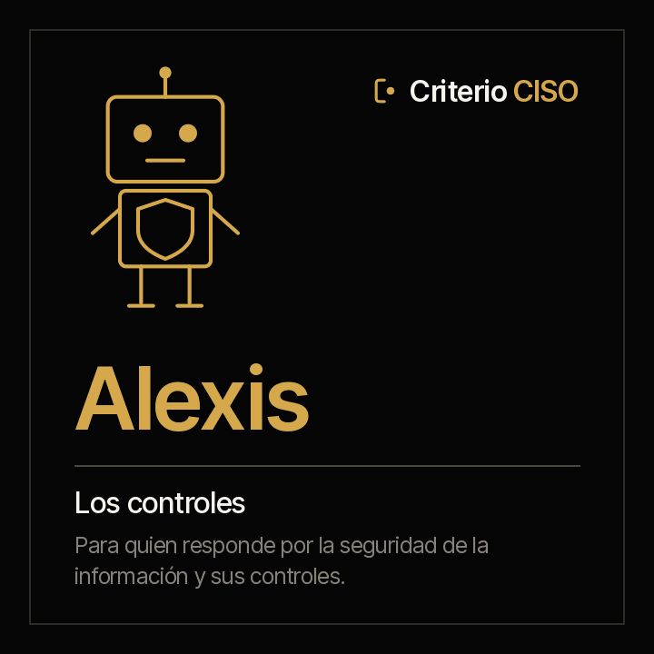

<picture><source media="(prefers-color-scheme: dark)" srcset="../../docs/img/marca/es/criterio-ciso-oscuro.svg"></picture>

# Alexis · el gobierno y los controles



**Alexis pone cada control al lado de la evidencia de que operó.**
Tú respondes por la seguridad de la información y por su sistema de gestión. Él llega con cada control aplicable de la declaración contra la evidencia de que operó en su periodicidad, las revisiones de acceso y las evaluaciones de terceros que vencieron, y las aceptaciones de riesgo que pasaron su fecha.

<!-- agente:nombre · generado por scripts/familias.py; no se edita a mano -->
**El nombre.** Alexis, del griego *Aléxios*, «el que defiende»: cada control contra la evidencia de que operó.
<!-- /agente:nombre -->

[English](README.md) · `criterio-security` · Apache 2.0 · Una instancia por entidad

**Estado: en construcción (versión 0.1.0).** El motor de cálculo, probado contra material sintético de cuatro industrias con una clave que el agente no ve y dos entidades de control. **La ronda con el agente es el siguiente paso**, en la 0.2.0. Nada se anuncia como terminado hasta que pasen los [criterios de aceptación](ACCEPTANCE.md).

**Esta página se lee sola.** Alexis funciona sin los otros dos agentes de la familia. La familia —cómo se encuentran entre sí y con Rostrum— está en la [familia criterio-ciso](../../families/criterio-ciso/README.es.md).

---

## Qué es

| | |
|---|---|
| **A quién extiende** | A quien responde por la seguridad de la información —el CISO, el oficial de seguridad— y a quien prepara el comité de seguridad o la auditoría |
| **Sobre qué trabaja** | **El sistema de gestión de seguridad de una entidad**, periodo a periodo |
| **Qué mira** | La declaración de aplicabilidad, la evidencia de cada control, las revisiones de acceso, las evaluaciones de terceros y el registro de riesgos |
| **Cadencia** | Cuando llega evidencia nueva, cuando vence una revisión o una evaluación, y una vez por semana |
| **Instancias** | Una por entidad |

## Qué hace

**Lo que hace y hoy no se hace: revisar todos los controles aplicables, no una muestra, contra la evidencia de que operaron**, antes de que lo pregunte la auditoría.

**Lo que puede responder que hoy cuesta días antes de una auditoría:** qué control figura implementado y no tiene ninguna evidencia, cuál la tiene vencida, qué sistema lleva meses sin revisión de accesos, qué tercero crítico no se ha evaluado y qué riesgo aceptado nadie volvió a mirar.

<!-- ciso:comandos · generado por scripts/familias.py; no se edita a mano -->
### Los ocho comandos

> Se escriben con el prefijo del plugin: `/criterio-security:` y autocompletar hace el resto. Es la única forma que resuelve en una sesión de Claude Code.

| Comando | Qué hace |
|---|---|
| `/criterio-security:security-setup` | La configuración, el inventario y lo que se excluyó |
| `/criterio-security:security-scan` | La ficha del periodo al día, con la evidencia nueva y las señales nuevas |
| `/criterio-security:soa-status` | Cada control aplicable con su responsable |
| `/criterio-security:control-evidence` | Cada control contra la evidencia de que operó |
| `/criterio-security:access-reviews` | Cada sistema con su revisión de accesos al día o vencida |
| `/criterio-security:third-parties` | Cada tercero crítico con su evaluación al día o vencida |
| `/criterio-security:risk-register` | Cada aceptación de riesgo contra su fecha de revisión |
| `/criterio-security:security-wake` | Lo que tocaba hoy, corrido |
<!-- /ciso:comandos -->

`security-setup` va primero porque los demás lo necesitan, y `security-wake` es el que se le pone a un reloj. Entre los dos, los seis que preparan el trabajo: qué cambió, la declaración, los controles contra su evidencia, los accesos, los terceros y los riesgos.

<!-- ciso:skills · generado por scripts/familias.py; no se edita a mano -->
### Los tres skills

Se cargan solos cuando el tema aparece. Son el conocimiento que los comandos comparten, y se consultan como un manual.

| Skill | Qué encapsula | De quién es |
|---|---|---|
| `control-evidence-record` | Cómo se lleva a la ficha la evidencia de un control, una revisión de accesos y la evaluación de un tercero: qué cuenta como evidencia, la fecha que cubre y la cita | Propio |
| `security-intake` | La estructura recomendada de la carpeta de seguridad, qué va en cada carpeta y qué agente la usa, cómo se nombran la evidencia y las exportaciones, y qué nunca se deja ahí | Propio · también en Guillermo y Amparo |
| `soa-and-risks` | La declaración de aplicabilidad y el registro de riesgos: sus columnas, qué es un control aplicable e implementado, la periodicidad y qué es una aceptación de riesgo con su fecha de revisión | Propio |
<!-- /ciso:skills -->

## Lo que cuesta hoy

<!-- ciso:cifras · generado por scripts/familias.py; no se edita a mano -->
| Cifra | Fuente |
|---|---|
| **31 %** de las brechas empezaron por la explotación de una vulnerabilidad: es la primera vía de entrada, por delante del abuso de credenciales (13 %) | [Verizon, 2026 Data Breach Investigations Report, resumen ejecutivo, 2026](https://www.verizon.com/business/resources/executivebriefs/2026-dbir-executive-summary.pdf) — Más de 31.000 incidentes reales, de ellos más de 22.000 brechas confirmadas, de octubre de 2024 a noviembre de 2025 |
| **26 %** de las vulnerabilidades del catálogo KEV de CISA quedaron corregidas por completo en 2025, frente al 38 % del año anterior; la mediana para corregirlas subió a 43 días | [Verizon, 2026 Data Breach Investigations Report, resumen ejecutivo, 2026](https://www.verizon.com/business/resources/executivebriefs/2026-dbir-executive-summary.pdf) — Las organizaciones del conjunto de datos del informe, de octubre de 2024 a noviembre de 2025 |
| **48 %** de las brechas involucraron a un tercero, un 60 % más que en el informe anterior | [Verizon, 2026 Data Breach Investigations Report, resumen ejecutivo, 2026](https://www.verizon.com/business/resources/executivebriefs/2026-dbir-executive-summary.pdf) — Más de 22.000 brechas confirmadas, de octubre de 2024 a noviembre de 2025 |
<!-- /ciso:cifras -->

## Para qué sirve

`/criterio-security:control-evidence` pone cada control que la declaración da por implementado al lado de la evidencia de la ficha. **Un control sin evidencia, o con la evidencia vencida, se dice con su fila y su responsable.**

### Y para qué no sirve

- **No acepta un riesgo ni declara cumplido un control.** Dice qué falta; la conclusión es de una persona.
- **No califica la madurez de la organización ni la certifica** contra la ISO/IEC 27001.
- **No se conecta a un sistema ni a una consola**: procesa los documentos que la organización deja en la carpeta.
- **No abre credenciales, llaves ni respaldos.** Los lista como excluidos y el reporte dice cuáles.

Y una que hay que decir en voz alta: **tus documentos se procesan en la infraestructura de la plataforma de IA**, no solo en tu equipo. Confirma que sea admisible bajo tus políticas antes de apuntarla a material confidencial. Descargo completo en [DISCLAIMER.es.md](../../DISCLAIMER.es.md), términos en [TERMS.es.md](../../TERMS.es.md).

## Instalación y configuración

**Todavía no está en el marketplace**: sale con su primera versión. Entonces:

```
/plugin marketplace add josenanez/criterio
/plugin install criterio-security@criterio
/criterio-security:security-setup
```

### El primer resultado

`/criterio-security:security-setup` no te pide que ordenes nada antes de empezar. Mira la carpeta de seguridad de la entidad, la compara con la [estructura recomendada](../../families/criterio-ciso/README.es.md#la-estructura-de-carpetas-recomendada), dice qué no va a abrir y hace las preguntas que ningún documento responde: dónde está la declaración de aplicabilidad y qué columna trae cada dato, la frecuencia de las revisiones de acceso y de las evaluaciones. En los primeros quince minutos deja ver el primer resultado: cada control aplicable contra la evidencia de que operó.

### Cada cuánto corre

`/criterio-security:security-wake` es el comando que el reloj invoca: hace lo que toca, responde primero las preguntas que alguien dejó en Rostrum, y **si no toca nada no produce nada.** La decisión de qué toca es aritmética de fechas, y la toma el código:

```
python3 scripts/seguridad.py despertar --config <archivo>
```

## Trabajo en equipo

| Con quién | Qué pasa |
|---|---|
| **Guillermo** | Comparten la carpeta y la referencia de la entidad. Guillermo procesa las vulnerabilidades; Alexis, los controles. Cada uno escribe solo su ficha |
| **Amparo** | Comparten la carpeta y la referencia. Amparo procesa los incidentes y las pruebas de continuidad |
| **Rostrum** | Publica sus reportes, lo que vence y sus señales para quien no abre una carpeta, y le devuelve las preguntas que deja quien lo mira. **No escribe en el estado** |

## Pruebas

### Cómo está construido

La espina es la **ficha del periodo**: cada evidencia de un control con la fecha que cubre, cada revisión de accesos y cada evaluación de un tercero, cada dato con su cita. La escribe el agente; los resultados, el motor.

[`scripts/seguridad.py`](scripts/seguridad.py), con la librería estándar, hace todo lo que es cálculo: procesa cada tabla y cada exportación con su fila de origen, cuenta los días y las horas contra los plazos de la política y excluye lo que nunca se abre, el mismo resultado cada vez. Vive en `criterio-security` y se copia a los otros dos agentes; `scripts/sincronizar.py --check` falla si alguna copia se separa.

### Cómo se verifica

```
python3 scripts/seguridad.py selftest                        el motor
python3 tests/criterio-ciso/generar.py                       el material de cuatro industrias
python3 tests/criterio-ciso/evaluar.py --agente alexis       cada señal contra la clave
```

**Cómo salió la última corrida, generado desde la corrida misma:** [`tests/criterio-security/RESULTADOS.md`](../../tests/criterio-security/RESULTADOS.md). Qué se siembra en cada entidad y **qué no prueba el material**, en [`EVIDENCIA.md`](../../tests/criterio-ciso/EVIDENCIA.md). El diseño, con la entrada, el proceso y el reporte de cada comando, en el [diseño de la familia](../../families/criterio-ciso/DISENO.es.md).
