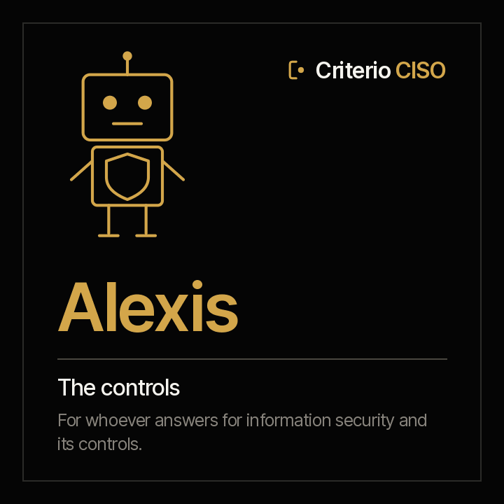

<picture><source media="(prefers-color-scheme: dark)" srcset="../../docs/img/marca/en/criterio-ciso-oscuro.svg"></picture>

# Alexis · governance and controls



**Alexis puts every control next to the evidence that it operated.**
You answer for information security and its management system. He comes with every applicable control in the statement against the evidence that it operated within its frequency, the access reviews and third-party assessments that lapsed, and the risk acceptances past their date.

<!-- agente:nombre · generado por scripts/familias.py; no se edita a mano -->
**The name.** Alexis, from the Greek *Aléxios*, “the one who defends”: every control against the evidence that it operated.
<!-- /agente:nombre -->

[Español](README.es.md) · `criterio-security` · Apache 2.0 · One instance per entity

**Status: laboratory, not yet launched (version 0.1.0).** The calculation engine, tested against synthetic material from four industries with a key the agent never sees and two control entities. It can already be installed from the marketplace. **The round with the agent is the next step**, in 0.2.0. Nothing is announced as finished until it passes the [acceptance criteria](ACCEPTANCE.md).

**This page stands on its own.** Alexis works without the family's other two agents. The family —how they meet each other and Rostrum— is in the [criterio-ciso family](../../families/criterio-ciso/README.md).

---

## What it is

| | |
|---|---|
| **Whom it extends** | Whoever answers for information security —the CISO, the security officer— and whoever prepares the security committee or the audit |
| **What it works on** | **An entity's security management system**, period by period |
| **What it looks at** | The statement of applicability, each control's evidence, the access reviews, the third-party assessments and the risk register |
| **Cadence** | When new evidence arrives, when a review or an assessment falls due, and once a week |
| **Instances** | One per entity |

## What it does

**What it does that is not done today: checking every applicable control, not a sample, against the evidence that it operated**, before the audit asks.

**What it can answer that takes days today before an audit:** which control is marked as implemented and has no evidence, which one's evidence has lapsed, which system has gone months without an access review, which critical third party has not been assessed and which accepted risk nobody looked at again.

<!-- ciso:comandos · generado por scripts/familias.py; no se edita a mano -->
### The nine commands

> They are typed with the plugin prefix: `/criterio-security:` and autocomplete does the rest. It is the only form that resolves in a Claude Code session.

| Command | What it does |
|---|---|
| `/criterio-security:security-setup` | The configuration, the inventory and what was excluded |
| `/criterio-security:security-scan` | The period record up to date, with the new evidence and the new signals |
| `/criterio-security:soa-status` | Each applicable control with its owner |
| `/criterio-security:control-evidence` | Each control against the evidence that it operated |
| `/criterio-security:access-reviews` | Each system with its access review current or overdue |
| `/criterio-security:third-parties` | Each critical third party with its assessment current or overdue |
| `/criterio-security:risk-register` | Each risk acceptance against its review date |
| `/criterio-security:security-wake` | What was due today, run |
| `/criterio-security:share-findings` | A summary with no data to share, only if you say yes |
<!-- /ciso:comandos -->

`security-setup` comes first because the others need it, and `security-wake` is the one you put on a clock. Between them, the six that prepare the work: what changed, the statement, controls against their evidence, access, third parties and risks.

<!-- ciso:skills · generado por scripts/familias.py; no se edita a mano -->
### The three skills

They load on their own when the subject comes up. They are the knowledge the commands share, and they are consulted like a manual.

| Skill | What it encapsulates | Whose it is |
|---|---|---|
| `control-evidence-record` | How a control's evidence, an access review and a third-party assessment go into the record: what counts as evidence, the date it covers and the citation | Own |
| `security-intake` | The recommended structure of the security folder, what goes in each folder and which agent uses it, how evidence and exports are named, and what is never left there | Own · also in Guillermo and Amparo |
| `soa-and-risks` | The statement of applicability and the risk register: their columns, what an applicable and implemented control is, the frequency, and what a risk acceptance with its review date is | Own |
<!-- /ciso:skills -->

## What it costs today

<!-- ciso:cifras · generado por scripts/familias.py; no se edita a mano -->
| Figure | Source |
|---|---|
| **31%** of breaches began with the exploitation of a vulnerability: it is the leading way in, ahead of credential abuse (13%) | [Verizon, 2026 Data Breach Investigations Report, resumen ejecutivo, 2026](https://www.verizon.com/business/resources/executivebriefs/2026-dbir-executive-summary.pdf) — Over 31,000 real-world incidents, of which over 22,000 confirmed breaches, October 2024 to November 2025 |
| **26%** of the vulnerabilities in CISA's KEV catalog were fully remediated in 2025, down from 38% the year before; the median time to fix them rose to 43 days | [Verizon, 2026 Data Breach Investigations Report, resumen ejecutivo, 2026](https://www.verizon.com/business/resources/executivebriefs/2026-dbir-executive-summary.pdf) — The organisations in the report's dataset, October 2024 to November 2025 |
| **48%** of breaches involved a third party, 60% more than in the previous report | [Verizon, 2026 Data Breach Investigations Report, resumen ejecutivo, 2026](https://www.verizon.com/business/resources/executivebriefs/2026-dbir-executive-summary.pdf) — Over 22,000 confirmed breaches, October 2024 to November 2025 |
<!-- /ciso:cifras -->

## What it is for

`/criterio-security:control-evidence` puts every control the statement marks as implemented next to the evidence in the record. **A control with no evidence, or with lapsed evidence, is reported with its row and its owner.**

### And what it is not for

- **It does not accept a risk or declare a control met.** It says what is missing; the conclusion is a person's.
- **It does not rate the organisation's maturity or certify it** against ISO/IEC 27001.
- **It does not connect to a system or a console**: it processes the documents the organisation leaves in the folder.
- **It does not open credentials, keys or backups.** It lists them as excluded and the report says which.

And one that has to be said out loud: **your documents are processed on the AI platform's infrastructure**, not only on your machine. Confirm that is acceptable under your policies before pointing it at confidential material. Full disclaimer in [DISCLAIMER.md](../../DISCLAIMER.md), terms in [TERMS.md](../../TERMS.md).

## Installation and setup

**Already in the marketplace**, laboratory and not yet launched:

```
/plugin marketplace add josenanez/criterio
/plugin install criterio-security@criterio
/criterio-security:security-setup
```

### The first result

`/criterio-security:security-setup` does not ask you to tidy anything before starting. It looks at the entity's security folder, compares it with the [recommended structure](../../families/criterio-ciso/README.md#the-recommended-folder-structure), says what it will not open and asks the questions no document answers: where the statement of applicability is and which column carries each field, how often access is reviewed and third parties assessed. Within the first fifteen minutes it shows the first result: every applicable control against the evidence that it operated.

### How often it runs

`/criterio-security:security-wake` is the command the clock invokes: it does what is due, first answers the questions somebody left in Rostrum, and **if nothing is due it produces nothing.** Deciding what is due is date arithmetic, and the code does it:

```
python3 scripts/seguridad.py despertar --config <archivo>
```

## Teamwork

| With whom | What happens |
|---|---|
| **Guillermo** | They share the entity's folder and reference. Guillermo processes the vulnerabilities; Alexis, the controls. Each writes only its own record |
| **Amparo** | They share the folder and the reference. Amparo processes the incidents and the continuity tests |
| **Rostrum** | Publishes its reports, what falls due and its signals for whoever will not open a folder, and returns the questions left by whoever looks at it. **It does not write the state** |

## Tests

### How it is built

The backbone is the **period record**: each piece of control evidence with the date it covers, each access review and each third-party assessment, every data point with its citation. The agent writes it; the engine writes the results.

[`scripts/seguridad.py`](scripts/seguridad.py), with the standard library, does everything that is calculation: it processes each table and each export with its source row, counts days and hours against the policy's deadlines and excludes what is never opened, the same result every time. It lives in `criterio-security` and is copied to the other two agents; `scripts/sincronizar.py --check` fails if any copy drifts.

### How it is verified

```
python3 scripts/seguridad.py selftest                        the engine
python3 tests/criterio-ciso/generar.py                       the material from four industries
python3 tests/criterio-ciso/evaluar.py --agente alexis       every signal against the key
```

**How the latest run went, generated from the run itself:** [`tests/criterio-security/RESULTADOS.md`](../../tests/criterio-security/RESULTADOS.md). What is planted in each entity and **what the material does not test**, in [`EVIDENCIA.md`](../../tests/criterio-ciso/EVIDENCIA.md) (Spanish). The design, with each command's input, process and report, in the [family design](../../families/criterio-ciso/DISENO.md).
