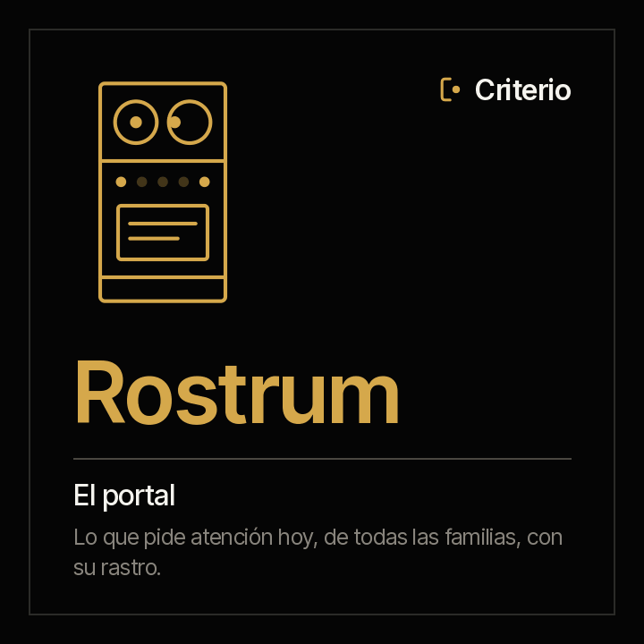
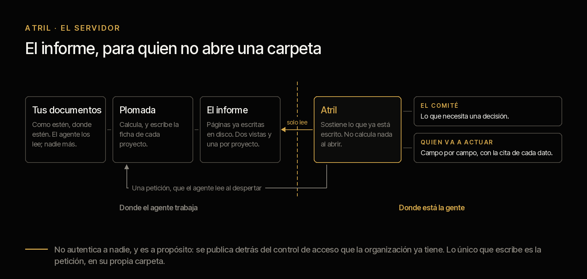
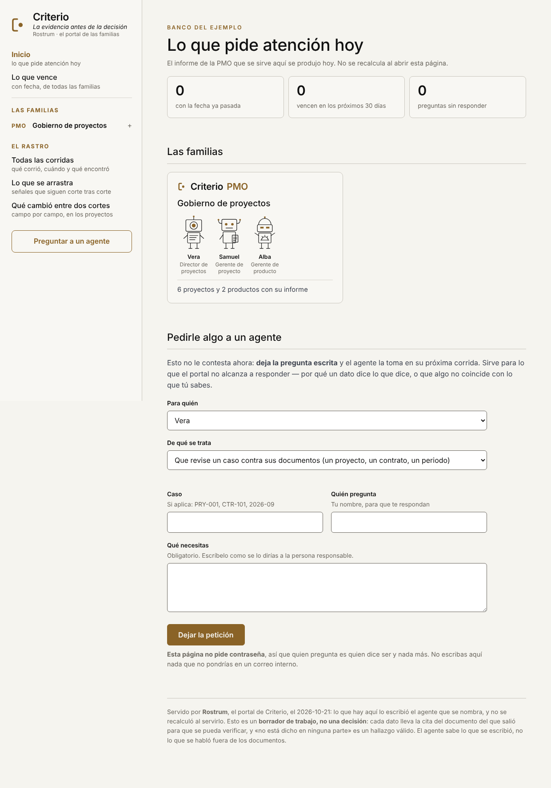
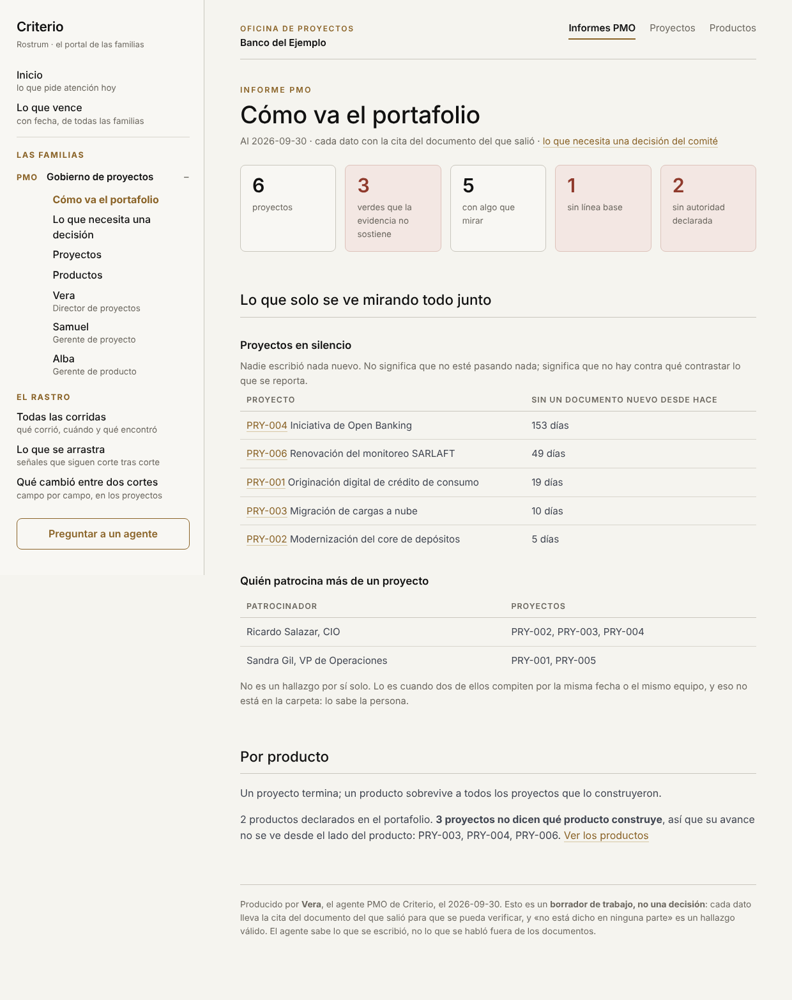
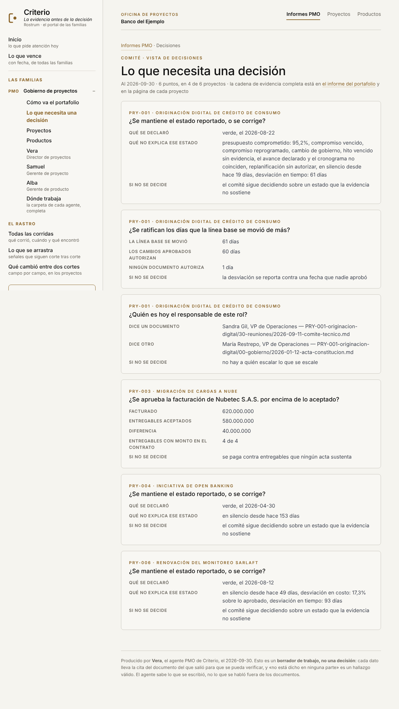
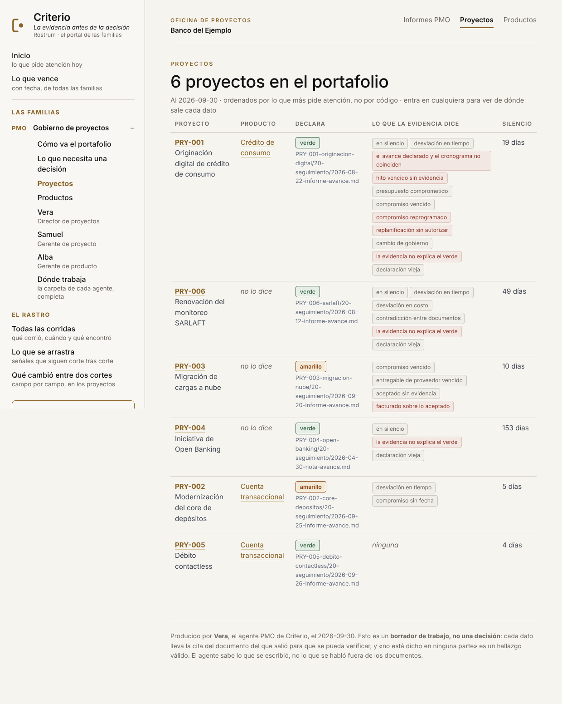
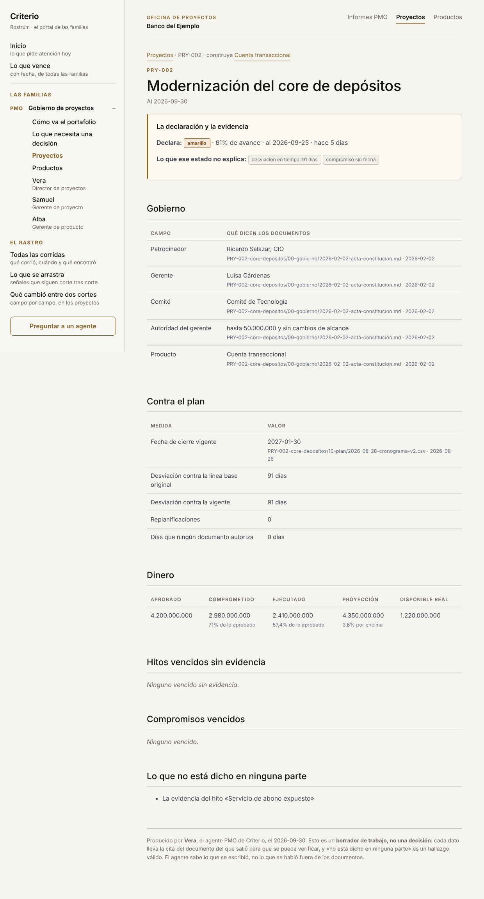
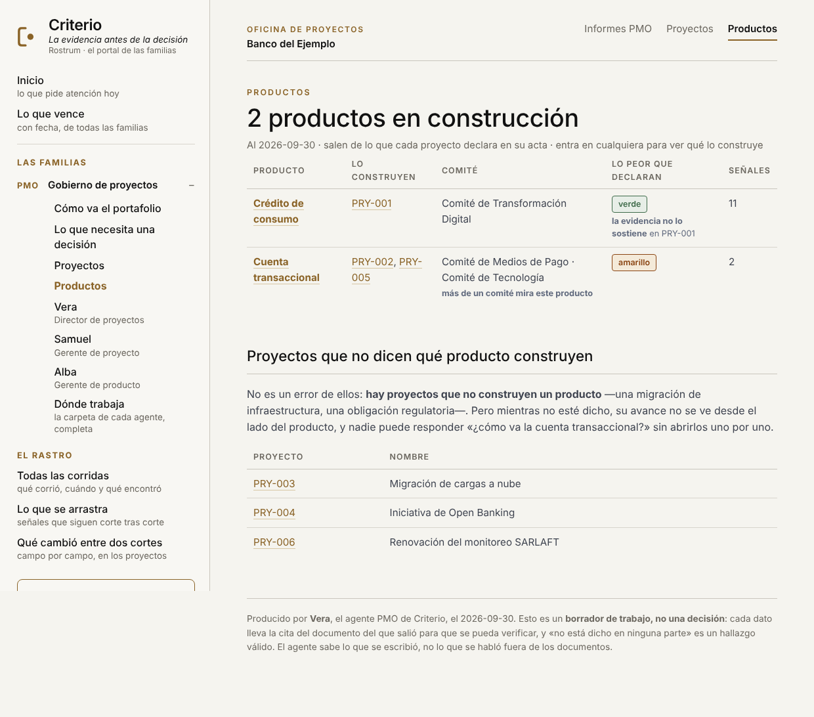
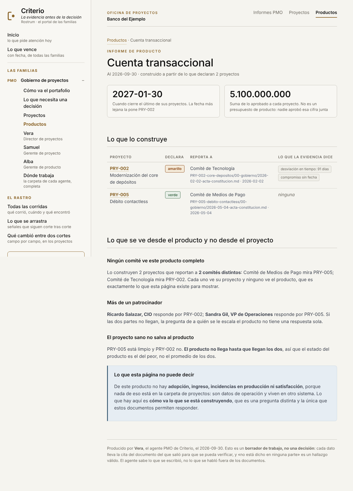

<picture><source media="(prefers-color-scheme: dark)" srcset="../../docs/img/marca/logotipo-oscuro.svg"></picture>

# Rostrum · el portal de todas las familias



**Lo que los agentes ya escribieron, para quien no abre una carpeta.**

Una tribuna no mide, no corrige y no opina: **sostiene lo que ya está escrito, a la
altura de quien lo va a leer.** Por eso se llama así, y si algún día calculara algo, el nombre
dejaría de ser cierto.

[English](README.md) · `criterio-server` · Apache 2.0 · Uno por organización

**Estado: construido; el mapa de las tres familias es nuevo y está en prueba.** El portal de la
familia PMO existe desde la 0.2 y se probó de punta a punta en cada ronda desde la 0.3.9; el mapa que suma las familias CFO y CLO lo
prueba su selftest sobre las tres familias a la vez. La decisión, en el
[ADR 0010](../../docs/decisions/0010-rostrum-plugin-propio.md).

---



Cada agente deja lo que produce como archivos en su estado: el informe de Vera, los reportes de
Clara y de Tomás, el calendario de Fidel, el estado del cumplimiento de Constanza. Eso le sirve a
quien lo corrió y a nadie más. **Un patrocinador no abre una carpeta de archivos**: abre un
enlace, o no abre nada.

**Rostrum** convierte esos archivos en **un solo portal para todas las familias**, y —esto es lo
que cambia cómo se usa— **deja dejarle preguntas escritas a cualquier agente**.

## Cómo trabaja

| | |
|---|---|
| **El mapa dice qué se sirve** | `server-setup` encuentra en la carpeta de trabajo la configuración de cada agente, `.criterio/<área>/[<instancia>/]config.json`, y cada una dice dónde está su estado. La persona confirma y el mapa queda en `.criterio/rostrum/config.json`. Lo que no está en el mapa no se sirve |
| **Los agentes salen de su familia** | Quién es cada agente, sus grupos y sus comandos salen de `agentes.json`, que se escribe desde las familias. El servidor no lleva ningún agente escrito a mano: una familia nueva entra al mapa volviendo a escanear |
| **Todos escriben igual** | Cada agente deja sus corridas, sus reportes, lo que vence y sus peticiones con el mismo esquema, y por eso el portal los sirve sin saber de qué familia son |

## Los comandos

| Comando | Qué entrega |
|---|---|
| `/criterio-server:server-setup` | El mapa: qué agentes de qué familias hay en la carpeta de trabajo y dónde está el estado de cada uno |
| `/criterio-server:server-start` | El portal levantado sobre el mapa, y qué pedirle a la organización para publicarlo |

## Instalación

```
/plugin marketplace add josenanez/criterio
/plugin install criterio-server@criterio
/criterio-server:server-setup
/criterio-server:server-start
```

Primero cada familia con su propio setup —`portfolio-setup`, `finance-setup`, `legal-setup`…—;
después el mapa; después el portal. **Rostrum no produce nada: lo sostiene.** A mano es lo mismo
que hacen los comandos:

```
python3 scripts/mapa.py descubrir --raiz <carpeta de trabajo>
python3 scripts/mapa.py guardar   --raiz <carpeta de trabajo>
python3 scripts/servidor.py --mapa <carpeta de trabajo>/.criterio/rostrum/config.json
```

Escucha en `127.0.0.1:8787`, **solo en tu equipo**, y se para con Ctrl-C. Si el puerto está
ocupado, `--puerto 8788`. Quien solo tiene la familia PMO lo puede levantar como antes, sin mapa:
`servidor.py --informe <carpeta> --estado <estado> --config <archivo>`.

## Cómo entra cada familia

Ninguna familia se programa en el servidor. Cada agente, al correr su setup, deja su
configuración en la carpeta de trabajo y marca la carpeta raíz de sus documentos;
`server-setup` encuentra esas configuraciones, te las muestra y guarda el mapa. Una familia o una
entidad nueva entra volviendo a correr `server-setup`.

<!-- servidor:familias · generado por scripts/familias.py; no se edita a mano -->
| Familia | Agente | Su setup | Deja su configuración en | Marca su carpeta raíz con |
|---|---|---|---|---|
| **Criterio PMO** · Gobierno de proyectos | Vera | `/criterio-portfolio:portfolio-setup` | `.criterio/portafolio/` | `_CRITERIO_PORTAFOLIO.txt` |
| **Criterio PMO** · Gobierno de proyectos | Samuel | `/criterio-project:pm-setup` | `.criterio/proyecto/<instancia>/` | `_CRITERIO_PROYECTO.txt` |
| **Criterio PMO** · Gobierno de proyectos | Alba | `/criterio-product:product-setup` | `.criterio/producto/<instancia>/` | `_CRITERIO_PRODUCTO.txt` |
| **Criterio CFO** · Cierre, control y reporte | Clara | `/criterio-finance:finance-setup` | `.criterio/finanzas/<instancia>/` | `_CRITERIO_FINANZAS.txt` |
| **Criterio CFO** · Cierre, control y reporte | Tomás | `/criterio-budget:budget-setup` | `.criterio/presupuesto/<instancia>/` | `_CRITERIO_FINANZAS.txt` |
| **Criterio CLO** · Contratos y cumplimiento | Fidel | `/criterio-legal:legal-setup` | `.criterio/legal/<instancia>/` | `_CRITERIO_LEGAL.txt` |
| **Criterio CLO** · Contratos y cumplimiento | Constanza | `/criterio-compliance:compliance-setup` | `.criterio/cumplimiento/<instancia>/` | `_CRITERIO_LEGAL.txt` |
<!-- /servidor:familias -->

Cada familia cuenta en su propia documentación qué tiene en el portal: la
[PMO](../../families/criterio-pmo/README.es.md#en-rostrum-el-portal-de-todas-las-familias), la
[CFO](../../families/criterio-cfo/README.es.md#en-rostrum-el-portal-de-todas-las-familias) y la
[CLO](../../families/criterio-clo/README.es.md#en-rostrum-el-portal-de-todas-las-familias). La guía completa, con capturas, está en
[josenanez.com/es/agents/rostrum](https://www.josenanez.com/es/agents/rostrum).

## El primer resultado

En los primeros quince minutos, después del setup de cada familia, `server-setup` muestra el mapa
—cada agente, su entidad o su caso, la carpeta de sus documentos con su marca
`_CRITERIO_<QUÉ>.txt` si la tiene, y la de su estado— y `server-start` deja en el navegador
la portada con todos los agentes del mapa: el informe de la PMO, una puerta por familia, lo que
vence en todas y el formulario para preguntarle a cualquiera de ellos.

---

## Lo que ve quien entra



El inicio responde primero **qué pide atención hoy**: lo que ya pasó su fecha, lo que vence en
treinta días, las señales abiertas y las preguntas sin responder. Después viene una tarjeta por
familia. Dentro de la PMO el orden es el de siempre: **cómo va todo, después el proyecto que le
toca, después el producto que le importa**.

La portada dice además **de cuándo es lo que se ve**, que es precisamente lo que nadie sabe
cuando le reenvían un PDF. No se recalcula al abrir la página, y eso se declara en vez de
disimularlo.

> Las capturas de esta página salen del [corpus sintético](../../tests/criterio-portfolio/)
> del repositorio, al 2026-09-30. «Banco del Ejemplo» es material de prueba.

### 1 · Informes PMO — cómo va el portafolio



Lo que **solo se ve mirando todo junto**, y por eso no está en la página de ningún
proyecto: cuántos verdes la evidencia no sostiene, qué lleva semanas sin un documento
nuevo, y quién patrocina más de una cosa a la vez.

Esa última no es un hallazgo por sí sola, y la página lo dice: lo es cuando dos de esos
proyectos compiten por la misma fecha o el mismo equipo, **y eso no está en la carpeta
— lo sabe la persona.**

### El comité tiene su propia vista



No es la anterior recortada: **es otro objeto**. Solo lo que excede la facultad de
quien gerencia cada proyecto, formulado como pregunta cerrada, con sus cifras y con la
**consecuencia de no decidirlo**.

La diferencia importa. A un patrocinador se le entrega la vista interna filtrada y hace
lo que hacen los patrocinadores: se clava en un detalle y desvía el comité. Aquí cada
bloque es una decisión suya, y si no hay ninguna, lo dice.

### 2 · Proyectos



El listado, **ordenado por lo que más pide atención y no por código**. Cada fila trae
lo que el proyecto declara, lo que la evidencia dice, cuánto lleva en silencio, y el
producto al que pertenece.



Y dentro, el informe: gobierno, plan, dinero, hitos vencidos, compromisos vencidos, y
**lo que no está dicho en ninguna parte**. Cada dato con la cita del documento del que
salió y su fecha, para que se pueda abrir y verificar.

Arriba del todo, el enlace al **producto que le dio origen**.

### 3 · Productos



Un proyecto termina; un producto sobrevive a todos los proyectos que lo construyeron.

El listado marca dos cosas que un informe de portafolio normal no marca: cuándo **más
de un comité mira el mismo producto**, y cuándo el semáforo que sus proyectos declaran
**no lo sostiene la evidencia**. Un producto en verde con diez señales es exactamente
la lectura que este portal existe para no permitir.

Abajo, los proyectos que no dicen qué producto construyen. No es un error de ellos
—hay proyectos que no construyen un producto—, pero mientras no esté dicho su avance no
se ve desde ese lado.



**Aquí está lo que ninguna otra página puede decir.** Cuando un producto lo construyen
dos proyectos que reportan a comités distintos, cada comité ve su proyecto y **ninguno
ve el producto**. Desde adentro de un proyecto eso no se puede detectar, porque desde
adentro no se ve el otro.

De ahí salen las tres cosas propias de esta página:

- **Ningún comité lo ve completo**, con cuál mira cuál.
- **Más de un patrocinador responde por él**, y entonces no hay una sola respuesta a
  quién se le escala.
- **El proyecto sano no salva al producto**: no llega hasta que llegan todos, así que
  su estado es el del peor y no el promedio.

Y lo que la página **no** dice, declarado en la propia página: de este producto no hay
adopción, ingreso, incidencias en producción ni satisfacción. Nada de eso está en la
carpeta de proyectos — son datos de operación y viven en otro sistema.

### 4 · Las familias CFO y CLO

`/familia/cfo` y `/familia/clo` muestran a cada agente de la familia con **lo último que escribió
su motor**: el ámbito —el cierre de un mes, el presupuesto de un año, los contratos, el
cumplimiento de un periodo—, cuántas señales dejó abiertas y cuándo lo escribió. Debajo, sus
reportes, cada uno tal como el motor lo dejó en `reporte-<comando>.md`. El portal no los
reescribe ni los resume: los convierte a página.

### 5 · Lo que vence

`/vence` junta en una sola lista lo pendiente que tiene fecha, de todas las familias: el preaviso
de un contrato con renovación automática, la obligación de cumplimiento que vence el 5, la tarea
del cierre sin soporte, el requerimiento del auditor, el próximo comité. **Cada motor calculó lo
suyo** —está en su `resultados.json`, en `vence`—, y la tabla dice cuándo; el portal solo junta las
listas y las ordena por fecha.

### El caso cruza familias

`/caso/<código>` junta todo lo que los agentes han hecho sobre un caso. Cuando el código es el de
un proyecto de la PMO y Tomás lo encontró con otro presupuesto que el de su línea, la señal de
Tomás aparece en la página del proyecto. **Esa vista no existe en ninguna otra parte**, y es la
razón de que el portal sea uno y no uno por familia.

---

## Pedirle algo a un agente

En la portada hay un formulario con un **«Para quién»**: cada agente y cada entidad del mapa. **No
le contesta a nadie en el momento**, y decirlo es más honesto que un «en breve te contactamos»:
escribe la pregunta en `<estado>/peticiones/` del agente elegido, y ese agente la atiende cuando
despierte.

| Asunto | Qué hace el agente |
|---|---|
| *Que revise un caso contra sus documentos* | Lo procesa desde cero, sin asumir nada de su último reporte |
| *Que explique de dónde salió un dato* | Rastrea el dato hasta su documento y lo cita |
| *Que algo no coincide con lo que sé* | **Alguien está diciendo qué documento falta.** Se registra con quién lo dijo y cuándo; no se escribe en la ficha |

Ese último es el que convierte el portal en algo más que una pantalla. La persona que sabe que
el patrocinador cambió en el comité del 11, o que el otrosí ya se firmó, no va a ir a arreglar un
documento; va a decírselo a lo que tenga delante, si lo que tiene delante escucha.

**Una petición abierta rompe el silencio del agente** en su `*-wake`: es la única cosa que lo hace
hablar sin ser aritmética de fechas, porque una persona preguntó y está esperando. Cuando la
responde, la marca, y solo entonces deja de aparecer.

## Publicarlo dentro de tu organización

Hay dos formas y no dan lo mismo. Si no sabes cuál quieres, **empieza por la primera**:
se levanta en diez segundos, y con eso funcionando en la mano la conversación con
seguridad ya no es pedir permiso para una idea.

**Para mirarlo un rato.** Alguien lo levanta, mira, y lo apaga. Cero infraestructura
que pedirle a nadie. Lo que se pierde: el patrocinador no tiene un enlace que funcione
mañana.

**Que quede corriendo.** Vive en una máquina de la organización y el patrocinador tiene un
enlace estable. Es donde está el valor, y también la conversación. `--abierto` hace que
escuche fuera del equipo, y el programa lo advierte al arrancar.

### Qué hay que pedir

| Qué se pide | Por qué |
|---|---|
| Una máquina dentro de la red y un puerto | Es donde vive. **No necesita salir a internet** |
| Publicarlo detrás del control de acceso que ya usan | Ver abajo |
| Que esa máquina siga encendida | Si se apaga, el enlace deja de funcionar. No hay alta disponibilidad y no hace falta: lo que sirve se vuelve a producir |

### Qué **no** hay que pedir

Suele ser la mitad de la conversación, así que conviene llevarlo escrito: no necesita
base de datos, ni cuenta de servicio con permisos, ni certificado propio, ni salida a
internet, ni tocar ninguna de tus carpetas de documentación.

## Lo que nunca hace

- **No calcula.** Sirve lo que los agentes ya escribieron en disco. Abrir la página no dispara
  ningún procesamiento de documentos, y por eso dos personas ven exactamente lo mismo.
- **No escribe ninguna ficha.** Lo único que crea es el archivo de la petición, en la carpeta
  `peticiones/` del agente al que va. **El camino de escritura hacia el estado de un agente no
  existe en ese programa**, y el selftest lo comprueba comparando la ficha byte a byte antes y
  después de mandar una petición.
- **No sirve lo que no está en el mapa**, ni un archivo del estado que no sea un reporte.
- **No autentica a nadie, y es a propósito.** Un servidor sobre la librería estándar no va a
  autenticar mejor que el proxy que tu organización ya tiene, y prometer que sí sería
  exactamente lo que este plugin no hace. Por eso escucha solo en tu equipo salvo que le digas
  lo contrario, y cuando se lo dices, lo advierte.
- **No manda nada.** No hay correo ni notificación. Si algo tiene que llegar a un buzón, hoy lo
  reenvía una persona.

---

De aquí para abajo es para quien lo va a publicar.

## Las rutas

| Ruta | Qué es | Para quién |
|---|---|---|
| `/` | La portada: los agentes del mapa, una puerta por familia y el formulario | Todos |
| `/pmo` | Cómo va el portafolio, si la PMO está en el mapa | La PMO |
| `/decisiones` | Lo que necesita una decisión | El comité y el patrocinador |
| `/proyectos` | El listado de proyectos | Todos |
| `/p/<código>` | El informe de un proyecto | Quien gerencia, y quien pregunta |
| `/productos` | El listado de productos | Quien responde por un producto |
| `/producto/<nombre>` | El informe de un producto | Quien responde por un producto |
| `/familia/<sigla>` | Una familia: cada agente con lo último que escribió y sus reportes | Quien responde por esa función |
| `/reporte/<área>/<instancia>/<archivo>` | Un reporte tal como lo escribió el motor | Quien responde por él |
| `/vence` | Lo pendiente con fecha, de todas las familias | La gerencia |
| `/corridas` | La historia de **todos los agentes**, y qué se arrastra | Todos |
| `/corridas?agente=&que=&caso=` | Las de un agente, un comando o un caso; es a donde llevan las ramas del árbol | Quien prueba |
| `/agente/<área>` | Qué hace cada agente, función por función, cuántas veces corrió cada una y sus reportes | Todos |
| `/caso/<código>` | Todo lo que los agentes han hecho sobre un proyecto, un producto o un contrato | El patrocinador |
| `/arrastres` | Señales con varios cortes seguidos y nadie ha decidido | El comité |
| `/corrida/<área>/<id>` | **Una corrida entera, tal como la dejó el arnés**: lo que el agente mostró, con las cifras que midió | Todos |
| `/corrida/<área>/<caso>/<id>` | Las cifras de una corrida registrada solo por `corrida` | Todos |
| `/historia/<código>` | Desde cuándo un caso arrastra cada señal, y cuál se resolvió | La PMO y el gerente |
| `/corte?a=&b=` | Qué cambió campo por campo entre dos cortes de la PMO | Quien pregunta «desde cuándo» |
| `/estado.json` | De cuándo es lo de cada agente y cuántas peticiones tiene abiertas | Un mecanismo, no una persona |
| `/peticion` | `POST` · deja una pregunta para un agente | El formulario de la portada |

Las rutas del informe de la PMO **redirigen al archivo** en vez de servirlo en su lugar: las
páginas enlazan entre sí por nombre de archivo, porque tienen que funcionar también **abiertas
desde el disco, comprimidas o impresas**. El servidor es una proyección, no el dueño.

`/estado.json` es el punto por el que un mecanismo de tu organización puede enterarse de que
hay algo nuevo. **Mandar correos en nombre de alguien es una facultad que este plugin no va a
tener**, así que ese paso lo da algo tuyo, no el plugin.

## La historia, y por qué no se borra

### Un solo portal para todas las familias

Ningún agente tiene portal aparte. Cada uno escribe su estado donde su configuración dice, el
mapa lo encuentra, y este mismo Rostrum lo sirve. Varios portales obligarían a un patrocinador a
saber a cuál entrar, y eso ya no es transparencia: es un directorio interno.

Cada corrida dice de quién es y sobre qué caso. El árbol de la izquierda lleva a la de cada
agente, y `/corridas` las muestra todas en una sola línea de tiempo. Cuando un mismo caso
aparece en dos estados, se queda la racha más larga: un problema no empieza de nuevo porque lo
mire otro.

Una organización real produce informes, cuadros y documentos todos los días, y ese rastro
**es** la memoria del proyecto. El portal mostraba solo el presente y se sobreescribía: no
había forma de saber qué se dijo antes de una decisión, ni de presentar un avance, ni de
entender dónde está un proyecto más allá de hoy.

Tres vistas, y las tres leen sin escribir:

- **`/corridas`** — qué se corrió, cuántos documentos hubo que releer, cuánto tardó, cuántos
  hallazgos, cuántos subagentes lanzó y cuántos a la vez —en rojo si pasó de lo que la
  configuración permite—, y **cuántos más o menos que la vez anterior**. Debajo, lo que se arrastra: una
  señal que sonó una vez es ruido; una que lleva varios cortes seguidos es una decisión que
  nadie ha tomado.
- **`/historia/<código>`** — de un proyecto, desde cuándo arrastra cada señal y **cuál se
  resolvió, con la fecha**. Que algo se haya resuelto también es historia.
- **`/corte?a=&b=`** — qué cambió campo por campo entre dos cortes. Es lo que contesta
  «desde cuándo» sin que nadie tenga que recordarlo: tres patrocinadores en dieciocho meses
  explican más que cualquier análisis de causa raíz.

**No se poda nada, y no hace falta.** Una instantánea de cincuenta proyectos pesa 112 KB, y
tres años de corridas semanales caben en 17 MB; con trescientos proyectos, en 100 MB. Lo
que no se guarda es el informe renderizado —pesa siete veces más— porque se vuelve a
producir cuando alguien lo pide. Borrar el rastro sería borrar la historia del proyecto, y
con ella la posibilidad de hacerle un seguimiento que se sostenga.

Y hay una simetría que el producto necesita. Criterio le exige a una PMO que lo declarado
tenga evidencia. Si el informe de la PMO se sobreescribe, **a la PMO no la puede auditar
nadie**. Un histórico de corridas somete al agente a su propia regla.

Las tres páginas lo dicen en una línea, y no es un descargo de relleno: esta es la historia
de **lo que el agente procesó de los documentos**, no de lo que pasó ni un juicio sobre nadie.
Un registro de cinco cortes diciendo que un proyecto estuvo en verde sin sustento es un
artefacto político, y si la página no dice qué es, alguien lo va a usar para lo que no es.

## Cómo se verifica

```
python3 scripts/servidor.py --selftest
python3 scripts/mapa.py --selftest
```

Con la librería estándar y sin levantar nada a mano. Un servidor que expone lo que escriben
varios agentes tiene **dos formas de fallar que no se ven mirando la pantalla**, y son las que se
comprueban: que sirva un archivo que no le toca —rutas con `..`, rutas absolutas, un archivo del
estado que no es un reporte, una entrada que no está en el mapa— y que tenga un camino de
escritura hacia el estado de un agente.

Además: que las secciones de la PMO sean las mismas que las de `informe.py`, que cada ruta
declarada responda de verdad, que la portada lleve a todos los agentes del mapa, que una petición
llegue solo al estado del agente elegido y que lo que vence salga ordenado de las listas de cada
motor. **Cómo salió la última corrida**, generado desde la corrida misma:
[`tests/criterio-server/RESULTADOS.md`](../../tests/criterio-server/RESULTADOS.md). Criterios de
aceptación en [ACCEPTANCE.md](ACCEPTANCE.md).

**Accesibilidad, WCAG 2.2 AA.** Las pruebas de arriba comprueban sin navegador lo que no puede
volver atrás:

- el contraste de cada color de texto contra cada fondo;
- el borde de los campos;
- que ninguna letra baje de 12 px;
- en cada página enlazada: un solo `h1`, el salto al contenido, `main`, título e idioma;
- que los robots se paren solos en menos de cinco segundos.

El recorrido completo, con Chromium y axe-core, está en
[`tests/criterio-server/accesibilidad/`](../../tests/criterio-server/accesibilidad/). Con un
Rostrum corriendo, `npm ci && BASE=http://127.0.0.1:<puerto> npm run auditar` recorre cada página
enlazada a 1280, 768, 390 y 320 px. Revisa también el teclado, el menú del teléfono, el
formulario y el movimiento.

## El menú, las páginas de los agentes y las de cada caso

A la izquierda de toda página va el menú. Está ordenado por lo que alguien viene a hacer y crece
con las familias sin alargarse:

1. **Inicio** y **Lo que vence.** Arriba, lo que pide atención hoy. El único número que lleva el
   menú es el de lo que ya pasó su fecha.
2. **Las familias.** Una entrada por familia, con su sigla y su función, plegada. Dentro van sus
   vistas (las cuatro de la PMO, o lo último de la familia), sus agentes y **Dónde trabaja**. Se
   abre sola la de la página que se está mirando, así que con diez familias el menú sigue siendo
   de diez líneas.
3. **El rastro.** Todas las corridas, lo que se arrastra y, si está la PMO, qué cambió entre dos
   cortes.
4. **Preguntar a un agente**, como botón, con las preguntas sin responder si las hay.

El inicio repite esa lógica: primero las cifras de lo que pide atención (lo vencido, lo que vence
en treinta días, las señales abiertas, las preguntas sin responder) y después una tarjeta por
familia con sus agentes y una sola puerta, la de la familia. Cada familia tiene su página en
`/familia/<sigla>`, la PMO también.

Arriba del menú va la marca de [`docs/design.md`](../../docs/design.md): el símbolo, «Criterio» y
la promesa, *la evidencia antes de la decisión*. Cada familia se presenta igual en el menú, en su
tarjeta y en su página: **Criterio CFO** con la función en palabras debajo, sin un color propio.

**Dónde trabaja.** La página de cada familia y la de cada agente dicen, con la ruta completa en el
equipo donde corre Rostrum, la carpeta raíz (la que tiene `.criterio/`), la de los documentos con
su marca `_CRITERIO_…` o el aviso de que falta, la del estado y la configuración. Un clic sobre una
ruta la selecciona entera para copiarla. El mapa guarda esas rutas relativas a la raíz para no
publicar la carpeta de nadie; Rostrum las completa al servir.

`/agente/<área>` es el catálogo de cada agente: sus funciones agrupadas como las declara su
familia, cada comando con un nombre que se entiende y el técnico al lado, cuántas veces corrió y
cuándo fue la última, y los reportes que dejó su motor. Un comando que no ha corrido aparece con
cero: que no haya corrido también es un dato.

Las corridas no las registra el agente. Las registra el arnés: cada plugin de agente lleva
`hooks/hooks.json`, y Claude Code dispara `rastro.py` cuando la persona invoca un comando y cuando
el agente termina de responder. Queda en `<carpeta de trabajo>/.criterio/corridas/<área>/` la
página de esa corrida, con las cifras que `corrida` haya medido incrustadas. El agente no puede
dejar de registrarse, porque no es él quien registra.
