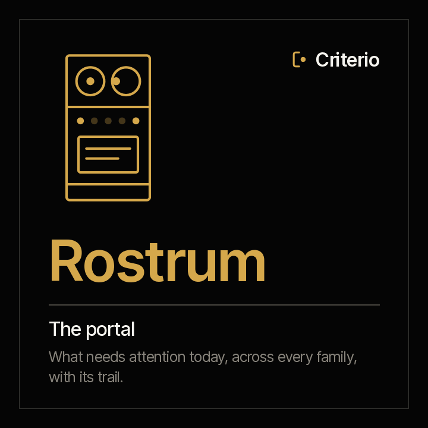
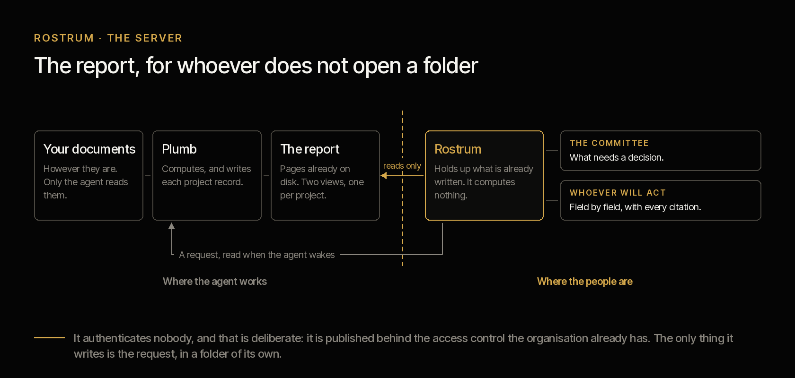

<picture><source media="(prefers-color-scheme: dark)" srcset="../../docs/img/marca/logotipo-oscuro.svg"></picture>

# Rostrum · the portal for every family



**What the agents already wrote, for whoever does not open a folder.**

A rostrum does not measure, correct or opine: it **holds up what is already written, at the
height of whoever is going to read it.** That is why it is called that — and if it ever computed
anything, the name would stop being true.

[Español](README.es.md) · `criterio-server` · Apache 2.0 · One per organisation

**Status: built and tested.** The PMO family's
portal has existed since 0.2 and has been tested end to end in every round since 0.3.9; the map
that adds the CFO and CLO families is tested by its selftest across the three families at once, and the accessibility audit ran on the round outputs of all three.
The decision is in [ADR 0010](../../docs/decisions/0010-rostrum-plugin-propio.md) (Spanish).

---



Every agent leaves what it produces as files in its state: Vera's report, Clara's and Tomás's
reports, Fidel's calendar, Constanza's compliance status. That serves whoever ran it and nobody
else. **A sponsor does not open a folder of files**: they open a link, or they open nothing.

**Rostrum** turns those files into **a single portal for every family**, and — this is what
changes how it gets used — **it lets anyone leave any agent a written question.**

## How it works

| | |
|---|---|
| **The map says what is served** | `server-setup` finds each agent's configuration in the working folder, `.criterio/<area>/[<instance>/]config.json`, and each one says where its state is. The person confirms and the map is saved in `.criterio/rostrum/config.json`. Whatever is not on the map is not served |
| **The agents come from their family** | Who each agent is, its groups and its commands come from `agentes.json`, written from the families. The server carries no agent written by hand: a new family joins the map by scanning again |
| **They all write the same way** | Every agent leaves its runs, its reports, what falls due and its requests with the same schema, which is why the portal serves them without knowing which family they belong to |

## The commands

| Command | What it delivers |
|---|---|
| `/criterio-server:server-setup` | The map: which agents of which families are in the working folder and where each one's state is |
| `/criterio-server:server-start` | The portal running on the map, and what to ask the organisation for to publish it |

## Install

```
/plugin marketplace add josenanez/criterio
/plugin install criterio-server@criterio
/criterio-server:server-setup
/criterio-server:server-start
```

First each family with its own setup —`portfolio-setup`, `finance-setup`, `legal-setup`…—; then
the map; then the portal. **Rostrum produces nothing: it holds it up.** By hand, it is what the
commands do:

```
python3 scripts/mapa.py descubrir --raiz <working folder>
python3 scripts/mapa.py guardar   --raiz <working folder>
python3 scripts/servidor.py --mapa <working folder>/.criterio/rostrum/config.json
```

It listens on `127.0.0.1:8787`, **only on your machine**, and stops with Ctrl-C. If the port is
taken, `--puerto 8788`. Whoever has only the PMO family can raise it as before, without a map:
`servidor.py --informe <folder> --estado <state> --config <file>`.

## How each family enters

No family is programmed into the server. Each agent, when its setup runs, leaves its
configuration in the working folder and marks the root folder of its documents; `server-setup`
finds those configurations, shows them to you and saves the map. A new family or entity enters by
running `server-setup` again.

<!-- servidor:familias · generado por scripts/familias.py; no se edita a mano -->
| Family | Agent | Its setup | Leaves its configuration in | Marks its root folder with |
|---|---|---|---|---|
| **Criterio PMO** · Project governance | Vera | `/criterio-portfolio:portfolio-setup` | `.criterio/portafolio/` | `_CRITERIO_PORTAFOLIO.txt` |
| **Criterio PMO** · Project governance | Samuel | `/criterio-project:pm-setup` | `.criterio/proyecto/<instance>/` | `_CRITERIO_PROYECTO.txt` |
| **Criterio PMO** · Project governance | Alba | `/criterio-product:product-setup` | `.criterio/producto/<instance>/` | `_CRITERIO_PRODUCTO.txt` |
| **Criterio CFO** · The finance function | Clara | `/criterio-finance:finance-setup` | `.criterio/finanzas/<instance>/` | `_CRITERIO_FINANZAS.txt` |
| **Criterio CFO** · The finance function | Tomás | `/criterio-budget:budget-setup` | `.criterio/presupuesto/<instance>/` | `_CRITERIO_FINANZAS.txt` |
| **Criterio CFO** · The finance function | Áurea | `/criterio-treasury:treasury-setup` | `.criterio/tesoreria/<instance>/` | `_CRITERIO_FINANZAS.txt` |
| **Criterio CLO** · Contracts and compliance | Fidel | `/criterio-legal:legal-setup` | `.criterio/legal/<instance>/` | `_CRITERIO_LEGAL.txt` |
| **Criterio CLO** · Contracts and compliance | Constanza | `/criterio-compliance:compliance-setup` | `.criterio/cumplimiento/<instance>/` | `_CRITERIO_LEGAL.txt` |
| **Criterio EA** · Executive office | Ofelia | `/criterio-assistant:ea-setup` | `.criterio/direccion/<instance>/` | `_CRITERIO_DIRECCION.txt` |
<!-- /servidor:familias -->

Each family explains in its own documentation what it has in the portal: the
[PMO](../../families/criterio-pmo/README.md#in-rostrum-the-portal-for-every-family), the
[CFO](../../families/criterio-cfo/README.md#in-rostrum-the-portal-for-every-family) and the
[CLO](../../families/criterio-clo/README.md#in-rostrum-the-portal-for-every-family). The full guide, with
screenshots, is at [josenanez.com/agents/rostrum](https://www.josenanez.com/agents/rostrum).

## The first result

In the first fifteen minutes, after each family's setup, `server-setup` shows the map —every
agent, its entity or case, its documents folder with its `_CRITERIO_<QUÉ>.txt` marker if it
has one, and its state folder— and `server-start` puts the landing page in the
browser with every agent on the map: the PMO report, one door per family, what falls due across
all of them and the form to ask any of them a question.

---

## What a visitor sees


The home page answers first **what needs attention today**: what is already past its date, what
falls due in thirty days, open signals and unanswered questions. Then comes one card per family.
Inside the PMO the order is the usual one: **how everything is going, then the project that is
theirs, then the product they care about**.

The landing page also says **how old what you are looking at is**, which is precisely what nobody
knows when a PDF is forwarded to them. It is not recomputed when the page opens, and that is
declared rather than hidden.

> **The pages are in Spanish today.** `report.language` is declared in the
> configuration and not yet read — it is the open gap on this side of the plugin, and
> it is written down in [`DISENO.es.md`](../criterio-portfolio/DISENO.es.md) rather than
> quietly left out. The screenshots here come from the repository's
> [synthetic corpus](../../tests/criterio-portfolio/), as of 2026-09-30; "Banco del Ejemplo"
> is test material.

### 1 · PMO reports — how the portfolio is going


What **only shows up looking at everything together**, and is therefore on no single
project's page: how many greens the evidence does not support, what has gone weeks
without a new document, and who sponsors more than one thing at a time.

That last one is not a finding on its own, and the page says so: it becomes one when
two of those projects compete for the same date or the same team, **and that is not in
the folder — the person knows it.**

### The committee gets its own view


Not the previous one trimmed down: **a different object**. Only what exceeds the
authority of whoever manages each project, framed as a closed question, with its
figures and with **what it costs not to decide it**.

The difference matters. Hand a sponsor the filtered internal view and they do what
sponsors do: fix on one detail and derail the committee. Here each block is a decision
of theirs, and if there is none, it says so.

### 2 · Projects


The list, **ordered by what most demands attention rather than by code**. Every row
carries what the project declares, what the evidence says, how long it has been silent,
and the product it belongs to.


And inside, the report: governance, plan, money, overdue milestones, overdue
commitments, and **what is not stated anywhere**. Every value with the citation of the
document it came from and its date, so it can be opened and verified.

At the very top, the link to the **product it came from**.

### 3 · Products


A project ends; a product outlives every project that built it.

The list flags two things a normal portfolio report does not: when **more than one
committee is looking at the same product**, and when the status its projects declare
**is not supported by the evidence**. A product showing green with ten signals is
exactly the reading this portal exists to prevent.

Below, the projects that do not say which product they build. It is not their mistake
— some projects do not build a product — but until it is stated, their progress is
invisible from that side.


**Here is what no other page can say.** When a product is built by two projects
reporting to different committees, each committee sees its project and **none of them
sees the product**. From inside a project that cannot be detected, because from inside
one you do not see the other.

Three things follow, and they belong to this page alone:

- **No committee sees it whole**, with which one looks at which.
- **More than one sponsor answers for it**, so there is no single answer to whom it
  gets escalated.
- **The healthy project does not save the product**: it does not land until all of them
  land, so its status is the worst of them, not the average.

And what the page does **not** say, declared on the page itself: for this product there
is no adoption, revenue, production incident or satisfaction data. None of that is in
the project folder — it is operational data and it lives in another system.

### 4 · The CFO and CLO families

`/familia/cfo` and `/familia/clo` show each agent in the family with **the latest its engine
wrote**: the scope —a month's close, a year's budget, the contracts, a compliance period—, how many
signals it left open and when it wrote them. Below, its reports, each one as the engine left it in
`reporte-<command>.md`. The portal does not rewrite or summarise them: it turns them into a page.

### 5 · What falls due

`/vence` brings together in a single list everything pending that has a date, across every
family: the notice deadline of an auto-renewing contract, the compliance obligation due on the
5th, the close task without support, the auditor's request, the next committee. **Each engine
calculated its own** —it is in its `resultados.json`, under `vence`— and the table says when; the
portal only brings the lists together and sorts them by date.

### The case crosses families

`/caso/<code>` brings together everything the agents have done on a case. When the code is a PMO
project and Tomás found it with a different budget from its line's, Tomás's signal shows up on the
project's page. **That view does not exist anywhere else**, and it is why the portal is one and not
one per family.

---

## Asking an agent for something

The landing page has a form with a **"For whom"**: every agent and every entity on the map. **It
answers nobody on the spot**, and saying so is more honest than "we will be in touch shortly": it
writes the question into `<state>/peticiones/` of the chosen agent, and that agent takes it up
when it wakes.

| Subject | What the agent does |
|---|---|
| *Review a case against its documents* | It processes it from scratch, assuming nothing from its last report |
| *Explain where a figure came from* | It traces the figure to its document and cites it |
| *Something does not match what I know* | **Someone is saying which document is missing.** It is recorded with who said it and when; it is not written into the record |

That last one is what turns the portal into more than a screen. The person who knows the sponsor
changed at the committee on the 11th, or that the amendment has been signed, is not going to go
and fix a document; they will tell whatever is in front of them, if what is in front of them
listens.

**An open request breaks the agent's silence** in its `*-wake`: it is the only thing that makes it
speak without being date arithmetic, because a person asked and is waiting. When it answers, it
marks it, and only then does it stop appearing.

## Publishing it inside your organisation

There are two shapes and they are not equivalent. If you do not know which you want,
**start with the first**: it goes up in ten seconds, and with it running in your hands
the conversation with security is no longer asking permission for an idea.

**To look at it for a while.** Someone raises it, looks, and shuts it down. No
infrastructure to ask anyone for. What is lost: the sponsor has no link that works
tomorrow.

**Left running.** It lives on a machine of the organisation and the sponsor has a stable link. That is
where the value is, and also the conversation. `--abierto` makes it listen beyond the
machine, and the program warns you at startup.

### What to ask for

| What is asked for | Why |
|---|---|
| A machine inside the network and a port | That is where it lives. **It does not need to reach the internet** |
| Publishing it behind the access control they already use | See below |
| That machine staying on | If it goes off, the link stops working. There is no high availability and none is needed: what it serves is produced again |

### What **not** to ask for

Usually half the conversation, so it is worth carrying written down: no database, no
service account with permissions, no certificate of its own, no internet access, and
nothing touching any of your documentation folders.

## What it never does

- **It does not compute.** It serves what the agents already wrote to disk. Opening the page
  triggers no document processing, which is why two people see exactly the same thing.
- **It writes no record.** The only thing it creates is the request file, in the `peticiones/`
  folder of the agent it is for. **The write path to an agent's state does not exist in that
  program**, and the selftest checks it by comparing the record byte for byte before and after
  sending a request.
- **It does not serve what is not on the map**, nor any file in the state that is not a report.
- **It authenticates nobody, on purpose.** A server on the standard library is not going to
  authenticate better than the proxy your organisation already has, and promising it would is
  exactly what this plugin does not do. That is why it listens only on your machine unless you
  tell it otherwise, and when you do, it warns you.
- **It sends nothing.** No email, no notification. If something has to reach an inbox, today a
  person forwards it.

---

From here down is for whoever is going to publish it.

## The routes

| Route | What it is | For whom |
|---|---|---|
| `/` | The landing page: the agents on the map, one door per family and the form | Everyone |
| `/pmo` | How the portfolio is going, if the PMO is on the map | The PMO |
| `/decisiones` | What needs a decision | The committee and the sponsor |
| `/proyectos` | The project list | Everyone |
| `/p/<code>` | A project's report | Whoever manages it, and whoever asks |
| `/productos` | The product list | Whoever answers for a product |
| `/producto/<name>` | A product's report | Whoever answers for a product |
| `/familia/<code>` | A family: each agent with the latest it wrote and its reports | Whoever answers for that function |
| `/reporte/<area>/<instance>/<file>` | A report as the engine wrote it | Whoever answers for it |
| `/vence` | Everything pending with a date, across every family | Management |
| `/corridas` | The history of **every agent**, and what is being carried | Everyone |
| `/corridas?agente=&que=&caso=` | One agent's, one command's or one case's; it is where the tree's branches lead | Whoever tests |
| `/agente/<area>` | What each agent does, function by function, how many times each ran, and its reports | Everyone |
| `/caso/<code>` | Everything the agents have done on a project, a product or a contract | The sponsor |
| `/arrastres` | Signals over several consecutive cut-offs that nobody has decided | The committee |
| `/corrida/<area>/<id>` | **A whole run, as the harness left it**: what the agent showed, with the figures it measured | Everyone |
| `/corrida/<area>/<case>/<id>` | The figures of a run recorded only by `corrida` | Everyone |
| `/historia/<code>` | Since when a case has been carrying each signal, and which was resolved | The PMO and the manager |
| `/corte?a=&b=` | What changed field by field between two PMO cut-offs | Whoever asks "since when" |
| `/estado.json` | How old each agent's output is and how many requests it has open | A mechanism, not a person |
| `/peticion` | `POST` · leaves a question for an agent | The landing page's form |

The PMO report's routes **redirect to the file** instead of serving it in its place: the pages
link to each other by file name, because they also have to work **opened from disk, zipped or
printed**. The server is a projection, not the owner.

`/estado.json` is the point through which a mechanism of your organisation can find out there is
something new. **Sending email on someone's behalf is a power this plugin will not have**, so that
step is taken by something of yours, not by the plugin.

## The history, and why it is not deleted

### One portal for every family

No agent has a portal of its own. Each one writes its state where its configuration says, the map
finds it, and this same Rostrum serves it. Several portals would force a sponsor to know which one
to open, and that is no longer transparency: it is an internal directory.

Every run says whose it is and on which case. The tree on the left leads to each agent's, and
`/corridas` shows them all on a single timeline. When the same case appears in two states, the
longest streak is kept: a problem does not start over because someone else looks at it.

A real organisation produces reports, charts and documents every day, and that trail **is**
the project's memory. The portal showed only the present and overwrote itself: there was no
way to know what had been said before a decision, nor to present progress, nor to
understand where a project stands beyond today.

Three views, and all three read without writing:

- **`/corridas`** — what ran, how many documents had to be re-read, how long it took, how
  many findings, how many subagents it launched and how many at once — in red when it
  exceeded what the configuration allows —, and **how many more or fewer than last time**. Below, what is being
  carried: a signal that fired once is noise; one that has lasted several consecutive
  cut-offs is a decision nobody has taken.
- **`/historia/<code>`** — for one project, since when it has been carrying each signal and
  **which one was resolved, with the date**. That something got resolved is history too.
- **`/corte?a=&b=`** — what changed field by field between two cut-offs. It answers "since
  when" without anyone having to remember: three sponsors in eighteen months explains more
  than any root-cause analysis.

**Nothing is pruned, and nothing needs to be.** A snapshot of fifty projects weighs 112 KB,
and three years of weekly runs fit in 17 MB; with three hundred projects, in 100 MB. What
is not stored is the rendered report — it weighs seven times more — because it is produced
again when someone asks for it. Deleting the trail would delete the project's history, and
with it any tracking that holds up.

And there is a symmetry the product needs. Criterio demands that a PMO's declarations have
evidence. If the PMO's own report overwrites itself, **nobody can audit the PMO**. A run
history subjects the agent to its own rule.

All three pages say it in one line, and it is not boilerplate: this is the history of
**what the agent processed from the documents**, not of what happened, and not a judgement about
anyone.

## How it is verified

```
python3 scripts/servidor.py --selftest
python3 scripts/mapa.py --selftest
```

Standard library, nothing raised by hand. A server that exposes what several agents write has
**two ways to fail that are not visible on screen**, and those are the ones checked: serving a
file it should not —paths with `..`, absolute paths, a state file that is not a report, an entry
not on the map— and having a write path into an agent's state.

Also: that the PMO sections are the same as `informe.py`'s, that every declared route really
answers, that the landing page leads to every agent on the map, that a request reaches only the
chosen agent's state and that what falls due comes out sorted from each engine's lists. **How the
latest run went**, generated from the run itself:
[`tests/criterio-server/RESULTADOS.md`](../../tests/criterio-server/RESULTADOS.md) (Spanish).
Acceptance criteria in [ACCEPTANCE.md](ACCEPTANCE.md).

**Accessibility, WCAG 2.2 AA.** The tests above check, without a browser, what must not regress:

- the contrast of every text colour against every background;
- the border of form fields;
- that no text drops below 12 px;
- on every linked page: a single `h1`, the skip link, `main`, title and language;
- that the robots stop on their own in under five seconds.

The full walk, with Chromium and axe-core, is in
[`tests/criterio-server/accesibilidad/`](../../tests/criterio-server/accesibilidad/). With
Rostrum running, `npm ci && BASE=http://127.0.0.1:<port> npm run auditar` walks every linked page
at 1280, 768, 390 and 320 px. It also checks the keyboard, the phone menu, the form and motion.

## The menu, the agents' pages and the case pages

On the left of every page is the menu. It is ordered by what someone comes to do, and it grows
with the families without getting longer:

1. **Home** and **What falls due.** At the top, what needs attention today. The only number on the
   menu is the count of what is already past its date.
2. **The families.** One entry per family, with its acronym and its function, folded. Inside are
   its views (the PMO's four, or the family's latest), its agents and **Where it works**. The
   family of the page being viewed opens by itself, so with ten families the menu is still ten
   lines.
3. **The trail.** Every run, what is being carried and, if the PMO is there, what changed between
   two cut-offs.
4. **Ask an agent**, as a button, with the unanswered questions if there are any.

The home page follows the same logic: first the figures for what needs attention (what is overdue,
what falls due in thirty days, open signals, unanswered questions), then one card per family with
its agents and a single door, the family's. Each family has its page at `/familia/<sigla>`, the
PMO's too.

Above the menu sits the brand from [`docs/design.md`](../../docs/design.md): the symbol, «Criterio»
and the promise, *evidence before the decision*. Each family is presented the same way in the
menu, on its card and on its page: **Criterio CFO** with its function in words underneath, and no
colour of its own.

**Where it works.** Each family's page and each agent's page give, with the full path on the
machine where Rostrum runs, the root folder (the one holding `.criterio/`), the documents folder
with its `_CRITERIO_…` marker or a note that it is missing, the state folder and the
configuration. One click on a path selects all of it for copying. The map stores those paths
relative to the root so it never publishes anyone's folder; Rostrum completes them when serving.

`/agente/<area>` is each agent's catalogue: its functions grouped as its family declares them,
each command with a name that can be understood and the technical one beside it, how many times
it ran and when the last time was, and the reports its engine left. A command that has not run
shows zero: that it has not run is also a fact.

Runs are not recorded by the agent. They are recorded by the harness: every agent plugin carries
`hooks/hooks.json`, and Claude Code fires `rastro.py` when the person invokes a command and when
the agent finishes answering. The page of that run lands in
`<working folder>/.criterio/corridas/<area>/`, with the figures `corrida` measured embedded. The
agent cannot skip recording itself, because it is not the one recording.
