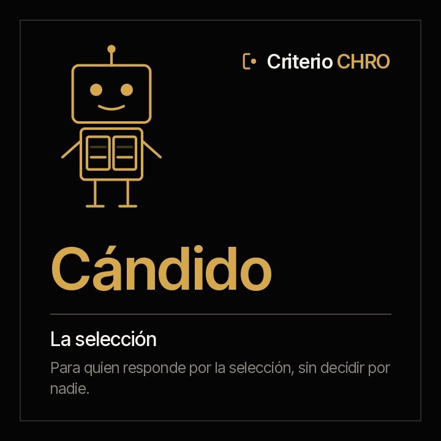

<picture><source media="(prefers-color-scheme: dark)" srcset="../../docs/img/marca/es/criterio-chro-oscuro.svg"></picture>

# Cándido · la selección



**Cándido pone cada afirmación de la hoja de vida al lado de su soporte.**
Tú respondes por la selección. Él llega con cada hoja de vida contra sus soportes —el título sin diploma, el empleo cuyas fechas no son las de su certificado, la certificación vencida—, cada candidato contra el perfil requisito por requisito y con la cita, la autorización y la conservación de sus datos, y cada vacante contra su plazo. Sin puntajes y sin ordenar a nadie: quien selecciona decide.

<!-- agente:nombre · generado por scripts/familias.py; no se edita a mano -->
**El nombre.** Cándido, del latín *candidus*, «blanco»: de ahí *candidato*, el que en Roma vestía la toga blanca para pedir un cargo. Cada afirmación de la hoja de vida contra su soporte.
<!-- /agente:nombre -->

[English](README.md) · `criterio-talent` · Apache 2.0 · Una instancia por entidad

**Estado: construido, en su versión 0.1.0, de laboratorio, con la familia CHRO.** El motor de cálculo, probado contra todo el material sintético de la familia con una clave que el agente no ve, entidades de control y la prueba de sesgo con pares de candidatos; con el agente, las rondas 1 y 2 sobre la banca de Colombia y su control. El resto del material todavía no corre con el agente, y no se ha probado sobre la documentación de una organización concreta.

**Esta página se lee sola.** Cándido funciona sin el otro agente de la familia. La familia —cómo se encuentran entre sí y con Rostrum— está en la [familia criterio-chro](../../families/criterio-chro/README.es.md).

---

## Qué es

| | |
|---|---|
| **A quién extiende** | A quien responde por la selección —el jefe de selección, el reclutador— y a quien responde por los datos personales de los candidatos |
| **Sobre qué trabaja** | **Las vacantes y los candidatos de una entidad**, periodo a periodo |
| **Qué mira** | El registro de vacantes, las hojas de vida y sus soportes, el registro de autorizaciones y la exportación del ATS |
| **Cadencia** | Cuando llegan hojas de vida nuevas, cuando una vacante se acerca a su plazo, y una vez por semana |
| **Instancias** | Una por entidad |

## Qué hace

**Lo que hace y hoy no se hace: contrastar cada afirmación de cada hoja de vida con su soporte**, y cada candidato con el perfil, requisito por requisito, sin que el nombre, la fotografía o la edad entren al análisis.

**Lo que puede responder:** qué título no tiene diploma, qué empleo no coincide con su certificado, qué certificación exigida venció, qué requisito esencial no tiene evidencia, qué candidato no autorizó el tratamiento de sus datos, de quién se conservan los datos más de lo que dice la política y qué vacante pasó su plazo.

<!-- chro:comandos · generado por scripts/familias.py; no se edita a mano -->
### Los diez comandos

> Se escriben con el prefijo del plugin: `/criterio-talent:` y autocompletar hace el resto. Es la única forma que resuelve en una sesión de Claude Code.

| Comando | Qué hace |
|---|---|
| `/criterio-talent:talent-setup` | La configuración y el inventario |
| `/criterio-talent:candido` | Lo que necesites, en tus palabras: Cándido elige el comando que lo resuelve y lo corre |
| `/criterio-talent:talent-scan` | La ficha del periodo al día |
| `/criterio-talent:talent-search` | La búsqueda que corre quien recluta |
| `/criterio-talent:cv-check` | Cada afirmación de la hoja de vida contra su soporte |
| `/criterio-talent:candidate-fit` | Cada candidato contra el perfil, requisito por requisito |
| `/criterio-talent:privacy-check` | La autorización y la conservación de cada candidato |
| `/criterio-talent:vacancy-status` | Cada vacante contra su plazo de cobertura |
| `/criterio-talent:talent-wake` | Lo que toca hoy en la selección |
| `/criterio-talent:share-findings` | Un resumen sin datos, solo si se dice que sí |
<!-- /chro:comandos -->

`talent-setup` va primero porque los demás lo necesitan, y `talent-wake` es el que se le pone a un reloj. Entre los dos, los que preparan el trabajo: qué cambió, la búsqueda de una vacante, las hojas de vida contra sus soportes, cada candidato contra el perfil, los datos de los candidatos y las vacantes.

<!-- chro:skills · generado por scripts/familias.py; no se edita a mano -->
### Los tres skills

Se cargan solos cuando el tema aparece. Son el conocimiento que los comandos comparten, y se consultan como un manual.

| Skill | Qué encapsula | De quién es |
|---|---|---|
| `cv-record` | Cómo se lleva una hoja de vida a la ficha: cada título, certificación y empleo con su soporte y sus fechas, la evidencia de cada requisito y lo que llegó y no se debe tratar, sin copiar su valor | Propio |
| `selection-policy` | La política de selección: el plazo de cobertura, los días de conservación de los datos, el registro de autorizaciones, el de vacantes y la exportación del ATS con sus columnas | Propio |
| `talent-intake` | La estructura recomendada de la carpeta de talento, qué va en cada carpeta y qué agente la usa, cómo se nombran los perfiles, las carpetas de los candidatos y las exportaciones, y qué nunca se pide ni se trata | Copia de Norma |
<!-- /chro:skills -->

## Para qué sirve

`/criterio-talent:candidate-fit` pone cada requisito del perfil al lado de la evidencia de cada candidato, en el orden de su identificador. **Lo que no tiene evidencia se dice; quién sigue en el proceso lo decide una persona.**

### Y para qué no sirve

- **No rechaza, no descarta, no da puntajes y no ordena candidatos.** Ninguna decisión sobre una persona es del agente (decisión 0031; Reglamento (UE) 2024/1689, anexo III, punto 4).
- **No usa la fotografía, la edad, el sexo, el estado civil, el origen ni la salud de nadie.** Si llegan, se excluyen y se dice.
- **No entra a LinkedIn ni a ninguna red, no compra bases y no verifica antecedentes.** Prepara la búsqueda para que la corra quien recluta.
- **No infiere la personalidad, la «cultura» ni el potencial**, ni penaliza una brecha entre dos empleos.

Y una que hay que decir en voz alta: **tus documentos se procesan en la infraestructura de la plataforma de IA**, no solo en tu equipo. Una hoja de vida trae datos personales: confirma que sea admisible bajo tu política de datos antes de apuntarla a esa carpeta. Descargo completo en [DISCLAIMER.es.md](../../DISCLAIMER.es.md), términos en [TERMS.es.md](../../TERMS.es.md).

## Instalación y configuración

**Está en el marketplace**, en su versión de laboratorio:

```
/plugin marketplace add josenanez/criterio
/plugin install criterio-talent@criterio
/criterio-talent:talent-setup
```

### El primer resultado

`/criterio-talent:talent-setup` no te pide que ordenes nada antes de empezar. Mira la carpeta de talento de la entidad, la compara con la [estructura recomendada](../../families/criterio-chro/README.es.md#la-estructura-de-carpetas-recomendada), reconoce las columnas de los registros y hace las preguntas que ningún documento responde: el plazo de cobertura de una vacante y cuánto se conservan los datos de un candidato, de la política de selección. En los primeros quince minutos deja ver el primer resultado: cada vacante contra su plazo.

### Cada cuánto corre

`/criterio-talent:talent-wake` es el comando que el reloj invoca: hace lo que toca, responde primero las preguntas que alguien dejó en Rostrum, y **si no toca nada no produce nada.** La decisión de qué toca es aritmética de fechas, y la toma el código:

```
python3 scripts/talento.py despertar --config <archivo>
```

## Trabajo en equipo

| Con quién | Qué pasa |
|---|---|
| **Norma** | Comparten la carpeta y la referencia. Cándido toma de las fichas de Norma los perfiles contra los que contrasta a cada candidato |
| **Rostrum** | Publica el estado de las vacantes. **Lo de los candidatos no sale ahí** salvo que la configuración lo diga, y entonces solo con su identificador |

## Pruebas

[`scripts/talento.py`](scripts/talento.py), con la librería estándar, hace todo lo que es cálculo: procesa la descarga del estándar y cada tabla con su fila de origen, cuenta los días contra los plazos de la política, contrasta cada requisito y cada afirmación con su evidencia y deja fuera lo que no se trata, el mismo resultado cada vez. Vive en `criterio-roles` y se copia a `criterio-talent`; `scripts/sincronizar.py --check` falla si la copia se separa.

```
python3 scripts/talento.py selftest                          el motor y la prueba de sesgo
python3 tests/criterio-chro/generar.py                       el material
python3 tests/criterio-chro/evaluar.py --agente candido       cada señal contra la clave
```

Qué se siembra en cada entidad y **qué no prueba el material**, en [`EVIDENCIA.md`](../../tests/criterio-chro/EVIDENCIA.md). El diseño, con la entrada, el proceso y el reporte de cada comando, en el [diseño de la familia](../../families/criterio-chro/DISENO.es.md).
