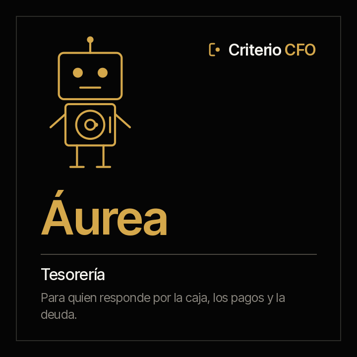

<picture><source media="(prefers-color-scheme: dark)" srcset="../../docs/img/marca/es/criterio-cfo-oscuro.svg"></picture>

# Áurea · Tesorería



**Áurea pone la caja, los pagos y la deuda al lado de su política.** Tú respondes por la caja de
la entidad. Ella llega con cada cuenta contra su mínimo y su proyección, cada pago programado
contra quién puede aprobarlo, la exposición cambiaria contra su límite y cada covenant calculado
desde el balance que cierra Clara.

<!-- agente:nombre · generado por scripts/familias.py; no se edita a mano -->
**El nombre.** Áurea, del latín *aureus*, «de oro»: la caja.
<!-- /agente:nombre -->

[English](README.md) · `criterio-treasury` · Apache 2.0 · Una instancia por entidad

**Estado: construida y probada sobre material sintético** de cuatro países —Colombia, Ecuador, Perú
y Chile— con las [rondas con el agente](../../tests/evidencias/familias/cfo/RONDAS.md) de la familia.
Nada se ha corrido aún sobre los documentos de una organización concreta. Lo que falta para darla
por terminada, en los [criterios de aceptación](ACCEPTANCE.md).

**Es el tercer agente de la oficina del CFO** ([ADR 0016](../../docs/decisions/0016-tesoreria-tercer-agente-cfo.md)):
comparte con Clara el motor, la carpeta y el periodo. La familia está en
[criterio-cfo](../../families/criterio-cfo/README.es.md).

---

## Qué es

La tercera capacidad de la oficina del CFO: la tesorería. O*NET reúne a tesoreros y contralores en
una misma ocupación (11-3031.01), y por eso Áurea vive en la familia CFO y no aparte.

## Qué hace

<!-- cfo:comandos · generado por scripts/familias.py; no se edita a mano -->
### Los seis comandos

> Se escriben con el prefijo del plugin: `/criterio-treasury:` y autocompletar hace el resto. Es la única forma que resuelve en una sesión de Claude Code.

| Comando | Qué hace |
|---|---|
| `/criterio-treasury:treasury-setup` | La configuración, el inventario y la primera posición de caja |
| `/criterio-treasury:treasury-scan` | La tesorería al día, con lo que cambió y las señales nuevas |
| `/criterio-treasury:cash-position` | La caja de cada cuenta contra su mínimo y su proyección, y la exposición cambiaria |
| `/criterio-treasury:payment-check` | Cada pago programado contra quién puede aprobarlo |
| `/criterio-treasury:debt-watch` | La deuda contra su vencimiento y lo que exige su contrato |
| `/criterio-treasury:treasury-wake` | Lo que toca hoy en la tesorería; si no toca nada, se calla |
<!-- /cfo:comandos -->

<!-- cfo:skills · generado por scripts/familias.py; no se edita a mano -->
### Los dos skills

Se cargan solos cuando el tema aparece. Son el conocimiento que los comandos comparten, y se consultan como un manual.

| Skill | Qué encapsula | De quién es |
|---|---|---|
| `finance-intake` | Qué documentos procesa la familia, dónde va cada uno, qué procesa el motor directamente y qué extrae el agente a la ficha | Copia de Clara · también en Tomás |
| `treasury-control` | La tesorería contra su política: la caja contra su mínimo y su proyección, los pagos contra sus aprobadores y la matriz de firmas, la exposición cambiaria y los covenants calculados desde el balance | Propio |
<!-- /cfo:skills -->

## Para qué sirve

Para que la tesorería llegue al comité y al banco con la caja, los pagos y la deuda contrastados
contra su política, sin armarlo a mano. Lo que procesa:

| Documento | Dónde |
|---|---|
| El extracto de cada cuenta, el mismo que concilia Clara, en CSV, Excel o PDF con texto | `<AAAA-MM>/20-bancos/<cuenta>/` |
| El programa de pagos, con quién aprobó cada uno, y el flujo de caja proyectado | `<AAAA-MM>/60-tesoreria/` |
| La política de tesorería, la matriz de firmas, el registro de la deuda y los covenants | `00-referencia/` |
| El balance de comprobación del periodo, para los covenants | `<AAAA-MM>/10-contabilidad/` |

**La política es de la organización.** Áurea no la propone como norma: sin política no hay
mínimo de caja ni aprobadores por monto, y el reporte lo dice.

### Lo que cuesta hoy

Las cifras verificadas de la función financiera —con su fuente, su año y su muestra— están en la
[página de la familia](../../families/criterio-cfo/README.es.md) y en
[`FUENTES.es.md`](../../families/criterio-cfo/FUENTES.es.md). La que toca de lleno a la tesorería es
la del fraude en pagos: un pago que sale sin las aprobaciones que pide su monto es justo lo que
Áurea pone sobre la mesa antes de que salga.

### Y para qué no sirve

- **No mueve dinero, no hace pagos y no entra a un portal bancario.** Procesa las exportaciones
  que la tesorería ya tiene.
- **No recomienda una inversión, un financiamiento ni una cobertura**, y no negocia con un banco.
- **No interpreta el contrato de la deuda.** Calcula cada covenant con la fórmula y el límite que
  la organización registró, desde el balance que cierra Clara.
- **No mueve, renombra ni crea nada dentro de los documentos de la organización**, salvo, con el
  sí de la persona, el archivo que marca la carpeta raíz.
- **No adivina.** Cada dato lleva la cita del documento y, en las tablas, la fila de donde salió.

Y una que hay que decir en voz alta: **tus documentos se procesan en la infraestructura de la
plataforma de IA**, no solo en tu equipo. Descargo completo en [DISCLAIMER.es.md](../../DISCLAIMER.es.md),
términos en [TERMS.es.md](../../TERMS.es.md).

## Instalación y configuración

```
/plugin marketplace add josenanez/criterio
/plugin install criterio-treasury@criterio
/criterio-treasury:treasury-setup
```

**En Claude Cowork** — Personalizar → Explorar plugins → Personal → **+** → Agregar
marketplace desde GitHub → `josenanez/criterio`.

### El primer resultado

`/criterio-treasury:treasury-setup` no te pide que ordenes nada. Mira la misma carpeta de Clara y
Tomás, dice qué cuentas tienen extracto, si hay programa de pagos y flujo, y si `00-referencia`
trae la política, la matriz de firmas, el registro de la deuda y los covenants. Pregunta lo que
ningún documento responde —la entidad y el periodo, las cuentas en otra moneda y los umbrales— y
en los primeros quince minutos deja ver la posición de caja de cada cuenta contra su mínimo y su
proyección, sacada de sus propios extractos.

**Lo que queda configurado** lo escribe el setup en `.criterio/tesoreria/<entidad>/config.json`.
Su reporte **no se publica en Rostrum por omisión**: trae saldos y cuentas.

### Cada cuánto corre

Con cada extracto nuevo y antes de cada pago programado. La decisión es aritmética de fechas:

```
python3 scripts/finanzas.py despertar --config <archivo>
```

Y `/criterio-treasury:treasury-wake` es el comando que el reloj invoca: hace lo que toca y, **si no
toca nada, se calla.**

## Trabajo en equipo

Áurea no le habla a Clara ni a Tomás: se encuentran por el estado de la entidad.

| Con quién | Qué pasa |
|---|---|
| **Clara** | Áurea toma los extractos que Clara concilia y el balance que ella cierra, de la misma carpeta; no recalcula los libros |
| **Tomás** | Comparten el periodo y la entidad; cada uno escribe solo su ficha |
| **Rostrum** | Muestra lo que vence de su registro de la deuda; su reporte con saldos se publica solo si la configuración lo dice |

## Pruebas

### Cómo está construido

[`scripts/finanzas.py`](scripts/finanzas.py) es el mismo motor de Clara y Tomás, copiado byte a byte
(`scripts/sincronizar.py --check` falla si se separa). Procesa directamente los extractos, el
programa de pagos, el flujo, la política, la matriz de firmas, el registro de la deuda y el balance,
y calcula cada señal: la caja contra su mínimo y su proyección, los pagos contra sus aprobaciones y
firmas, la exposición cambiaria, lo que vence y cada covenant. El agente lleva a su ficha solo lo
que trae un documento escrito.

### Cómo se verifica

```
python3 scripts/finanzas.py selftest                 el motor
python3 tests/criterio-cfo/generar.py                 el material de prueba
python3 tests/criterio-cfo/evaluar.py --agente aurea  cada señal contra la clave
```

Sobre material sintético con una clave que el motor no ve, incluidas las entidades de control,
donde cualquier señal es una falla. Las rondas con los tres agentes, cada salida y cada defecto con
su origen, en [las rondas de la familia](../../tests/evidencias/familias/cfo/RONDAS.md); el análisis
estadístico, en [`ANALISIS.es.md`](../../families/criterio-cfo/analisis/ANALISIS.es.md); la última
corrida del motor, en [`tests/criterio-treasury/RESULTADOS.md`](../../tests/criterio-treasury/RESULTADOS.md).
