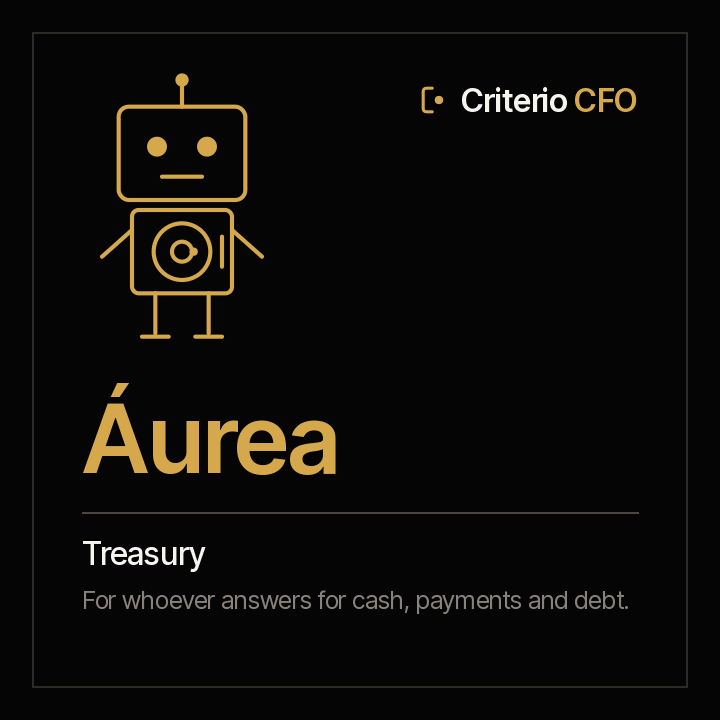

<picture><source media="(prefers-color-scheme: dark)" srcset="../../docs/img/marca/en/criterio-cfo-oscuro.svg"></picture>

# Áurea · Treasury



**Áurea puts cash, payments and debt next to their policy.** You answer for the entity's cash.
She arrives with each account against its minimum and projection, each scheduled payment against
who may approve it, currency exposure against its limit and each covenant calculated from the
books Clara closes.

[Español](README.es.md) · `criterio-treasury` · Apache 2.0 · One instance per entity

**Status: built and tested on synthetic material** from four countries —Colombia, Ecuador, Peru and
Chile— in the family's [rounds with the agent](../../tests/evidencias/familias/cfo/RONDAS.md).
Nothing has run yet on a specific organisation's documents. What remains before calling it done,
in the [acceptance criteria](ACCEPTANCE.md).

**She is the third agent of the CFO's office** ([ADR 0016](../../docs/decisions/0016-tesoreria-tercer-agente-cfo.md)):
she shares the engine, the folder and the period with Clara. The family is in
[criterio-cfo](../../families/criterio-cfo/README.md).

---

## What it is

The third capability of the CFO's office: treasury. O*NET groups treasurers and controllers in a
single occupation (11-3031.01), which is why Áurea lives in the CFO family and not on her own.

## What it does

<!-- cfo:comandos · generado por scripts/familias.py; no se edita a mano -->
### The six commands

> They are typed with the plugin prefix: `/criterio-treasury:` and autocomplete does the rest. It is the only form that resolves in a Claude Code session.

| Command | What it does |
|---|---|
| `/criterio-treasury:treasury-setup` | The configuration, the inventory and the first cash position |
| `/criterio-treasury:treasury-scan` | Treasury up to date, with what changed and the new signals |
| `/criterio-treasury:cash-position` | Each account's cash against its minimum and projection, and the currency exposure |
| `/criterio-treasury:payment-check` | Each scheduled payment against who may approve it |
| `/criterio-treasury:debt-watch` | Debt against its maturity and what its contract requires |
| `/criterio-treasury:treasury-wake` | What treasury needs today; silent when nothing does |
<!-- /cfo:comandos -->

<!-- cfo:skills · generado por scripts/familias.py; no se edita a mano -->
### The two skills

They load on their own when the subject comes up. They are the knowledge the commands share, and they are consulted like a manual.

| Skill | What it encapsulates | Whose it is |
|---|---|---|
| `finance-intake` | Which documents the family processes, where each one goes, what the engine processes directly and what the agent extracts to the record | Copy of Clara's · also in Tomás |
| `treasury-control` | Treasury against its policy: cash against its minimum and projection, payments against their approvers and the signing-authority matrix, currency exposure and covenants calculated from the trial balance | Own |
<!-- /cfo:skills -->

## What it is for

So that treasury reaches the committee and the bank with cash, payments and debt checked against
their policy, without building it by hand. What it processes:

| Document | Where |
|---|---|
| Each account's statement, the same one Clara reconciles, in CSV, Excel or text PDF | `<YYYY-MM>/20-bancos/<account>/` |
| The payment schedule, with who approved each payment, and the cash forecast | `<YYYY-MM>/60-tesoreria/` |
| The treasury policy, the signing matrix, the debt register and the covenants | `00-referencia/` |
| The period's trial balance, for the covenants | `<YYYY-MM>/10-contabilidad/` |

**The policy is the organisation's.** Áurea does not propose it as a rule: without a policy there is
no cash minimum and no approvers by amount, and the report says so.

### What it costs today

The verified figures for the finance function —with their source, year and sample— are on the
[family page](../../families/criterio-cfo/README.md) and in
[`FUENTES.es.md`](../../families/criterio-cfo/FUENTES.es.md). The one that hits treasury head-on is
payments fraud: a payment that goes out without the approvals its amount requires is exactly what
Áurea puts on the table before it leaves.

### And what it is not for

- **It does not move money, make payments or log into a bank portal.** It processes the exports
  treasury already has.
- **It does not recommend an investment, a financing or a hedge**, and does not negotiate with a bank.
- **It does not interpret the debt contract.** It calculates each covenant with the formula and
  limit the organisation recorded, from the balance sheet Clara closes.
- **It never moves, renames or creates anything inside the organisation's documents**, except, with
  the person's yes, the file that marks the root folder.
- **It does not guess.** Every data point cites the document and, in tables, the row it came from.

And one to say out loud: **your documents are processed on the AI platform's infrastructure**, not
only on your machine. Full disclaimer in [DISCLAIMER.md](../../DISCLAIMER.md), terms in
[TERMS.md](../../TERMS.md).

## Installing and configuring

```
/plugin marketplace add josenanez/criterio
/plugin install criterio-treasury@criterio
/criterio-treasury:treasury-setup
```

**In Claude Cowork** — Customise → Explore plugins → Personal → **+** → Add marketplace from
GitHub → `josenanez/criterio`.

### The first result

`/criterio-treasury:treasury-setup` does not ask you to tidy anything. It looks at the same folder as
Clara and Tomás, says which accounts have a statement, whether there is a payment schedule and a
forecast, and whether `00-referencia` holds the policy, the signing matrix, the debt register and
the covenants. It asks what no document answers —the entity and period, the foreign-currency
accounts and the thresholds— and within fifteen minutes shows each account's cash position against
its minimum and forecast, taken from its own statements.

**What stays configured** is written by the setup to `.criterio/tesoreria/<entity>/config.json`. Her
report **is not published on Rostrum by default**: it carries balances and accounts.

### How often it runs

With each new statement and before each scheduled payment. The decision is date arithmetic:

```
python3 scripts/finanzas.py despertar --config <file>
```

And `/criterio-treasury:treasury-wake` is the command the clock calls: it does what is due and, **if
nothing is, it stays quiet.**

## Working with the others

Áurea does not talk to Clara or Tomás: they find each other through the entity's state.

| With whom | What happens |
|---|---|
| **Clara** | Áurea takes the statements Clara reconciles and the balance sheet she closes, from the same folder; she does not recalculate the books |
| **Tomás** | They share the period and the entity; each writes only their own record |
| **Rostrum** | Shows what falls due from her debt register; her report with balances is published only if the configuration says so |

## Tests

### How it is built

[`scripts/finanzas.py`](scripts/finanzas.py) is the same engine as Clara's and Tomás's, copied byte for
byte (`scripts/sincronizar.py --check` fails if it drifts). It processes the statements, the payment
schedule, the forecast, the policy, the signing matrix, the debt register and the balance sheet
directly, and calculates every signal: cash against its minimum and forecast, payments against their
approvals and signatures, currency exposure, what falls due and each covenant. The agent takes to its
record only what a written document carries.

### How it is verified

```
python3 scripts/finanzas.py selftest                 the engine
python3 tests/criterio-cfo/generar.py                 the test material
python3 tests/criterio-cfo/evaluar.py --agente aurea  each signal against the key
```

On synthetic material with a key the engine never sees, including the control entities, where any
signal is a failure. The rounds with the three agents, every output and every defect with its origin,
in [the family's rounds](../../tests/evidencias/familias/cfo/RONDAS.md); the statistical analysis, in
[`ANALISIS.md`](../../families/criterio-cfo/analisis/ANALISIS.md); the engine's latest run, in
[`tests/criterio-treasury/RESULTADOS.md`](../../tests/criterio-treasury/RESULTADOS.md).
