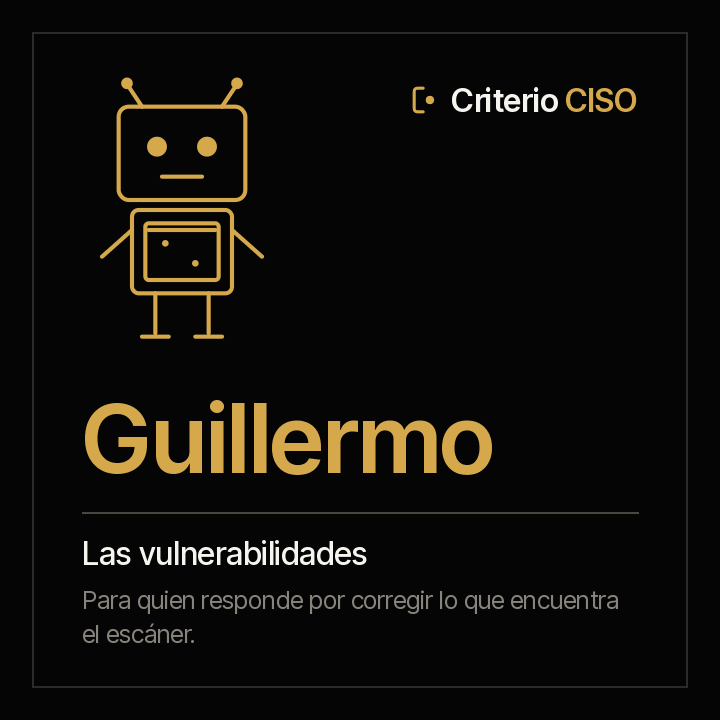

<picture><source media="(prefers-color-scheme: dark)" srcset="../../docs/img/marca/es/criterio-ciso-oscuro.svg"></picture>

# Guillermo · las vulnerabilidades



**Guillermo pone cada vulnerabilidad al lado del plazo para corregirla.**
Tú respondes por la gestión de vulnerabilidades. Él llega con cada hallazgo del escáner contra el plazo de su severidad en tu política, lo que está en el catálogo KEV de CISA, las excepciones que vencieron, los cierres que ningún escaneo prueba y los activos que ningún escaneo cubre.

<!-- agente:nombre · generado por scripts/familias.py; no se edita a mano -->
**El nombre.** Guillermo, del germánico *Wilhelm*, «protector decidido»: cada vulnerabilidad contra el plazo para corregirla.
<!-- /agente:nombre -->

[English](README.md) · `criterio-vulnerability` · Apache 2.0 · Una instancia por entidad

**Estado: en construcción (versión 0.1.0).** El motor de cálculo, probado contra material sintético de cuatro industrias con una clave que el agente no ve y dos entidades de control. **La ronda con el agente es el siguiente paso**, en la 0.2.0. Nada se anuncia como terminado hasta que pasen los [criterios de aceptación](ACCEPTANCE.md).

**Esta página se lee sola.** Guillermo funciona sin los otros dos agentes de la familia. La familia —cómo se encuentran entre sí y con Rostrum— está en la [familia criterio-ciso](../../families/criterio-ciso/README.es.md).

---

## Qué es

| | |
|---|---|
| **A quién extiende** | A quien responde por la gestión de vulnerabilidades y a quien reporta su avance al comité de seguridad |
| **Sobre qué trabaja** | **Las vulnerabilidades de una entidad**, escaneo a escaneo |
| **Qué mira** | Las exportaciones del escáner con su fecha, el catálogo KEV, el inventario de activos, el seguimiento de la remediación y las excepciones |
| **Cadencia** | Cuando llega una exportación o un catálogo nuevo, cuando vence un plazo, y una vez por semana |
| **Instancias** | Una por entidad |

## Qué hace

**Lo que hace y hoy no se hace: cruzar cada hallazgo de cada escaneo con el plazo de la política, con el catálogo de lo que se explota y con el escaneo que prueba cada cierre.**

**Lo que puede responder que hoy cuesta horas de hojas de cálculo:** qué vulnerabilidad crítica pasó su plazo, cuál de lo abierto ya se está explotando, qué cierre reportado el escáner sigue encontrando, qué excepción venció y qué servidor del inventario lleva semanas sin escanearse.

<!-- ciso:comandos · generado por scripts/familias.py; no se edita a mano -->
### Los seis comandos

> Se escriben con el prefijo del plugin: `/criterio-vulnerability:` y autocompletar hace el resto. Es la única forma que resuelve en una sesión de Claude Code.

| Comando | Qué hace |
|---|---|
| `/criterio-vulnerability:vuln-setup` | La configuración, con los plazos de la política, y el formato de cada exportación |
| `/criterio-vulnerability:vuln-scan` | Lo abierto al día, con las señales nuevas |
| `/criterio-vulnerability:vuln-sla` | Cada vulnerabilidad abierta contra el plazo de la política |
| `/criterio-vulnerability:kev-check` | Cada vulnerabilidad explotada que sigue abierta |
| `/criterio-vulnerability:scan-coverage` | Cada activo con su escaneo, y cada cierre con el escaneo que lo prueba |
| `/criterio-vulnerability:vuln-wake` | Lo que tocaba hoy, corrido |
<!-- /ciso:comandos -->

`vuln-setup` va primero porque los demás lo necesitan, y `vuln-wake` es el que se le pone a un reloj. Entre los dos, los cuatro que preparan el trabajo: qué cambió, lo abierto contra su plazo, lo explotado y la cobertura.

<!-- ciso:skills · generado por scripts/familias.py; no se edita a mano -->
### Los tres skills

Se cargan solos cuando el tema aparece. Son el conocimiento que los comandos comparten, y se consultan como un manual.

| Skill | Qué encapsula | De quién es |
|---|---|---|
| `scanner-exports` | Las exportaciones del escáner y el catálogo KEV: las columnas que se reconocen, el mapeo para las demás, la severidad desde el puntaje CVSS (F-05) y qué es lo abierto | Propio |
| `security-intake` | La estructura recomendada de la carpeta de seguridad, qué va en cada carpeta y qué agente la usa, cómo se nombran la evidencia y las exportaciones, y qué nunca se deja ahí | Copia de Alexis · también en Amparo |
| `vuln-policy` | Los plazos de corrección de la política, cómo se extraen con su cita, las excepciones con su aprobación y su vencimiento, y por qué los informes de vulnerabilidades no se publican por omisión | Propio |
<!-- /ciso:skills -->

## Para qué sirve

`/criterio-vulnerability:vuln-sla` pone cada vulnerabilidad abierta al lado del plazo de su severidad, contado desde su primera detección. **Una excepción vigente lo suspende; una vencida es una señal.**

### Y para qué no sirve

- **No corre un escaneo ni se conecta a un sistema, a una consola ni a internet.** Procesa lo que la organización exportó.
- **No aprueba ni extiende una excepción.** Dice cuál venció.
- **No publica en Rostrum las vulnerabilidades abiertas** salvo que la configuración lo diga: un informe de vulnerabilidades es un mapa para un atacante.
- **No abre credenciales, llaves ni respaldos.** Los lista como excluidos.

Y una que hay que decir en voz alta: **tus documentos se procesan en la infraestructura de la plataforma de IA**, no solo en tu equipo. Confirma que sea admisible bajo tus políticas antes de apuntarla a material confidencial. Descargo completo en [DISCLAIMER.es.md](../../DISCLAIMER.es.md), términos en [TERMS.es.md](../../TERMS.es.md).

## Instalación y configuración

**Todavía no está en el marketplace**: sale con su primera versión. Entonces:

```
/plugin marketplace add josenanez/criterio
/plugin install criterio-vulnerability@criterio
/criterio-vulnerability:vuln-setup
```

### El primer resultado

`/criterio-vulnerability:vuln-setup` no te pide que ordenes nada antes de empezar. Mira la carpeta de seguridad de la entidad, la compara con la [estructura recomendada](../../families/criterio-ciso/README.es.md#la-estructura-de-carpetas-recomendada), dice qué no va a abrir y hace las preguntas que ningún documento responde: los plazos de la política, con la página de donde salen, y qué columna del escáner trae cada dato si no la reconoce. En los primeros quince minutos deja ver el primer resultado: cada vulnerabilidad abierta contra el plazo de su severidad.

### Cada cuánto corre

`/criterio-vulnerability:vuln-wake` es el comando que el reloj invoca: hace lo que toca, responde primero las preguntas que alguien dejó en Rostrum, y **si no toca nada no produce nada.** La decisión de qué toca es aritmética de fechas, y la toma el código:

```
python3 scripts/seguridad.py despertar --config <archivo>
```

## Trabajo en equipo

| Con quién | Qué pasa |
|---|---|
| **Alexis** | Comparten la carpeta y la referencia de la entidad. Alexis procesa los controles; Guillermo, las vulnerabilidades. Cada uno escribe solo su ficha |
| **Amparo** | Comparten la carpeta y la referencia. Amparo procesa los incidentes y las pruebas de continuidad |
| **Rostrum** | Publica sus reportes, lo que vence y sus señales para quien no abre una carpeta, y le devuelve las preguntas que deja quien lo mira. **No escribe en el estado**. **Lo de vulnerabilidades no sale ahí** salvo que la configuración lo diga |

## Pruebas

### Cómo está construido

La espina son **las exportaciones del escáner**: el motor las procesa directamente, cada una con su fecha, y la ficha guarda solo las preguntas y sus respuestas.

[`scripts/seguridad.py`](scripts/seguridad.py), con la librería estándar, hace todo lo que es cálculo: procesa cada tabla y cada exportación con su fila de origen, cuenta los días y las horas contra los plazos de la política y excluye lo que nunca se abre, el mismo resultado cada vez. Vive en `criterio-security` y se copia a los otros dos agentes; `scripts/sincronizar.py --check` falla si alguna copia se separa.

### Cómo se verifica

```
python3 scripts/seguridad.py selftest                        el motor
python3 tests/criterio-ciso/generar.py                       el material de cuatro industrias
python3 tests/criterio-ciso/evaluar.py --agente guillermo    cada señal contra la clave
```

**Cómo salió la última corrida, generado desde la corrida misma:** [`tests/criterio-vulnerability/RESULTADOS.md`](../../tests/criterio-vulnerability/RESULTADOS.md). Qué se siembra en cada entidad y **qué no prueba el material**, en [`EVIDENCIA.md`](../../tests/criterio-ciso/EVIDENCIA.md). El diseño, con la entrada, el proceso y el reporte de cada comando, en el [diseño de la familia](../../families/criterio-ciso/DISENO.es.md).
