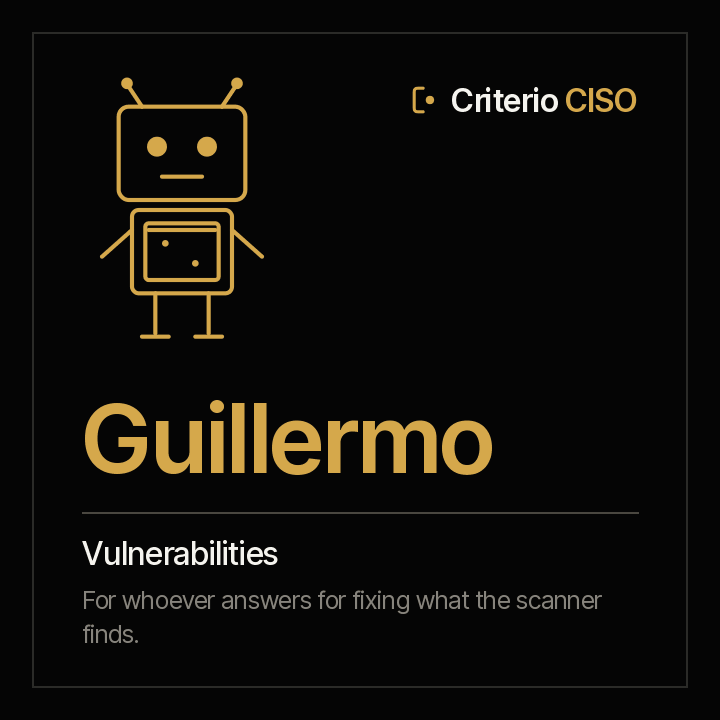

<picture><source media="(prefers-color-scheme: dark)" srcset="../../docs/img/marca/en/criterio-ciso-oscuro.svg"></picture>

# Guillermo · vulnerabilities



**Guillermo puts every vulnerability next to the deadline to fix it.**
You answer for vulnerability management. He comes with every scanner finding against its severity's deadline in your policy, what is in CISA's KEV catalog, the exceptions that expired, the closures no scan proves and the assets no scan covers.

<!-- agente:nombre · generado por scripts/familias.py; no se edita a mano -->
**The name.** Guillermo, from the Germanic *Wilhelm*, “resolute protector”: every vulnerability against the deadline to fix it.
<!-- /agente:nombre -->

[Español](README.es.md) · `criterio-vulnerability` · Apache 2.0 · One instance per entity

**Status: laboratory, not yet launched (version 0.2.0).** The calculation engine, tested against synthetic material from four industries with a key the agent never sees and two control entities, and the first round with the three agents on all six entities: 100 of 100 signals, none extra. It stays in laboratory because the extracted fields are still too few for a 95 % floor. It can already be installed from the marketplace. Nothing is announced as finished until it passes the [acceptance criteria](ACCEPTANCE.md).

**This page stands on its own.** Guillermo works without the family's other two agents. The family —how they meet each other and Rostrum— is in the [criterio-ciso family](../../families/criterio-ciso/README.md).

---

## What it is

| | |
|---|---|
| **Whom it extends** | Whoever answers for vulnerability management and whoever reports its progress to the security committee |
| **What it works on** | **An entity's vulnerabilities**, scan by scan |
| **What it looks at** | The scanner exports with their date, the KEV catalog, the asset inventory, the remediation tracker and the exceptions |
| **Cadence** | When a new export or catalog arrives, when a deadline falls due, and once a week |
| **Instances** | One per entity |

## What it does

**What it does that is not done today: crossing every finding of every scan with the policy's deadline, with the catalog of what is being exploited and with the scan that proves each closure.**

**What it can answer that takes hours of spreadsheets today:** which critical vulnerability is past its deadline, which open one is already being exploited, which reported closure the scanner still finds, which exception expired and which inventory server has gone weeks without a scan.

<!-- ciso:comandos · generado por scripts/familias.py; no se edita a mano -->
### The seven commands

> They are typed with the plugin prefix: `/criterio-vulnerability:` and autocomplete does the rest. It is the only form that resolves in a Claude Code session.

| Command | What it does |
|---|---|
| `/criterio-vulnerability:vuln-setup` | The configuration, with the policy's deadlines, and the format of each export |
| `/criterio-vulnerability:vuln-scan` | What is open, up to date, with the new signals |
| `/criterio-vulnerability:vuln-sla` | Each open vulnerability against the policy's deadline |
| `/criterio-vulnerability:kev-check` | Each exploited vulnerability still open |
| `/criterio-vulnerability:scan-coverage` | Each asset with its scan, and each closure with the scan that proves it |
| `/criterio-vulnerability:vuln-wake` | What was due today, run |
| `/criterio-vulnerability:share-findings` | A summary with no data to share, only if you say yes |
<!-- /ciso:comandos -->

`vuln-setup` comes first because the others need it, and `vuln-wake` is the one you put on a clock. Between them, the four that prepare the work: what changed, open items against their deadline, what is exploited and coverage.

<!-- ciso:skills · generado por scripts/familias.py; no se edita a mano -->
### The three skills

They load on their own when the subject comes up. They are the knowledge the commands share, and they are consulted like a manual.

| Skill | What it encapsulates | Whose it is |
|---|---|---|
| `scanner-exports` | The scanner exports and the KEV catalog: the columns that are recognised, the mapping for the rest, the severity from the CVSS score (F-05) and what counts as open | Own |
| `security-intake` | The recommended structure of the security folder, what goes in each folder and which agent uses it, how evidence and exports are named, and what is never left there | Copy of Alexis's · also in Amparo |
| `vuln-policy` | The policy's remediation deadlines, how they are extracted with their citation, the exceptions with their approval and expiry, and why vulnerability reports are not published by default | Own |
<!-- /ciso:skills -->

## What it is for

`/criterio-vulnerability:vuln-sla` puts every open vulnerability next to its severity's deadline, counted from its first detection. **A current exception suspends it; an expired one is a signal.**

### And what it is not for

- **It does not run a scan or connect to a system, a console or the internet.** It processes what the organisation exported.
- **It does not approve or extend an exception.** It says which one expired.
- **It does not publish open vulnerabilities in Rostrum** unless the configuration says so: a vulnerability report is a map for an attacker.
- **It does not open credentials, keys or backups.** It lists them as excluded.

And one that has to be said out loud: **your documents are processed on the AI platform's infrastructure**, not only on your machine. Confirm that is acceptable under your policies before pointing it at confidential material. Full disclaimer in [DISCLAIMER.md](../../DISCLAIMER.md), terms in [TERMS.md](../../TERMS.md).

## Installation and setup

**Already in the marketplace**, laboratory and not yet launched:

```
/plugin marketplace add josenanez/criterio
/plugin install criterio-vulnerability@criterio
/criterio-vulnerability:vuln-setup
```

### The first result

`/criterio-vulnerability:vuln-setup` does not ask you to tidy anything before starting. It looks at the entity's security folder, compares it with the [recommended structure](../../families/criterio-ciso/README.md#the-recommended-folder-structure), says what it will not open and asks the questions no document answers: the policy's deadlines, with the page they come from, and which scanner column carries each field if it does not recognise it. Within the first fifteen minutes it shows the first result: every open vulnerability against its severity's deadline.

### How often it runs

`/criterio-vulnerability:vuln-wake` is the command the clock invokes: it does what is due, first answers the questions somebody left in Rostrum, and **if nothing is due it produces nothing.** Deciding what is due is date arithmetic, and the code does it:

```
python3 scripts/seguridad.py despertar --config <archivo>
```

## Teamwork

| With whom | What happens |
|---|---|
| **Alexis** | They share the entity's folder and reference. Alexis processes the controls; Guillermo, the vulnerabilities. Each writes only its own record |
| **Amparo** | They share the folder and the reference. Amparo processes the incidents and the continuity tests |
| **Rostrum** | Publishes its reports, what falls due and its signals for whoever will not open a folder, and returns the questions left by whoever looks at it. **It does not write the state**. **Vulnerability findings do not go there** unless the configuration says so |

## Tests

### How it is built

The backbone is **the scanner exports**: the engine processes them directly, each with its date, and the record keeps only the questions and their answers.

[`scripts/seguridad.py`](scripts/seguridad.py), with the standard library, does everything that is calculation: it processes each table and each export with its source row, counts days and hours against the policy's deadlines and excludes what is never opened, the same result every time. It lives in `criterio-security` and is copied to the other two agents; `scripts/sincronizar.py --check` fails if any copy drifts.

### How it is verified

```
python3 scripts/seguridad.py selftest                        the engine
python3 tests/criterio-ciso/generar.py                       the material from four industries
python3 tests/criterio-ciso/evaluar.py --agente guillermo    every signal against the key
```

**How the latest run went, generated from the run itself:** [`tests/criterio-vulnerability/RESULTADOS.md`](../../tests/criterio-vulnerability/RESULTADOS.md). What is planted in each entity and **what the material does not test**, in [`EVIDENCIA.md`](../../tests/criterio-ciso/EVIDENCIA.md) (Spanish). The design, with each command's input, process and report, in the [family design](../../families/criterio-ciso/DISENO.md).
